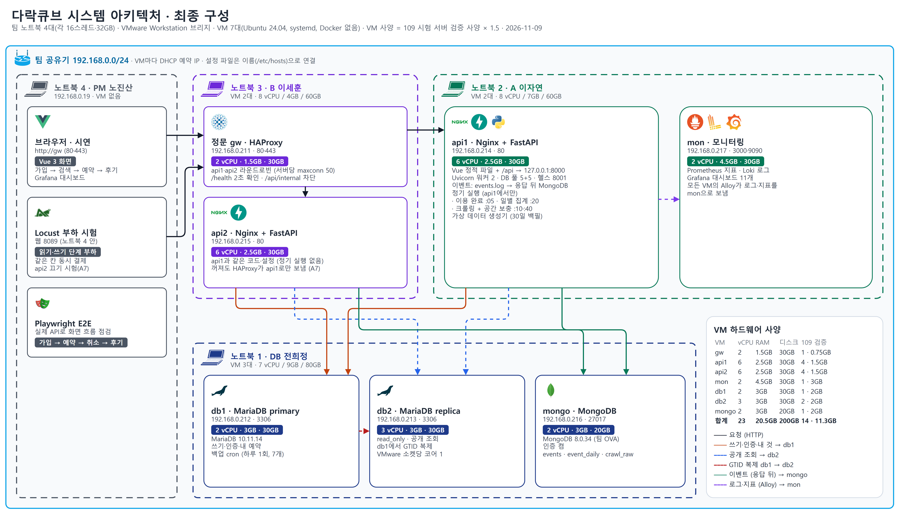
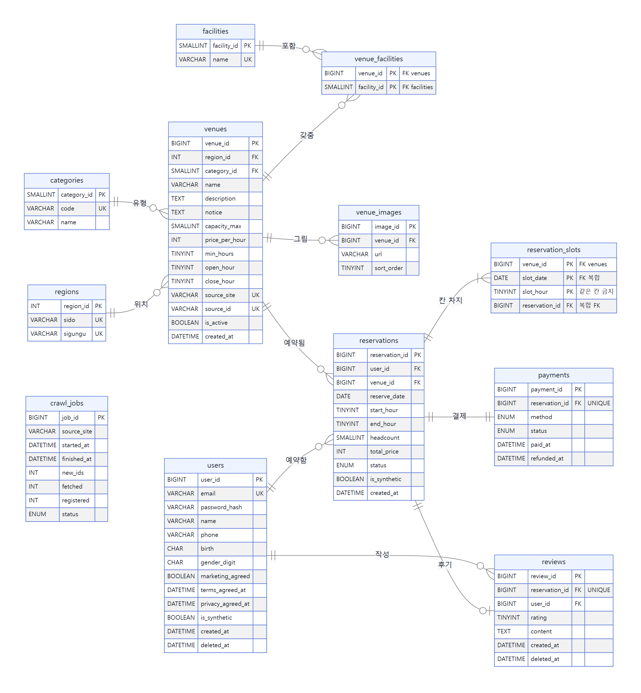
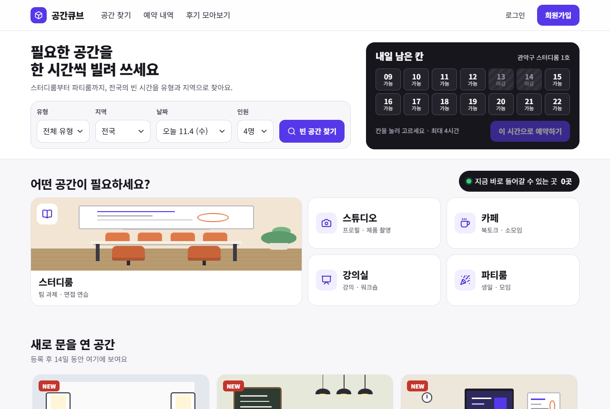
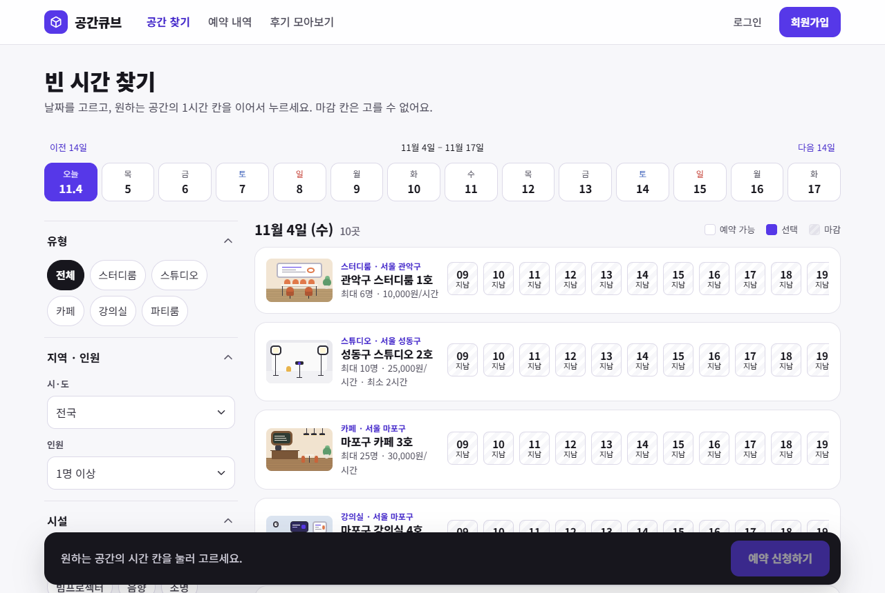
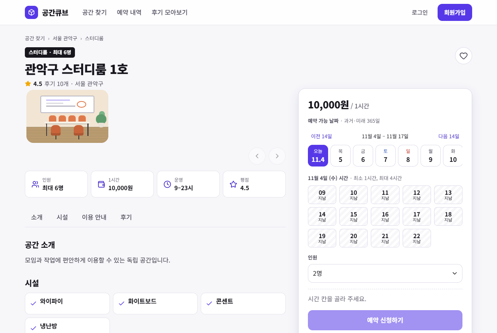
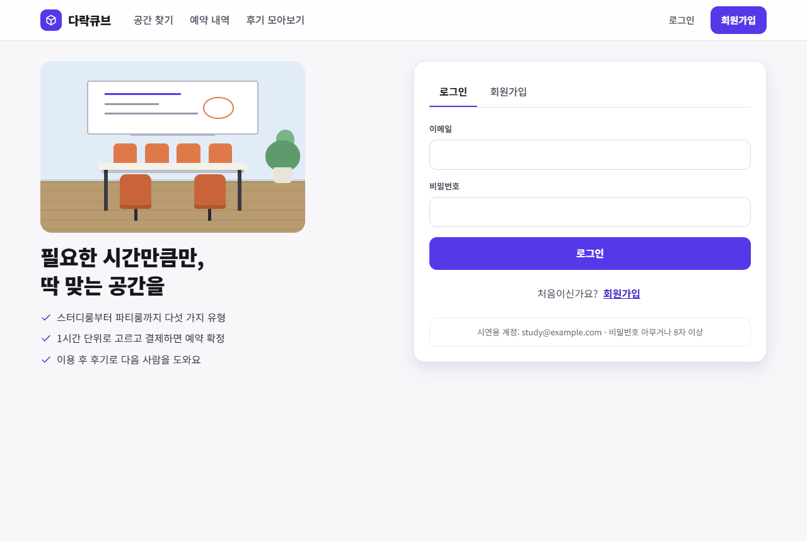
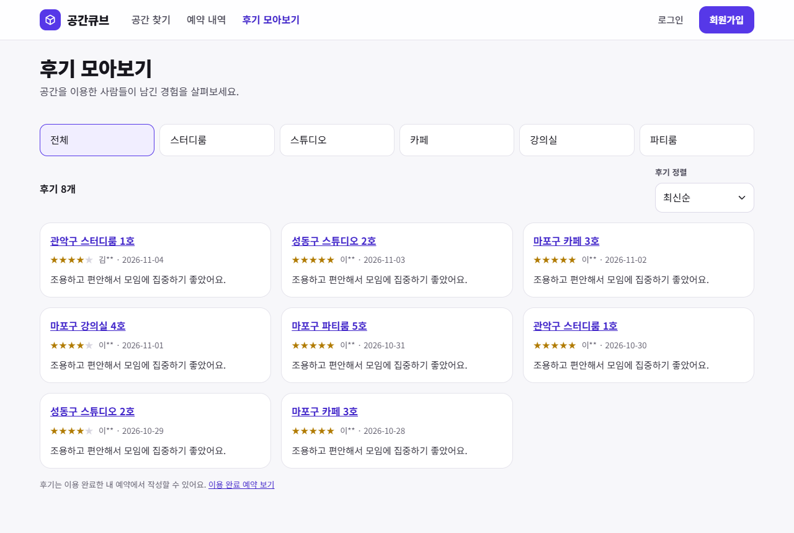

# 다락큐브

**[SK네트웍스 Family 엔코아AI캠퍼스] AI 레디 데이터 엔지니어링 캠프 3기 1차 프로젝트 · 팀 방조**

> **다락큐브(多樂 Cube)**: '많은 즐거움'을 뜻하는 다락(多樂)에 공간을 담는 큐브를 더한 이름입니다.

1. [팀 소개](#1-팀-소개) · 2. [프로젝트 개요](#2-프로젝트-개요) · 3. [기술 스택](#3-기술-스택) · 4. [WBS](#4-wbs) · 5. [요구사항 명세서](#5-요구사항-명세서) · 6. [ERD](#6-erd) · 7. [주요 프로시저](#7-주요-프로시저) · 8. [수행결과](#8-수행결과-테스트시연-페이지) · 9. [한 줄 회고](#9-한-줄-회고) · 📚 [위키](https://github.com/encore-ai-campus/mlo-03-p1-team4/wiki)

## 1. 팀 소개

**팀명: 방조**

| | 노진산 | 이자연 | 이세훈 | 전희정 |
| :---: | :---: | :---: | :---: | :---: |
| |  |  |  |  |
| **역할** | | | | |
| **GitHub** | [@jinsan02](https://github.com/jinsan02) | [@naturedevworks](https://github.com/naturedevworks) | [@hun117](https://github.com/hun117) | [@gmlwjd0055](https://github.com/gmlwjd0055) |

## 2. 프로젝트 개요

**프로젝트명:** 다락큐브, 공간 대여 예약 웹 서비스이자 사용자 행동 데이터 수집 환경

**소개:** 스터디룸·스튜디오·카페·강의실·파티룸을 전국에서 찾아 1시간 단위로 모의 결제 예약하고, 그 과정을 행동 데이터로 남기는 서비스입니다.

**필요성(배경):** 서비스를 개선하려면 사용자가 무엇을 검색하고, 무엇을 살펴보고, 예약의 어느 단계에서 멈추는지를 데이터로 알아야 합니다. 공간 대여는 검색 → 상세 → 날짜 → 시간 칸 → 결제로 단계가 짧고 분명해, 탐색·선택·이탈 데이터를 한 흐름으로 모으기 좋습니다. 같은 칸을 여러 사람이 동시에 노리는 상황도 있어 데이터의 정확성까지 함께 다룰 수 있습니다.

**목표**
- 검색·조회·시간 선택·예약 시도/성공/충돌/취소·후기 이벤트를 세션 단위로 연결해 수집
- 정형 데이터는 MariaDB, 이벤트·크롤링 원본은 MongoDB에 나눠 저장하고 일별로 집계
- 유실률·중복률·대체 저장 건수로 수집 신뢰성을 숫자로 증명
- 시연·생성 데이터는 `is_synthetic`으로 실제 데이터와 분리

자세히: [위키 · 프로젝트 목표](https://github.com/encore-ai-campus/mlo-03-p1-team4/wiki/프로젝트-목표)

## 3. 기술 스택

| 영역 | 기술 |
| --- | --- |
| 프론트엔드 |   |
| 백엔드 |   |
| 데이터 |   |
| 인프라·테스트 |      |

기술별 쓰임과 VM 7대 구성: [위키 · 기술 스택과 시스템 구성](https://github.com/encore-ai-campus/mlo-03-p1-team4/wiki/기술-스택과-시스템-구성)

## 4. WBS

발표는 **2026-11-09(월)**입니다. 할 일은 [이슈](https://github.com/encore-ai-campus/mlo-03-p1-team4/issues)와 [마일스톤](https://github.com/encore-ai-campus/mlo-03-p1-team4/milestones), 진행 상태는 [Project 보드](https://github.com/orgs/encore-ai-campus/projects/5)에서 봅니다.

| 날짜 | 단계 | 상태 |
| --- | --- | --- |
| ~11-03 | 기획·설계(요구사항·아키텍처·DB·API), 화면 7개 목업 | 완료 |
| 11-04(수) | 로컬 개발 환경, DDL·기초 데이터 검증, GitHub 규칙·CI | 완료 |
| 11-05(목) | 통합: 회원·공간 조회·예약·결제·공간 등록 API, 프론트 보완 | 완료 |
| 11-06(금) | 취소·내 예약·후기 목록 연결, 로컬 VM 배포, 모니터링, 부하 측정 | 진행 중 |
| 11-07(토) | 피드백 반영, 크롤링·가상 데이터(30일) | 예정 |
| 11-08(일) | 발표 자료, 시연 시나리오, 녹화 | 예정 |
| 11-09(월) | 발표 | 예정 |

## 5. 요구사항 명세서

기능 단위(F-xx)로 [이슈](https://github.com/encore-ai-campus/mlo-03-p1-team4/issues)를 만들어 진행합니다. 전체 명세: [요구사항 명세서](docs/산출물_01_요구사항명세서.md) · 묶음별 요약: [위키 · 요구사항](https://github.com/encore-ai-campus/mlo-03-p1-team4/wiki/요구사항)

## 6. ERD

설명: [위키 · ERD](https://github.com/encore-ai-campus/mlo-03-p1-team4/wiki/ERD)

## 7. 주요 프로시저

예약·결제 트랜잭션, 취소, 이용 완료 배치, 후기, 이벤트 수집, 크롤링 등록, 탈퇴: [위키 · 주요 프로시저](https://github.com/encore-ai-campus/mlo-03-p1-team4/wiki/주요-프로시저)

## 8. 수행결과 (테스트/시연 페이지)

| 대상 | 결과 |
| --- | --- |
| 테스트 | 백엔드·DB pytest 407건, 프론트 단위 71건·E2E 67건 통과 |
| 같은 칸 동시 결제 50명 | 201 1건 · 409 49건 (중복 예약 0) |
| 쓰기 부하 400명 | 오류 0, 예약 p95 81ms (DB 풀 조정 전에는 실패) |
| 읽기 부하 1,000명 | 오류 0, p95 954ms (800명까지 p95 314ms) |
| 이벤트 수집 | 파일 21,374건 = MongoDB 21,374건, 중복 0 |

시험 조건·단계별 수치·한계: [위키 · 수행결과](https://github.com/encore-ai-campus/mlo-03-p1-team4/wiki/수행결과)

시연 화면 (목업 데이터)

| 메인 | 공간 찾기 |
| --- | --- |
|  |  |
| **공간 상세** | **로그인·회원가입** |
|  |  |
| **후기 모아보기** | **공간 상세(폰)** |
|  |  |

직접 돌려 보기: `cd frontend && npm install && npm run dev` → http://localhost:5173 · 목업 로그인 `study@example.com` + 8자 이상 아무 비밀번호

## 9. 한 줄 회고

| 이름 | 한 줄 회고 |
| --- | --- |
| 노진산 | [프로젝트를 마친 뒤 작성] |
| 이자연 | [프로젝트를 마친 뒤 작성] |
| 이세훈 | [프로젝트를 마친 뒤 작성] |
| 전희정 | [프로젝트를 마친 뒤 작성] |

---

저장소 구성과 문서

`frontend/` 화면 · `backend/` API · `db/` 스키마·기초 데이터 · `crawler/` 수집 · `simulator/` 가상 데이터·부하 · `infra/` 배포·모니터링 · `docs/` 산출물·설계

- 폴더별 담당: [STRUCTURE.md](STRUCTURE.md) · 진행 상태: [STATE.md](STATE.md) · AI 에이전트 지침: [AGENTS.md](AGENTS.md) · 기여 규칙: [CONTRIBUTING.md](CONTRIBUTING.md)
- 산출물: [01 요구사항](docs/산출물_01_요구사항명세서.md) · [02 아키텍처](docs/산출물_02_시스템아키텍처_흐름도.md) · [03 서비스 흐름](docs/산출물_03_서비스흐름도.md) · [04 DB](docs/산출물_04_DB명세서.md) · [05 구현·운영 계획](docs/산출물_05_구현_운영_계획.md)

