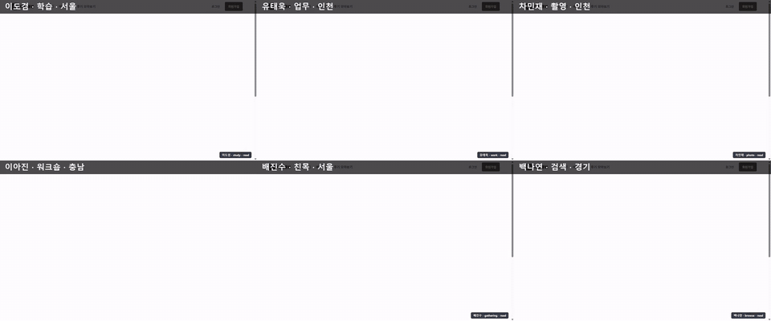
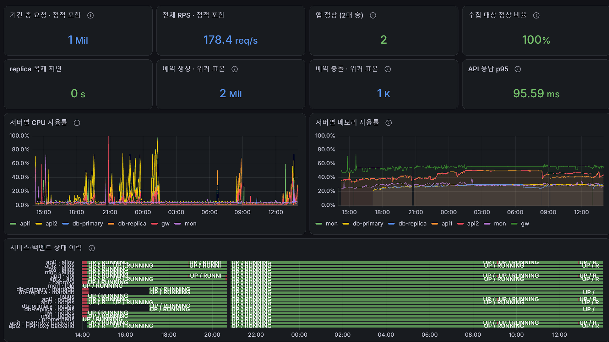

# 다락큐브

**[SK네트웍스 Family 엔코아AI캠퍼스] AI 레디 데이터 엔지니어링 캠프 3기 1차 프로젝트 · 팀 방조**

1. [프로젝트 소개](#1-프로젝트-소개) · 2. [프로젝트 목표](#2-프로젝트-목표) · 3. [기술 스택](#3-기술-스택) · 4. [WBS](#4-wbs) · 5. [요구사항 명세서](#5-요구사항-명세서) · 6. [ERD](#6-erd) · 7. [주요 프로시저](#7-주요-프로시저) · 8. [수행 결과](#8-수행-결과)

## 1. 프로젝트 소개

**다락큐브(多樂 Cube)**는 스터디룸·스튜디오·카페·강의실·파티룸을 1시간 단위로 모의 결제 예약하는 서비스입니다. 공간을 찾고 예약하는 과정에서 사용자 행동·예약 데이터를 수집하고 저장·집계하며, 데이터 정합성과 성능을 검증하는 프로젝트입니다.

팀 소개

**팀명: 방조**

| | 노진산 | 이자연 | 이세훈 | 전희정 |
| :---: | :---: | :---: | :---: | :---: |
| |  |  |  |  |
| **역할** | | | | |
| **GitHub** | [@jinsan02](https://github.com/jinsan02) | [@naturedevworks](https://github.com/naturedevworks) | [@hun117](https://github.com/hun117) | [@gmlwjd0055](https://github.com/gmlwjd0055) |

팀 회고

| 이름 | 한 줄 회고 |
| --- | --- |
| 노진산 | [프로젝트를 마친 뒤 작성] |
| 이자연 | [프로젝트를 마친 뒤 작성] |
| 이세훈 | [프로젝트를 마친 뒤 작성] |
| 전희정 | [프로젝트를 마친 뒤 작성] |

저장소 구성과 문서

`frontend/` 화면 · `backend/` API · `db/` 스키마·기초 데이터 · `crawler/` 수집 · `simulator/` 가상 데이터·부하 · `infra/` 배포·모니터링 · `docs/` 산출물·설계

[문서 지도](STRUCTURE.md) · [AI 작업 지침](AGENTS.md) · [기여 규칙](CONTRIBUTING.md) · [산출물 목록](docs/README.md) · [위키](https://github.com/encore-ai-campus/mlo-03-p1-team4/wiki/)

## 2. 프로젝트 목표

- 공간 검색·예약·취소·후기 서비스 구현
- 사용자 행동 및 예약 데이터 수집
- MariaDB의 정형 데이터와 MongoDB의 이벤트·수집 데이터 저장·처리
- 데이터 정합성·수집 신뢰성·성능 검증

[위키 · 프로젝트 목표](https://github.com/encore-ai-campus/mlo-03-p1-team4/wiki/프로젝트-목표)

## 3. 기술 스택

| 영역 | 기술 |
| --- | --- |
| Frontend |   |
| Backend |   |
| Database |   |
| Data Processing |    |
| Infrastructure |     |
| Monitoring & Testing |        |

## 4. WBS

발표 일정은 **2026-11-09(월)**입니다. 아래 상태는 기존 main의 WBS 기록을 보존했으며, 최신 상태는 [Project 보드](https://github.com/orgs/encore-ai-campus/projects/5)·[마일스톤](https://github.com/encore-ai-campus/mlo-03-p1-team4/milestones)·[STATE.md](STATE.md)에서 확인합니다.

| 일정 | 작업 항목 | 담당 | 기존 기록 상태 |
| --- | --- | --- | --- |
| ~11-03 | 기획·설계, 화면 7개 목업 | 공동 | 완료 |
| 11-04(수) | 로컬 개발 환경, DDL·기초 데이터 검증, GitHub 규칙·CI | 공동 | 완료 |
| 11-05(목) | 회원·공간 조회·예약·결제·공간 등록 API 통합 | A·B·FE | 완료 |
| 11-06(금) | 취소·내 예약·후기 연결, VM 배포·모니터링·부하 측정 | 공동 | 진행 중 |
| 11-07(토) | 피드백 반영, 크롤링·가상 데이터 | B·DB·FE | 예정 |
| 11-08(일) | 발표 자료·시연 시나리오·녹화 | 공동 | 예정 |
| 11-09(월) | 발표 | 공동 | 예정 |

## 5. 요구사항 명세서

| 기능 | GitHub Issue |
| --- | --- |
| 회원 | [#2 회원가입·로그인·내 정보·탈퇴 API](https://github.com/encore-ai-campus/mlo-03-p1-team4/issues/2) |
| 공간 조회 | [#6 공개 조회 API](https://github.com/encore-ai-campus/mlo-03-p1-team4/issues/6) |
| 예약·결제 | [#7 예약+결제 한 트랜잭션, 같은 칸 409](https://github.com/encore-ai-campus/mlo-03-p1-team4/issues/7) |
| 후기 | [#4 후기 작성·조회](https://github.com/encore-ai-campus/mlo-03-p1-team4/issues/4) |
| 이벤트 수집 | [#5 이벤트 수집 POST /events](https://github.com/encore-ai-campus/mlo-03-p1-team4/issues/5) |
| 크롤링 | [#10 크롤러·공간 등록](https://github.com/encore-ai-campus/mlo-03-p1-team4/issues/10) |

[전체 Issues](https://github.com/encore-ai-campus/mlo-03-p1-team4/issues) · [위키 · 요구사항](https://github.com/encore-ai-campus/mlo-03-p1-team4/wiki/요구사항) · [요구사항 명세서](docs/산출물_01_요구사항명세서.md)

## 6. ERD

[위키 · ERD 및 DB 설계](https://github.com/encore-ai-campus/mlo-03-p1-team4/wiki/ERD)

## 7. 주요 프로시저

[위키 · 주요 처리 로직 및 데이터 흐름](https://github.com/encore-ai-campus/mlo-03-p1-team4/wiki/주요-프로시저)

## 8. 수행 결과

| 항목 | 결과 페이지 |
| --- | --- |
| 기능 테스트 | [위키 · 기능·품질](https://github.com/encore-ai-campus/mlo-03-p1-team4/wiki/수행결과#기능품질) |
| 데이터 정합성 검증 | [위키 · 기능·품질](https://github.com/encore-ai-campus/mlo-03-p1-team4/wiki/수행결과#기능품질) |
| 데이터 수집·적재 검증 | [위키 · 이벤트 수집 신뢰성](https://github.com/encore-ai-campus/mlo-03-p1-team4/wiki/수행결과#이벤트-수집-신뢰성) · [데이터 수집·생성](https://github.com/encore-ai-campus/mlo-03-p1-team4/wiki/수행결과#데이터-수집생성) |
| 부하 테스트 | [위키 · 수행결과](https://github.com/encore-ai-campus/mlo-03-p1-team4/wiki/수행결과) |
| 프로젝트 시연 | [#21 발표 자료 + 시연 시나리오·계정](https://github.com/encore-ai-campus/mlo-03-p1-team4/issues/21) |

### Playwright: 여러 사용자가 동시에 이용하는 화면

대표 페르소나 6명이 실제 서비스(`https://www.darakcube.kro.kr`)에 동시에 접속해, 각자 조건(지역·인원·예산·시설·시간)에 맞는 공간을 검색하고 상세·시간표를 확인하는 흐름을 자동화했습니다. 칸마다 한 사람의 브라우저 화면이고, 6명 모두 조건에 맞는 공간을 찾았습니다.

| 사람 | 목적 · 지역 | 찾은 공간 |
| --- | --- | --- |
| 이도겸 | 학습 · 서울, 2명·1시간·2만 원 이내 | 마포 스터디룸, 12,000원 |
| 유태욱 | 업무 · 인천, 1명·1시간 | 서해 스터디룸, 3,000원 |
| 차민재 | 촬영 · 인천, 3명·4시간 | 계양 스튜디오, 120,000원 |
| 이아진 | 워크숍 · 충남, 8명·3시간 | 천안 강의실, 45,000원 |
| 배진수 | 친목 · 서울, 6명·4시간 | 카페 4곳은 16시 마감이라 넘기고 강동 파티룸 |
| 백나연 | 검색만 · 경기 | 파주 스터디룸을 둘러보고 종료 |

GIF는 1.5배속입니다. 원본(78초): [playwright_personas_grid.mp4](docs/figures/results/playwright_personas_grid.mp4)

### Grafana: 요청 처리량과 데이터가 쌓이는 모니터링 화면

`Spacecube / 전체 현황` 대시보드입니다. 부하 시험 기간 동안 초당 요청 수(RPS), 예약 생성·충돌 건수, API 응답 p95, replica 복제 지연, 서버별 CPU·메모리, 수집 대상 상태를 한 화면에서 봅니다.

- 전체 RPS 178.4 req/s, 기간 총 요청 약 100만 건
- API 응답 p95 95.59ms, replica 복제 지연 0초
- 앱 서버 2대와 수집 대상이 모두 정상(100%)
