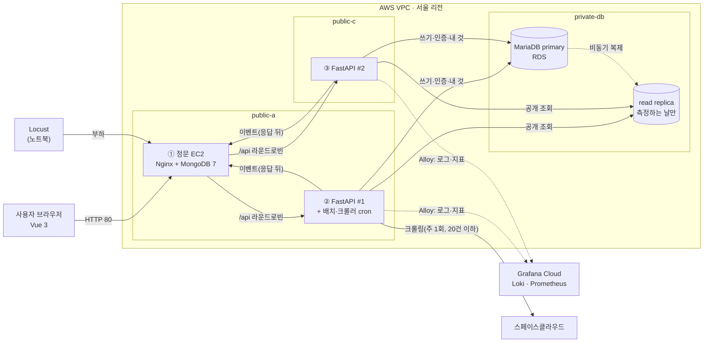

# 다락큐브

**[SK네트웍스 Family 엔코아AI캠퍼스] AI 레디 데이터 엔지니어링 캠프 3기 1차 프로젝트 · 팀 방조**

> **다락큐브(多樂 Cube)**는 '많은 즐거움'을 뜻하는 다락(多樂)에 공간을 담는 큐브의 이미지를 더한 이름입니다. 누구나 원하는 공간을 찾고 이용하며 **모두가 즐거운 공간**을 만든다는 뜻을 담았습니다.

## 1. 팀 소개

**팀명: 방조**. 프론트엔드, 백엔드 A·B, 데이터베이스로 역할을 나누어 개발합니다.

| 이름 | 담당 | 주요 작업 | GitHub |
| --- | --- | --- | --- |
| 노진산 | 프론트엔드 | Vue 웹 화면, 사용자 흐름, API 연동 | [@jinsan02](https://github.com/jinsan02) |
| 이자연 | 백엔드 A | 공통 기능, 회원·인증, 후기, 이벤트·관측 | [@naturedevworks](https://github.com/naturedevworks) |
| 이세훈 | 백엔드 B | 공간 조회, 예약·모의 결제, 취소, 크롤링 등록 API | [@hun117](https://github.com/hun117) |
| 전희정 | 데이터베이스 | MariaDB·MongoDB 스키마, 기초 데이터, 크롤링·데이터 생성 | [@gmlwjd0055](https://github.com/gmlwjd0055) |

## 2. 프로젝트 개요

### 프로젝트명

**다락큐브** — 공간 대여 예약 웹 서비스이자 사용자 행동 데이터 수집 환경

### 프로젝트 소개

스터디룸·스튜디오·카페·강의실·파티룸을 전국에서 유형·지역·조건으로 찾고, 1시간 단위로 시간을 골라 모의 결제로 예약하는 웹 서비스입니다. 이 서비스를 **데이터 수집 환경**으로 삼아, 사용자가 어떤 조건으로 공간을 찾고 상세를 살펴보고 예약까지 가는지를 기록해 분석에 쓸 수 있는 데이터 기반을 만듭니다.

### 프로젝트 필요성 (배경)

온라인 서비스는 사용자가 무엇을 검색하고 어떤 정보를 확인하며 예약의 어느 단계까지 가는지에 따라 개선 방향이 달라집니다. 그래서 탐색·선택·예약 데이터를 일정한 기준으로 수집하고 연결하는 과정이 필요합니다.

공간 대여는 이 흐름이 짧고 분명한 사례입니다. 검색 → 상세 → 날짜 → 시간 칸 → 결제로 단계가 나뉘고, 같은 시간 칸을 여러 사람이 동시에 노리는 **동시성 문제**도 함께 다뤄야 합니다. 교육 과정에서 배운 프론트엔드·백엔드·데이터베이스·서버 기술을 한 흐름으로 연결해 볼 수 있는 주제입니다.

### 프로젝트 목표

| 목표 | 내용 |
| --- | --- |
| 정확한 예약 | 결제 버튼 한 번에 예약·시간 칸·결제를 **한 트랜잭션**으로 저장하고, 같은 칸 중복은 DB 기본키가 막아 먼저 결제한 사람만 확정 |
| 행동 데이터 수집 | 검색·공간 조회·날짜 조회·시간 선택·예약 시도/성공/충돌/취소·가입·로그인·후기 이벤트를 세션 ID(+ 회원 ID)로 한 흐름으로 연결 |
| 용도에 맞는 저장 | 정형 데이터(회원·공간·예약·결제·후기)는 MariaDB, 이벤트·크롤링 원본은 MongoDB |
| 읽기·요청 분산 | Nginx가 FastAPI 2대로 나눠 보내고, 공개 조회는 MariaDB read replica로 보내 primary 부담을 줄임 |
| 관측 | 서버·이벤트 로그는 Loki, 지표는 Prometheus, 화면은 Grafana |
| 데이터 신뢰성 | 예약 결과는 서버가 직접 기록하고, 시연·생성 데이터는 `is_synthetic`으로 실제 흐름과 분리 |

**범위 밖:** 실제 결제 연동, 호스트 공간 등록, 관리자 화면, 자유게시판·댓글, 결제 전 시간 홀딩, 모바일 앱.

## 3. 기술 스택

| 구분 | 기술 | 쓰임 |
| --- | --- | --- |
| 프론트엔드 | Vue 3.5, Vite 8, JavaScript, Pinia, Vue Router, reka-ui | 화면 7개, 접근성 있는 UI 부품 |
| 백엔드 | Python 3.12, FastAPI, SQLAlchemy 2.1(동기) + PyMySQL, pymongo | API, 업무 규칙, 트랜잭션 |
| 관계형 DB | MariaDB 11.4 (AWS RDS primary + read replica) | 회원·공간·예약·결제·후기 |
| 비정형 DB | MongoDB 7 | 사용자 이벤트, 크롤링 원본, 일별 집계 |
| 관측 | Grafana Alloy, Loki, Prometheus, Grafana | 로그 검색, 지표, 대시보드 |
| 서버 | AWS EC2 3대(Nginx·FastAPI 2), RDS, 서울 리전 | 프리 티어(크레딧) 안에서 측정·시연 때만 켬 |
| 테스트·품질 | Vitest, Playwright, axe, pytest, Ruff, Locust | 단위·화면 흐름·접근성·부하 |
| 개발 환경 | conda `pro_1`, Node.js/npm, Docker Compose(로컬 DB) | 팀원 모두 같은 버전 |

## 4. WBS

1차 일정은 **1일 구현 → 2일 배포 → 3일 자동화·발표**입니다. 상세 상태는 [STATE.md](STATE.md)에 있습니다.

| 단계 | 작업 | 담당 | 산출물 | 상태 |
| --- | --- | --- | --- | --- |
| 0. 기획 | 주제·범위, 공간 유형 5개, 크롤링 대상 조사 | 전원 | [기능 정의](docs/지난설계/README.md), [크롤링 사이트 조사](docs/공간대여_06_크롤링_사이트조사.md) | 완료 |
| 0. 설계 | 요구사항, 시스템 아키텍처, 서비스 흐름, DB 명세, API 설계, 오류 코드 | 전원 | `docs/산출물_01~04`, `docs/백엔드_A·B`, `docs/오류코드.md` | 완료(11-03 확정안) |
| 0. 화면 | 화면 7개 시안, UI 패턴·글꼴, 목업으로 동작하는 Vue 화면 | 프론트 | [UI 패턴](docs/공간대여_04_UI패턴_글꼴.md), `frontend/` | 완료(목업) |
| 0. DB 준비 | DDL 실행 검증(제약 29건), 0001 마이그레이션, 기초 데이터, 로컬 compose | DB | `db/migrations`, `db/seed`, `infra/local` | 완료(11-04) |
| 1일차 오전 | 공통 core(DB 세션·인증·오류·이벤트 기록) / 공개 조회 API | A / B | `backend/app/core`, `catalog·venues` | 예정 |
| 1일차 오후 | 회원·후기·이벤트 API / 예약·결제 트랜잭션·동시성 50건 시험 / 크롤러 새 필터 | A / B / DB | API + pytest | 예정 |
| 1일차 | 목업을 실제 API로 바꿀 준비, 공통 푸터 | 프론트 | `frontend/src/api` | 예정 |
| 2일차 | AWS 배포(EC2 3대·RDS), 정문 Nginx, Grafana Cloud, 프론트 실제 API 연결 | 전원 | [AWS 구성](docs/AWS_프리티어_구성.md) 체크리스트 | 예정 |
| 3일차 | 가상 데이터 생성, Locust 부하(replica 있음·없음), 자동 환경 구성, 발표 | 전원 | 측정 결과, 발표 자료 | 예정 |

## 5. 요구사항 명세서

전체: [docs/산출물_01_요구사항명세서.md](docs/산출물_01_요구사항명세서.md) (기능 ID F-xx, 수용 기준, 비기능 요구)

| 묶음 | 기능 ID | 핵심 |
| --- | --- | --- |
| 회원 | F-01~04 | 가입(필수 동의 2개·만 14세 이상), JWT 로그인(60분), 내 정보, 탈퇴(개인정보 즉시 삭제) |
| 탐색·상세 | F-10~14, F-20~22 | 유형·지역 조회, 검색·정렬, NEW 공간, 상세, 예약 가능 날짜, 시간 칸 |
| 예약·결제 | F-30~32, F-35 | 1시간 칸, `min_hours`~4칸, 과거·미래 365일, 결제 한 번에 확정, 같은 칸은 409, 끝난 예약은 이용 완료 |
| 내 예약·취소 | F-34, F-40 | 이용 예정·완료·취소, 이용 시작 전 취소와 모의 환불 |
| 후기 | F-41, F-50~51 | 이용 완료한 예약에 1개, 후기 모아보기, 탈퇴 회원은 '탈퇴한 회원' |
| 수집·관측 | F-60~65, F-70 | 사용자 이벤트(프론트 9종 + 서버 3종), 크롤링 등록, 가상 데이터 구분, 로그·지표, 헬스체크 |

## 6. ERD

MariaDB 표 12개 + 뷰 1개. 상세: [DB 명세서](docs/산출물_04_DB명세서.md), 실행 파일 [`db/migrations/0001_init.sql`](db/migrations/0001_init.sql)


- 같은 칸 중복 예약은 `reservation_slots` 기본키 `(venue_id, slot_date, slot_hour)`가 막습니다(동시 결제 시험: 먼저 커밋한 1건만 남음).
- MongoDB 컬렉션 3개: `user_events`(이벤트 원본, 365일 보관), `event_daily`(일별 집계), `crawl_raw`(크롤링 추출값). 정의: [`docs/db/mongo_init.js`](docs/db/mongo_init.js)

## 7. System Architecture

1차는 AWS 프리 티어(크레딧) 안에서 **EC2 3대 + RDS**로 올립니다. EC2에는 Docker 없이 직접 설치합니다. 기준: [AWS 프리 티어 구성](docs/AWS_프리티어_구성.md), [시스템 아키텍처](docs/산출물_02_시스템아키텍처_흐름도.md)



| 결정 | 내용 |
| --- | --- |
| 예약 | 결제 화면에서는 아무것도 잡지 않고, 결제 버튼 한 번에 예약·칸·결제를 한 트랜잭션으로. 같은 칸 두 번째 결제는 1062 → 409 `SLOT_TAKEN` |
| 읽기 경로 | 쓰기·인증·'내 것'은 primary, 공개 조회만 replica(실패하면 primary) |
| 이벤트 | `events.log`(→ Loki)에 먼저 쓰고 MongoDB에는 응답 뒤. MongoDB가 멈춰도 예약은 성공 |
| 네트워크 | NAT 게이트웨이 없음, RDS는 인터넷 없는 서브넷, 보안 그룹으로 포트를 좁힘 |
| 확장안 | EC2 5대 + RDS 2대 + 모니터링 EC2 구성은 [그림](docs/figures/architecture.png)으로 남김(조건을 넘으면 ALB·Auto Scaling 추가) |

## 8. 저장소 구성과 실행

| 경로 | 내용 |
| --- | --- |
| `frontend/` | Vue 화면 7개(지금은 목업 데이터로 동작) |
| `backend/` | FastAPI 앱 폴더와 작업 지침(구현 예정) |
| `db/` | 마이그레이션, 기초 데이터, 적재·제약 시험 스크립트 |
| `crawler/` | 공간 데이터 수집 코드 |
| `simulator/` | 가상 데이터 생성, Locust 부하 |
| `infra/` | 로컬 compose, Nginx, 모니터링, AWS 체크리스트 |
| `docs/` | 산출물·설계 문서, 그림, 회의·검토 기록 |

폴더별 담당과 기준 문서는 [STRUCTURE.md](STRUCTURE.md), AI 에이전트(Codex·Claude Code) 지침은 [AGENTS.md](AGENTS.md)에 있습니다.

```bash
conda env create -f environment.yml
```

```bash
docker compose -f infra/local/docker-compose.yml up -d
```

```bash
cd frontend && npm install && npm run dev
```

- 로컬 DB: `infra/local/.env.example`을 `.env`로 복사해 비밀번호를 채운 뒤 compose를 띄우면 스키마·기초 데이터·MongoDB 초기화가 자동으로 들어갑니다(MariaDB 포트 3308). [infra/local](infra/local/README.md)
- 프론트: http://localhost:5173 (목업 로그인 `study@example.com` + 8자 이상 아무 비밀번호)
- 검증: `powershell -NoProfile -ExecutionPolicy Bypass -File verify.ps1` (Ruff, pytest, 프론트 린트·테스트·빌드)
- 비밀값(DB 비밀번호, JWT 키 등)은 `.env`에만 두고 저장소에 올리지 않습니다. 키 이름은 `backend/.env.example`, `infra/local/.env.example`.

## 9. 현재 개발 현황 (2026-11-04)

| 파트 | 상태 |
| --- | --- |
| 프론트엔드 | 화면 7개가 11-03 확정안대로 목업에서 동작. 린트·단위 54개·화면 흐름·접근성 검사 통과. 실제 API 연결 전 |
| 백엔드 A·B | 설계 확정(API·오류 코드·파트 약속), 저장소에는 폴더와 작업 지침. 구현은 1일차 |
| 데이터베이스 | 스키마 실행 검증 끝(MariaDB 11.8·11.4, MongoDB 7), 0001 마이그레이션·기초 데이터(유형 5·시설 20·지역 230)·로컬 compose 완료 |
| 인프라 | AWS 1차 구성(EC2 3대 + RDS, 프리 티어) 확정, 배포 전 |

## 10. 문서

- [요구사항 명세서](docs/산출물_01_요구사항명세서.md) · [시스템 아키텍처](docs/산출물_02_시스템아키텍처_흐름도.md) · [서비스 흐름도](docs/산출물_03_서비스흐름도.md) · [DB 명세서](docs/산출물_04_DB명세서.md)
- [백엔드 A 설계](docs/백엔드_A_회원_후기_이벤트.md) · [백엔드 B 설계](docs/백엔드_B_공간_예약_결제_크롤링.md) · [오류 코드](docs/오류코드.md)
- [AWS 프리 티어 구성](docs/AWS_프리티어_구성.md) · [인프라·트래픽 검토](docs/인프라_트래픽_안정성_검토.md) · [전체 문서 목록](docs/README.md)
