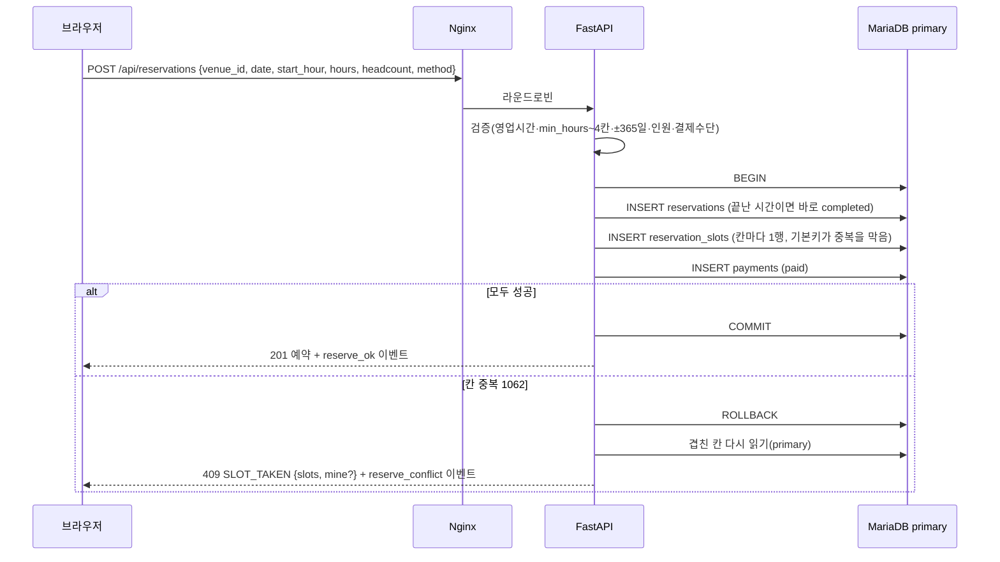

# 다락큐브

**[SK네트웍스 Family 엔코아AI캠퍼스] AI 레디 데이터 엔지니어링 캠프 3기 1차 프로젝트 · 팀 방조**

> **다락큐브(多樂 Cube)**는 '많은 즐거움'을 뜻하는 다락(多樂)에 공간을 담는 큐브의 이미지를 더한 이름입니다. 누구나 원하는 공간을 찾고 이용하며 **모두가 즐거운 공간**을 만든다는 뜻을 담았습니다.

## 목차

1. [팀 소개](#1-팀-소개) · 2. [프로젝트 개요](#2-프로젝트-개요) · 3. [기술 스택](#3-기술-스택) · 4. [WBS](#4-wbs) · 5. [요구사항 명세서](#5-요구사항-명세서) · 6. [ERD](#6-erd) · 7. [주요 프로시저](#7-주요-프로시저) · 8. [수행결과](#8-수행결과-테스트시연-페이지) · 9. [한 줄 회고](#9-한-줄-회고)

## 1. 팀 소개

**팀명: 방조**. 프론트엔드, 백엔드 A·B, 데이터베이스로 역할을 나누어 개발하고, 프로젝트 관리(PM)는 노진산이 함께 맡습니다.

| 이름 | 담당 | 주요 작업 | GitHub |
| --- | --- | --- | --- |
| 노진산 | 프론트엔드 · PM | Vue 웹 화면, 사용자 흐름, API 연동 / 일정·이슈·마일스톤 관리, 산출물 정리, 통합 점검 | [@jinsan02](https://github.com/jinsan02) |
| 이자연 | 백엔드 A | 공통 기능, 회원·인증, 후기, 이벤트·관측 | [@naturedevworks](https://github.com/naturedevworks) |
| 이세훈 | 백엔드 B | 공간 조회, 예약·모의 결제, 취소, 크롤링 등록 API | [@hun117](https://github.com/hun117) |
| 전희정 | 데이터베이스 | MariaDB·MongoDB 스키마, 기초 데이터, 크롤링·데이터 생성 | [@gmlwjd0055](https://github.com/gmlwjd0055) |

## 2. 프로젝트 개요

### 프로젝트명

**다락큐브** — 공간 대여 예약 웹 서비스이자 사용자 행동 데이터 수집 환경

### 프로젝트 소개

스터디룸·스튜디오·카페·강의실·파티룸을 전국에서 유형·지역·조건으로 찾고, 1시간 단위로 시간을 골라 모의 결제로 예약하는 웹 서비스입니다. 이 서비스를 **데이터 수집 환경**으로 삼아, 사용자가 어떤 조건으로 공간을 찾고 상세를 살펴보고 예약까지 가는지를 기록해 분석에 쓸 수 있는 데이터 기반을 만듭니다.

### 프로젝트 필요성 (배경)

온라인 서비스는 사용자가 무엇을 검색하고 어떤 정보를 확인하며 예약의 어느 단계까지 가는지에 따라 개선 방향이 달라집니다. 그래서 탐색·선택·예약 데이터를 일정한 기준으로 수집하고 연결하는 과정이 필요합니다.

공간 대여는 이 흐름이 짧고 분명한 사례입니다. 검색 → 상세 → 날짜 → 시간 칸 → 결제로 단계가 나뉘고, 같은 시간 칸을 여러 사람이 동시에 노리는 **동시성 문제**도 함께 다뤄야 합니다. 교육 과정에서 배운 프론트엔드·백엔드·데이터베이스·서버 기술을 한 흐름으로 연결해 볼 수 있는 주제입니다.

### 프로젝트 목표

| 목표 | 내용 |
| --- | --- |
| 정확한 예약 | 결제 버튼 한 번에 예약·시간 칸·결제를 **한 트랜잭션**으로 저장하고, 같은 칸 중복은 DB 기본키가 막아 먼저 결제한 사람만 확정 |
| 행동 데이터 수집 | 검색·공간 조회·날짜 조회·시간 선택·예약 시도/성공/충돌/취소·가입·로그인·후기 이벤트를 세션 ID(+ 회원 ID)로 한 흐름으로 연결 |
| 용도에 맞는 저장 | 정형 데이터(회원·공간·예약·결제·후기)는 MariaDB, 이벤트·크롤링 원본은 MongoDB |
| 읽기·요청 분산 | Nginx가 FastAPI 2대로 나눠 보내고, 공개 조회는 MariaDB read replica로 보내 primary 부담을 줄임 |
| 관측 | 서버·이벤트 로그는 Loki, 지표는 Prometheus, 화면은 Grafana |
| 데이터 신뢰성 | 유실률·중복률·대체 저장 건수를 측정해 숫자로 보여 줌, 시연·생성 데이터는 `is_synthetic`으로 분리 |

**범위 밖:** 실제 결제 연동, 호스트 공간 등록, 관리자 화면, 자유게시판·댓글, 결제 전 시간 홀딩, 모바일 앱.

구현·운영 계획(AI 활용, 서버 구성, 자동화, 데이터 규모·신뢰성): [산출물 05](docs/산출물_05_구현_운영_계획.md)

## 3. 기술 스택

| 구분 | 기술 | 쓰임 |
| --- | --- | --- |
| 프론트엔드 | Vue 3.5, Vite 8, JavaScript, Pinia, Vue Router, reka-ui | 화면 7개, 접근성 있는 UI 부품 |
| 백엔드 | Python 3.12, FastAPI, SQLAlchemy 2.1(동기) + PyMySQL, pymongo | API, 업무 규칙, 트랜잭션 |
| 관계형 DB | MariaDB 11.4 (AWS RDS primary + read replica, Replication) | 회원·공간·예약·결제·후기 |
| 비정형 DB | MongoDB 7 | 사용자 이벤트, 크롤링 원본, 일별 집계 |
| 관측 | Grafana Alloy, Loki, Prometheus, Grafana Cloud, 서비스별 exporter | 로그 검색, 지표, 대시보드 |
| 서버 | AWS EC2 3대(Nginx + MongoDB, FastAPI 2), RDS, 서울 리전 | 프리 티어(크레딧) 안에서 측정·시연 때만 켬 |
| 테스트·품질 | Vitest, Playwright, axe, pytest, Ruff, Locust | 단위·화면 흐름·접근성·부하 |
| AI 개발 도구 | Codex, Claude Code + `AGENTS.md` 지침, 디자인·보안 점검 스킬 | 파트별 구현·리뷰([산출물 05](docs/산출물_05_구현_운영_계획.md) 1절) |
| 개발 환경 | conda `pro_1`, Node.js/npm, Docker Compose(로컬 DB) | 팀원 모두 같은 버전 |

### 시스템 구성 (System Architecture)

1차는 AWS 프리 티어(크레딧) 안에서 **EC2 3대 + RDS**로 올립니다. 브라우저는 Nginx만 부르고, FastAPI는 밖에서 직접 부를 수 없습니다. EC2에는 Docker 없이 직접 설치합니다. 기준: [AWS 프리 티어 구성](docs/AWS_프리티어_구성.md), [시스템 아키텍처](docs/산출물_02_시스템아키텍처_흐름도.md)


확장안(EC2 5대 + RDS 2대 + 모니터링 EC2)은 [그림](docs/figures/architecture_expanded.png)으로 남기고, 측정에서 조건을 넘으면 ALB·Auto Scaling을 더합니다.

## 4. WBS

발표는 **2026-11-09(월)**입니다. 날짜별 묶음은 GitHub [마일스톤](https://github.com/encore-ai-campus/mlo-03-p1-team4/milestones), 할 일은 [이슈](https://github.com/encore-ai-campus/mlo-03-p1-team4/issues)로 관리하며 진행 상태는 [Project 보드](https://github.com/orgs/encore-ai-campus/projects/5)에서 한눈에 봅니다. 상세 상태는 [STATE.md](STATE.md)에 있습니다.

| 날짜 | 단계 | 작업 | 담당 | 산출물 | 상태 |
| --- | --- | --- | --- | --- | --- |
| ~11-03 | 기획·설계 | 주제·범위, 공간 유형 5개, 크롤링 조사 / 요구사항·아키텍처·서비스 흐름·DB·API·오류 코드 | 전원 | `docs/산출물_01~04`, `docs/백엔드_A·B`, `docs/오류코드.md` | 완료(11-03 확정안) |
| ~11-03 | 화면 | 화면 7개 시안, UI 패턴·글꼴, 목업으로 동작하는 Vue 화면 | 프론트 | [UI 패턴](docs/공간대여_04_UI패턴_글꼴.md), `frontend/` | 완료(목업) |
| 11-04(수) | 로컬 개발 | 각자 가상환경 세팅·로컬 테스트 / DB 검증·0001·기초 데이터·로컬 compose / 구현·운영 계획 / GitHub 규칙·이슈·마일스톤 | 전원 | `db/`, `infra/local`, [산출물 05](docs/산출물_05_구현_운영_계획.md), [CONTRIBUTING](CONTRIBUTING.md) | 진행 중 |
| 11-05(목) | 통합 | 각자 한 것 합치기(A core·회원·후기·이벤트, B 조회·예약·결제), 프론트 실제 API 연결, **회원가입부터 후기까지 전체 기능 점검** | 전원 | 통합 PR, 점검 체크리스트 | 예정 |
| 11-06(금) | 피드백·검토 | 피드백과 검토, 디테일 다듬기, AWS 배포(EC2 3대·RDS)·모니터링, Locust 부하·신뢰성 측정 | 전원 | 측정 결과, 검토 이슈 | 예정 |
| 11-07(토) | 피드백 반영 | 검토 이슈 반영, 가상 데이터(90일 백필·페르소나 자동 실행) | 전원 | 반영 PR | 예정 |
| 11-08(일) | 발표 준비 | 발표 자료, 시연 시나리오·계정, README 수행결과·회고 | 전원 | 발표 자료 | 예정 |
| 11-09(월) | 발표 | 시연·발표 | 전원 | — | 예정 |

## 5. 요구사항 명세서

전체: [docs/산출물_01_요구사항명세서.md](docs/산출물_01_요구사항명세서.md) (기능 ID F-xx, 수용 기준, 비기능 요구)

| 묶음 | 기능 ID | 핵심 |
| --- | --- | --- |
| 회원 | F-01~04 | 가입(필수 동의 2개·만 14세 이상), JWT 로그인(60분), 내 정보, 탈퇴(개인정보 즉시 삭제, 시작 전 예약이 있으면 먼저 취소) |
| 탐색·상세 | F-10~14, F-20~22 | 유형·지역 조회, 검색·정렬, NEW 공간, 상세, 예약 가능 날짜, 시간 칸 |
| 예약·결제 | F-30~32, F-35 | 1시간 칸, `min_hours`~4칸, 과거·미래 365일, 결제 한 번에 확정, 같은 칸은 409, 끝난 예약은 이용 완료 |
| 내 예약·취소 | F-34, F-40 | 이용 예정·완료·취소, 이용 시작 전 취소와 모의 환불 |
| 후기 | F-41, F-50~51 | 이용 완료한 예약에 1개, 후기 모아보기, 탈퇴 회원은 '탈퇴한 회원' |
| 수집·관측 | F-60~65, F-70 | 사용자 이벤트(프론트 9종 + 서버 3종), 크롤링 등록, 가상 데이터 구분, 로그·지표, 헬스체크 |

## 6. ERD

MariaDB 표 12개 + 뷰 1개. 상세: [DB 명세서](docs/산출물_04_DB명세서.md), 실행 파일 [`db/migrations/0001_init.sql`](db/migrations/0001_init.sql)


- 같은 칸 중복 예약은 `reservation_slots` 기본키 `(venue_id, slot_date, slot_hour)`가 막습니다.
- MongoDB 컬렉션 3개: `user_events`(이벤트 원본, 365일 보관), `event_daily`(일별 집계), `crawl_raw`(크롤링 추출값). 정의: [`docs/db/mongo_init.js`](docs/db/mongo_init.js)

## 7. 주요 프로시저

DB 저장 프로시저는 쓰지 않고, 업무 규칙은 FastAPI 서비스 계층의 트랜잭션으로 처리합니다(라우터는 검증, 서비스는 트랜잭션, 리포지토리는 SQL). 흐름도 전체: [서비스 흐름도](docs/산출물_03_서비스흐름도.md)

### 7-1. 예약·결제 — 결제 버튼 한 번 = 한 트랜잭션 (F-30~32)



- 결제 화면에 들어올 때는 아무것도 잡지 않습니다. 같은 칸을 동시에 결제하면 **먼저 커밋한 요청만 남고**, 뒤 요청은 앞 트랜잭션이 끝날 때까지 기다렸다가 1062를 받습니다.
- 같은 요청을 10분 안에 다시 보내면(두 번 누름) 200으로 처음 예약을 돌려줍니다.

### 7-2. 그 밖의 프로시저

| 프로시저 | 순서 | 기능 ID |
| --- | --- | --- |
| 예약 취소 | 이용 시작 전인지 확인 → 한 트랜잭션에서 상태 `cancelled` + 칸 삭제(바로 다시 예약 가능) + 결제 `refunded`·환불 시각 | F-34 |
| 이용 완료 배치 | FastAPI #1의 cron이 1시간마다 끝나는 시각이 지난 `confirmed`를 `completed`로 | F-35 |
| 후기 작성 | B의 `get_owned()`로 본인 예약 확인 → `completed`인지 → `max(이용일, 예약한 날) + 7일` 안인지 → 기존 후기 없음 → 저장 | F-50 |
| 이벤트 수집 | `POST /events`(최대 50건) → 허용 목록 검사(모르는 이벤트는 그 건만 버림) → `events.log`에 쓰기 → 202 → 응답 뒤 MongoDB `insert_many` | F-60 |
| 크롤링 등록 | 주 1회 사이트맵 비교 → 새 상세 20건 이하 → MongoDB `crawl_raw` → 유형·지역 맞춤(`category_map`·별칭) → `POST /internal/venues` 업서트 | F-61 |
| 회원 탈퇴 | 시작 전 예약이 남아 있으면 409 `HAS_UPCOMING_RESERVATION`으로 막음. 없으면 한 트랜잭션에서 이름·휴대폰·생년월일·이메일을 바로 지우고 `deleted_at` 기록. 예약·후기는 `user_id`로 남김 | F-04 |

## 8. 수행결과 (테스트/시연 페이지)

### 8-1. 테스트 결과 (2026-11-04 기준)

| 대상 | 무엇을 | 결과 |
| --- | --- | --- |
| MariaDB 스키마 | `0001_init.sql` 실행 + 제약 시험(형식·범위 CHECK, 외래키, 중복 키, 취소 뒤 재예약) | **29건 통과** (설치형 11.8, Docker 11.4) |
| 동시 결제 | 두 세션이 같은 칸을 동시에 결제 | 먼저 커밋한 1건만 남고 뒤 요청은 1062 |
| MongoDB | `mongo_init.js` + 검증기·고유 인덱스·TTL 시험 | **13건 통과** |
| 기초 데이터 | 크롤링 표본 주소 → 지역 표로 풀기 | 200건 중 197건(나머지 3건은 둘로 나뉜 옛 구라 제외) |
| 프론트엔드 | 린트, 단위·컴포넌트 테스트, 빌드 | **단위 54개 통과** |
| 프론트엔드 | 화면 흐름 E2E(데스크톱 1280·폰 375), axe 접근성 | 59개 통과(기기 조건으로 7개 제외), 심각·치명 0건 |

실행 기록: [DDL 실행 검증](docs/기록/검증_2026-11-04_DDL실행.md), [프론트 FE 반영](docs/기록/작업_2026-11-03_프론트_FE반영.md)

**배포 뒤 추가할 결과:** Locust 부하(조회·예약 p95, 오류율), replica 있음·없음 비교, 같은 칸 50명 동시 결제, 이벤트 유실률·중복률·대체 저장 건수([측정 방법](docs/산출물_05_구현_운영_계획.md#5-2-수집-신뢰성은-어떻게-입증하나)).

### 8-2. 시연 페이지

지금은 목업 데이터로 동작하는 화면입니다(백엔드 연결 전).

| 메인 | 공간 찾기 |
| --- | --- |
|  |  |
| **공간 상세** | **로그인·회원가입** |
|  |  |
| **후기 모아보기** | **공간 상세(폰)** |
|  |  |

직접 돌려 보기:

```bash
cd frontend && npm install && npm run dev
```

http://localhost:5173 · 목업 로그인 `study@example.com` + 8자 이상 아무 비밀번호. 로컬 DB는 `docker compose -f infra/local/docker-compose.yml up -d`([안내](infra/local/README.md)).

## 9. 한 줄 회고

| 이름 | 한 줄 회고 |
| --- | --- |
| 노진산 | [프로젝트를 마친 뒤 작성] |
| 이자연 | [프로젝트를 마친 뒤 작성] |
| 이세훈 | [프로젝트를 마친 뒤 작성] |
| 전희정 | [프로젝트를 마친 뒤 작성] |

---

<details>
<summary>저장소 구성과 문서</summary>

| 경로 | 내용 |
| --- | --- |
| `frontend/` | Vue 화면 7개(지금은 목업 데이터로 동작) |
| `backend/` | FastAPI 앱 폴더와 작업 지침 |
| `db/` | 마이그레이션, 기초 데이터, 적재·제약 시험 스크립트 |
| `crawler/` | 공간 데이터 수집 코드 |
| `simulator/` | 가상 데이터 생성, Locust 부하 |
| `infra/` | 로컬 compose, Nginx, 모니터링, AWS 체크리스트 |
| `docs/` | 산출물·설계 문서, 그림, 회의·검토 기록 |

- 폴더별 담당과 기준 문서: [STRUCTURE.md](STRUCTURE.md) · AI 에이전트 지침: [AGENTS.md](AGENTS.md) · 진행 상태: [STATE.md](STATE.md)
- 산출물: [01 요구사항](docs/산출물_01_요구사항명세서.md) · [02 아키텍처](docs/산출물_02_시스템아키텍처_흐름도.md) · [03 서비스 흐름](docs/산출물_03_서비스흐름도.md) · [04 DB](docs/산출물_04_DB명세서.md) · [05 구현·운영 계획](docs/산출물_05_구현_운영_계획.md)
- 설계: [백엔드 A](docs/백엔드_A_회원_후기_이벤트.md) · [백엔드 B](docs/백엔드_B_공간_예약_결제_크롤링.md) · [오류 코드](docs/오류코드.md) · [AWS 프리 티어 구성](docs/AWS_프리티어_구성.md) · [전체 목록](docs/README.md)
- 검증: `powershell -NoProfile -ExecutionPolicy Bypass -File verify.ps1` · 비밀값은 `.env`에만(키 이름은 `backend/.env.example`, `infra/local/.env.example`)

</details>
