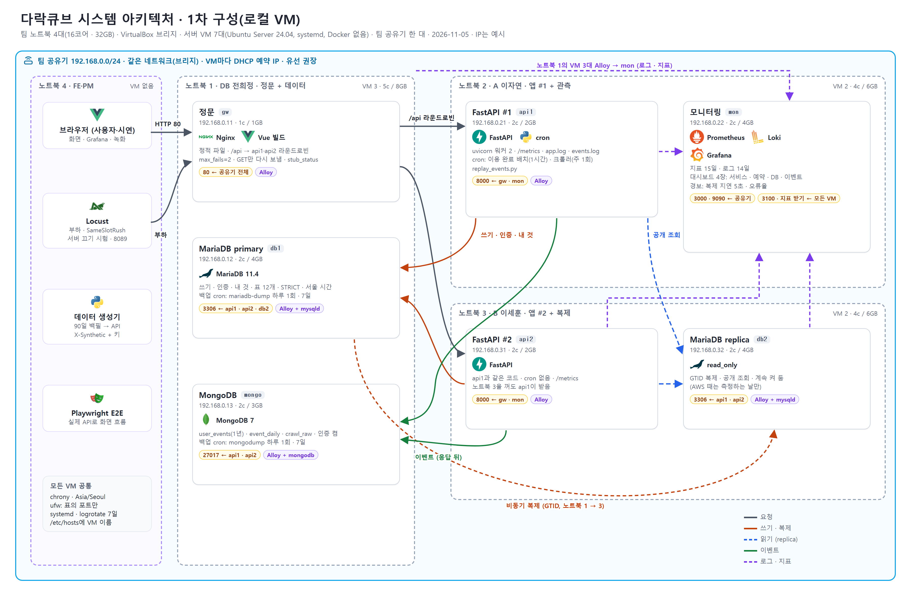

# 로컬 VM 구성 (1차 배포·측정·시연)

2026-11-05 · 공동 · PM 결정(노진산): **1차는 AWS 대신 팀 노트북 4대에 VM을 만들어 같은 공유기에 브리지로 붙인다.** 노트북은 모두 16코어·32GB로 같다. AWS 구성(`AWS_프리티어_구성.md`)과 확장안(`산출물_02` 1절부터)은 비교용 참고안으로 남긴다.



## 1. 왜 바꾸나

| | AWS C안 (11-04) | 로컬 VM (11-05) |
| --- | --- | --- |
| 비용 | 작업 시간만 월 약 $17, 크레딧 계정은 다 쓰면 닫힘 | **0원** |
| replica | 측정하는 날만 몇 시간 | **계속 켜 둠** |
| 모니터링 | Grafana Cloud 무료(외부) | **우리 VM**(`mon`)에서 Prometheus·Loki·Grafana |
| 서버 수 | EC2 3대 + RDS | **VM 7대** (확장안과 같은 역할 분리) |
| 장애 시연 | 가용 영역(2a·2c) 분리 | **노트북 분리**(노트북 한 대 전원을 꺼도 서비스 유지) |
| 배우는 것 | 관리형 서비스 | 리눅스 설치·systemd·방화벽·복제를 직접 |

## 2. 노트북별 배치

| 노트북 (주인) | VM | vCPU / 메모리 / 디스크 | 올리는 것 | 열 포트 ← 받는 곳 |
| --- | --- | --- | --- | --- |
| **1** (DB 전희정) | `gw` 정문 | 1c / 1GB / 10GB | **HAProxy**(80 → api1·api2 라운드로빈, `/health` 2초 능동 확인, `/api/internal`·`/api/metrics` 차단, 통계·지표 8404), Alloy | 80 ← 공유기 전체, 8404 ← mon |
| | `db1` MariaDB primary | 2c / 4GB / 20GB | MariaDB 11.4(STRICT `sql_mode`, `+09:00`, utf8mb4), 백업 cron, mysqld exporter, Alloy | 3306 ← api1·api2·db2 |
| | `mongo` | 2c / 3GB / 20GB | MongoDB 7(인증 켬, `docs/db/mongo_init.js`), 백업 cron, mongodb exporter, Alloy | 27017 ← api1·api2 |
| **2** (A 이자연) | `api1` FastAPI #1 | 2c / 2GB / 15GB | **Nginx**(80: Vue 정적 파일 + `/api` → `127.0.0.1:8000`) + FastAPI(uvicorn 워커 2), cron: 이용 완료 배치(1시간)·크롤러(주 1회)·`replay_events.py`·`event_daily` 집계(매일 새벽), 데이터 생성기(과거 30일 백필, 수동 실행), `app.log`·`events.log`, `/metrics`, nginx exporter, Alloy | 80 ← gw, 8000 ← mon(지표) |
| | `mon` 모니터링 | 2c / 4GB / 30GB | Prometheus(15일), Loki(14일), Grafana(대시보드 4장 + 경보) | 3000·9090 ← 공유기, 3100·지표 받기 ← 모든 VM |
| **3** (B 이세훈) | `api2` FastAPI #2 | 2c / 2GB / 15GB | api1과 같은 Nginx·코드(cron 없음), `/metrics`, nginx exporter, Alloy | 80 ← gw, 8000 ← mon(지표) |
| | `db2` MariaDB replica | 2c / 4GB / 20GB | MariaDB replica(`read_only`, GTID 복제), mysqld exporter, Alloy | 3306 ← api1·api2 |
| **4** (FE·PM 노진산) | VM 없음 | — | Locust(부하·`SameSlotRush`·서버 끄기 시험), Playwright E2E(실제 API), 발표 브라우저·녹화 | Locust 웹 8089 ← 노트북 4 안에서만 |

| 노트북 | VM 수 | 쓰는 자원 | 남는 자원 |
| --- | --- | --- | --- |
| 1 | 3 | 5c / 8GB / 50GB | 11c / 24GB |
| 2 | 2 | 4c / 6GB / 45GB | 12c / 26GB |
| 3 | 2 | 4c / 6GB / 35GB | 12c / 26GB |
| 4 | 0 | Locust 약 4c / 4GB (시험할 때만) | 넉넉함 |
| **합계** | **VM 7대** | **13c / 20GB** | 각자 개발을 같이 해도 됨 |

- **api1·api2를 다른 노트북에**: 노트북 2나 3을 꺼도 서비스가 버팀(서버 끄기 시연).
- **db1·db2를 다른 노트북에**: 복제가 실제로 네트워크를 건넘.
- **Locust는 서버와 다른 노트북에**: 같은 노트북이면 CPU를 나눠 써서 측정이 틀어짐.
- **알려진 한계**: 노트북 1이 꺼지면 정문과 primary가 같이 멈춤(정문 1대는 AWS C안과 같은 약점). 공유기도 한 대.

## 3. 주소 (예시 — 공유기 대역에 맞춰 바꿈)

| 이름 | IP | 노트북 |
| --- | --- | --- |
| `gw` | 192.168.0.11 | 1 |
| `db1` | 192.168.0.12 | 1 |
| `mongo` | 192.168.0.13 | 1 |
| `api1` | 192.168.0.21 | 2 |
| `mon` | 192.168.0.22 | 2 |
| `api2` | 192.168.0.31 | 3 |
| `db2` | 192.168.0.32 | 3 |

- 공유기 관리 화면에서 VM의 MAC 주소마다 IP를 **DHCP 예약**한다(고정 IP를 VM 안에서 직접 줘도 됨).
- 모든 VM의 `/etc/hosts`에 위 이름을 넣어, 설정 파일에는 IP 대신 이름(`db1`, `api1`)을 쓴다.
- 백엔드 `.env`: `DB_WRITE_URL=mysql+pymysql://app:…@db1:3306/spacecube?charset=utf8mb4`, `DB_READ_URL=mysql+pymysql://app_ro:…@db2:3306/spacecube?charset=utf8mb4`, `MONGO_URL=mongodb://app:…@mongo:27017/spacecube`. 값은 팀 채널 비밀 메시지로 나눈다.

## 4. 방화벽 (`ufw`, AWS 보안 그룹 대신)

| VM | 허용 |
| --- | --- |
| 전부 | 22 ← 팀 노트북 4대의 IP만, 나머지 들어오는 것 거부 |
| `gw` | 80 ← 공유기 대역, 8404 ← `mon` |
| `api1`·`api2` | 80 ← `gw`, 8000 ← `mon`(지표만) |
| `db1` | 3306 ← `api1`, `api2`, `db2` |
| `db2` | 3306 ← `api1`, `api2` |
| `mongo` | 27017 ← `api1`, `api2` |
| `mon` | 3000·9090 ← 공유기 대역, 3100·9090 ← 모든 VM(Alloy) |

## 4-1. 정문 구성 (11-06 B안)

```
브라우저 ─▶ gw: HAProxy :80 ─▶ api1: Nginx :80 ─▶ FastAPI 127.0.0.1:8000
                            └▶ api2: Nginx :80 ─▶ FastAPI 127.0.0.1:8000
```

- HAProxy가 진입과 분산을 맡고, Nginx의 `GET /api/health`를 2초마다 확인해 2번 실패한 서버를 먼저 뺍니다. 이 경로는 업무 Uvicorn(8000) 동시성 제한과 분리된 루프백 8001 헬스 프로세스의 `/health`로 전달합니다. 기존 primary·replica·MongoDB 상태 판정과 업무 8000 TCP 연결을 확인합니다. 서버별 `maxconn 50`은 업무 Uvicorn `--limit-concurrency 100`보다 작게 두고 대기열 시간 제한은 5초입니다. 결제(POST)는 다시 보내지 않습니다(`retries 0`). 설치 예시는 `infra/haproxy/README.md`이며 VM 검증은 별도입니다.
- 서버마다 Nginx가 화면 파일과 `/api` 전달을 맡아, 서버를 늘리면 HAProxy에 한 줄 더해 확장합니다.
- `gw` 한 대는 단일 장애점으로 남습니다(발표 범위에서 허용). 비교: [`figures/haproxy_compare.png`](figures/haproxy_compare.png), 원본 `figures/src/haproxy_compare.drawio`.

### 자체 구성 테스트 VM에서 PR #66·#67 확인 (2026-11-07)

사용자가 직접 구성한 bridged 테스트 환경: gw `.231`, api1 `.232`, api2 `.233`. gw는 HAProxy 2.8.30, 두 API VM은 Nginx 1.24와 기존 FastAPI를 사용한다. HAProxy는 두 서버를 각각 50 동시 연결로 제한하고 2초 간격 health 두 번 실패 시 제외했다. 이전 TCP-only 검사본의 30초 loopback 240연결 시험에서 categories 503·api2 local health 503 1회를 관찰했고, 같은 구간 gateway health는 모두 200·backend는 UP이었다. HTTP 응답 검사 수정본을 양 노드에 배포한 뒤 같은 240연결 상황을 다시 만들어 업무 HEAD가 503인 동안 health 5/5회 200, categories 5/5회 503을 확인했다. 연결은 모두 닫았고 HAProxy 두 backend는 UP이었다. 정상 부하 해제 뒤 gateway health/categories 각 10회도 모두 200이었다. 별도 gateway 동시 health 160건 모두 200, 최대 server session은 각각 50이었다. service 중지·복구 각 노드 3회 시험의 DOWN 관측 상한은 3.03~3.89초, UP은 5.36~6.47초다. api2:80 네트워크 차단의 DOWN 상한은 6.46초·규칙 제거 후 UP은 2.69초이며, 제외 중 health/categories 10요청 모두 api1에서 200이었다. 임시 방화벽 규칙은 제거했다. HTTP 무응답 감지는 로컬 회귀에서 연결만 수락하는 실제 소켓으로 검증했으며 VM에 별도 worker hang 장애를 주입하지는 않았다.

MariaDB `.212`는 SSH 없이 health·categories 읽기 요청만 사용했다. 예약·결제 쓰기, DDL, 정리는 없었다. MongoDB 미구성은 `degraded` 상태로 기록했다. gw 원본 Nginx/HAProxy와 api VM 설정은 `/opt/spacecube/backups/pr66-before-20261107-*`에 보존했다. 8404 접근은 테스트 제어 PC `.20`에서 허용했고 api2에서 거부됨을 확인했다. `mon` IP와 실제 scrape는 미확인이다. 상세 응답·캐시 결과는 [`infra/haproxy/README.md`](../infra/haproxy/README.md#자체-구성-테스트-환경-배포시험-기록-2026-11-07)에 기록했다.

## 5. 11-05 결정과 바뀌는 점

| 결정 | AWS에서 | 로컬 VM에서 |
| --- | --- | --- |
| A6 RDS 백업 7일 | RDS 자동 백업 | `db1` cron: 하루 1회 `mariadb-dump` → `/var/backups/mariadb`, 7개 보관. `mongo`도 `mongodump` 7개 |
| A6 삭제 보호 | RDS 설정 | 해당 없음. 대신 **VM 스냅샷**(설치를 마친 뒤, 측정 전에 VirtualBox 스냅샷) |
| A6 파라미터 그룹 | RDS 파라미터 그룹 | `/etc/mysql/mariadb.conf.d/90-spacecube.cnf`에 `sql_mode`·`default-time-zone`·문자셋 |
| A6 `X-Synthetic-Key`, Nginx `max_fails=2`, `limit_req` 안 넣음 | 그대로 | 그대로 |
| A7 측정 기준 | 그대로 | 그대로. 단 **유선 랜 기준**. 와이파이로 잰 값은 '참고'로 표시(응답 시간이 2~10ms씩 흔들림) |
| replica | 측정하는 날만 | 계속 켜 둠. 'replica 있음·없음' 비교는 `DB_READ_URL`을 비워 api 두 대를 다시 시작해서 함 |
| 연결 수 | RDS `db.t4g.micro` 약 35~40 | MariaDB 기본 `max_connections` 151. 풀 규칙(`backend/AGENTS.md`)은 그대로 |

## 6. 먼저 확인할 것

1. **공유기의 'AP 격리'(접속 기기끼리 통신 차단)가 꺼져 있는지.** 학원·공용 와이파이는 보통 켜져 있어 노트북끼리 VM이 안 보인다 → **팀 전용 공유기**를 쓴다.
2. **유선 연결.** USB 랜 어댑터 + 공유기 랜 포트를 권장. 와이파이 브리지는 VirtualBox에서 되지만 측정이 흔들린다.
3. **가상화 프로그램.** PC가 Windows 11 Home이라 **Hyper-V가 없다** → 모두 **VirtualBox 7**(브리지 어댑터)로 맞춘다. BIOS에서 가상화(VT-x/AMD-V)가 켜져 있어야 한다.
4. **OS 이미지.** Ubuntu Server 24.04 LTS 하나를 만들어 복제한다. MongoDB 7.0이 24.04를 지원하는지 설치 전에 확인하고, 안 되면 `mongo` VM만 22.04로 한다.
5. **노트북 운영.** 측정·시연 동안 절전 끄기, 덮개를 닫아도 계속 켜짐, 전원 연결.
6. **발표 장소.** 시연은 같은 공유기 안에서만 된다. 발표 날은 노트북 4대와 공유기를 함께 가져가고, 안 되면 일요일에 찍어 둔 녹화로 대신한다.

설치 순서 체크리스트는 [`infra/vm/README.md`](../infra/vm/README.md).
