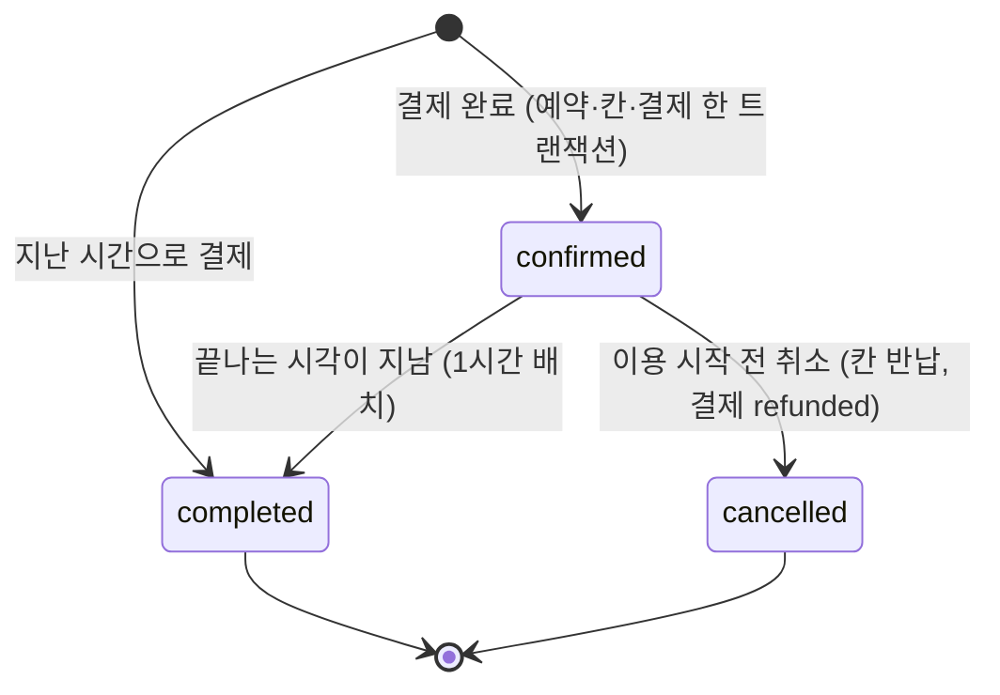

# 공간큐브 요구사항 명세서

2026-11-03 확정안 · 작성 노진산 · 기준: `산출물_04_DB명세서.md`, 11-03 회의, `공간대여_01_기능정의.md` · 검토 기록: `검토_2026-11-03_산출물_비판적검토.md`

스터디룸·스튜디오·카페·강의실·파티룸을 전국에서 1시간 단위로 예약하는 웹 서비스의 요구사항입니다. 기능 ID(F-xx)는 01 기능정의 문서를 그대로 쓰고, 바뀐 항목은 '변경' 열에 적었습니다.

## 1. 개요

| 항목 | 내용 |
| --- | --- |
| 서비스 | 공간큐브(가칭). 공간 검색 → 1시간 칸 선택 → 모의 결제로 예약 확정 → 이용 후 후기 |
| 목적 | ① 같은 칸 동시 예약을 DB가 막는 예약 시스템 ② Nginx + FastAPI 2대 부하분산, MariaDB 읽기 분산(master–slave) ③ 크롤링·사용자 이벤트를 MongoDB에 쌓고 Loki·Prometheus·Grafana로 관측 |
| 범위 | 웹(PC·폰 화면), 공간 유형 5개, 전국 시·도/시·군·구 |
| 범위 밖 | 실제 결제 연동, 호스트 등록, 관리자·공지, 자유게시판·댓글, 예약 홀딩(결제 대기), 예약 대기(빈자리 알림), 앱, DB 클러스터 |
| 팀 | 프론트 1, FastAPI A 1(회원·후기·이벤트·공통·관측), FastAPI B 1(공간·검색·예약·결제·크롤링 등록 API), DB 1(MariaDB·MongoDB·크롤러·데이터 생성) |

### 사용자

| 사용자 | 할 수 있는 것 |
| --- | --- |
| 비회원 | 공간 검색·조회, 상세·칸 보기, 후기 읽기, 회원가입 |
| 회원 | 위 전부 + 예약(모의 결제)·취소, 내 예약, 후기 쓰기·수정·삭제 |
| 시스템 | 크롤러가 신규 공간 등록, 생성기가 과거 데이터, Locust가 부하 |
| 운영자 | Grafana로 상태·로그·지표 확인 (서비스 안 관리자 화면은 없음) |

## 2. 기능 요구사항

우선순위: **M** MVP 필수, **S** MVP 직후. 담당: FE 프론트, A·B FastAPI, DB.

### 2-1. 회원

| ID | 요구사항 | 수용 기준 | 우선 | 담당 | 변경 |
| --- | --- | --- | --- | --- | --- |
| F-01 | 회원가입 | 이메일(100자 이내, 중복 불가)·비밀번호·이름·휴대폰·생년월일 6자리·성별 숫자(1~4)·**이용약관·개인정보 필수 동의(시각 저장)**·마케팅 동의(선택). 만 14세 미만 가입 불가. 이메일 중복이면 409 | M | A, FE | 칸 3개 추가 |
| F-02 | 로그인 | 맞으면 JWT 발급, 틀리면 401, 탈퇴 회원 불가. 가입 직후 바로 로그인돼야 함 | M | A, FE | |
| F-03 | 내 정보 조회·수정 | 이름·휴대폰·마케팅 동의 수정, 비밀번호 변경(현재 비밀번호 확인) | M | A, FE | |
| F-04 | 회원 탈퇴 | `deleted_at` 기록과 함께 이름·휴대폰·생년월일·이메일을 바로 지움(같은 이메일 재가입 가능). 취소할 수 있는 예약(이용 시작 전)이 남아 있으면 탈퇴를 막고 먼저 취소하도록 안내(409 `HAS_UPCOMING_RESERVATION`, 11-05). 예약·결제·후기는 `user_id`로 남기고 후기 작성자는 '탈퇴한 회원' | M | A, FE | |

### 2-2. 탐색·상세

| ID | 요구사항 | 수용 기준 | 우선 | 담당 | 변경 |
| --- | --- | --- | --- | --- | --- |
| F-10 | 유형별 조회 | 유형 5개(studyroom·studio·cafe·lectureroom·partyroom) | M | B, FE | 11-03: 영화관 → 강의실 |
| F-11 | 지역별 조회 | 시·도 → 시·군·구 2단계 | M | B, FE | |
| F-12 | 검색 | 검색어 + 유형 + 지역 + 날짜·시작 시간·이용 시간 + 인원 + 시설(모두 갖춤) → 그 칸이 모두 빈 공간 | M | B, FE | 최소 인원 조건 없음 |
| F-13 | 정렬 | 기본순, 인기순(최근 7일 실제 결제된 예약 수, 지난 날짜 예약 제외), 낮은 가격순, 평점순 | S | B | |
| F-14 | NEW 공간 | 한국 날짜 기준 오늘 포함 최근 14일: `0 ≤ (get_today() - venues.created_at.date()).days < 14`. 오늘·13일 전 포함, 14일 전·미래 날짜 제외 | S | B, FE | `new_until` 삭제, 11-05 경계 확정 |
| F-20 | 공간 상세 | 일러스트, 설명, 이용 안내(`notice`), 시간당 가격, 최대 인원, 최소 이용시간, 시설, 영업시간, 평균 별점·후기 수, 하단 후기 목록. 이미지 누락 시 대표·상세 갤러리 모두 RoomArt 기본 그림 `art:group-0` 표시 | M | B, A, FE | 공간 = 예약 단위, 11-05 이미지 기본값 확정 |
| F-21 | 예약 가능 날짜 | 예약 가능 범위(오늘 ± `BOOKING_PAST_DAYS`·`BOOKING_FUTURE_DAYS`, 기본 각 365일) 안에서 이어진 빈 칸이 `min_hours` 이상인 날. 화면은 14일씩, 앞·뒤로 넘김 | M | B, FE | 11-03 날짜 결정 |
| F-22 | 시간 칸 조회 | 고른 날짜의 영업시간 칸마다 가능·마감, 그리고 '지난 시간' 표시(지난 칸도 고를 수 있음) | M | B, FE | 11-03 날짜 결정 |

### 2-3. 예약·결제

| ID | 요구사항 | 수용 기준 | 우선 | 담당 | 변경 |
| --- | --- | --- | --- | --- | --- |
| F-30 | 예약 + 결제 | 공간·날짜·연속 칸(min_hours~4)·인원·결제수단을 보내면 한 트랜잭션에서 예약(confirmed)·칸·결제(paid) 생성. 결제 화면에 들어가도 칸을 잡지 않고 **먼저 결제를 끝낸 사람이 확정**. 같은 요청을 다시 보내면(두 번 누름) 200으로 같은 예약 | M | B, FE | 11-03 결정 2 |
| F-31 | 모의 결제 | 수단 3가지: 계좌이체(`transfer`)·카드결제(`card`)·휴대폰(`phone`). 실제 결제 연동 없음. 금액은 `reservations.total_price` | M | B | |
| F-32 | 중복 차단 | 같은 칸 동시 요청 중 1건만 성공, 나머지 409 `SLOT_TAKEN`(겹친 칸 포함). primary의 `reservation_slots` 기본키가 막음 | M | B, DB | |
| F-33 | ~~결제 대기 만료~~ | 홀딩이 없어 삭제 | — | — | 삭제 |
| F-34 | 예약 취소 | 이용 시작 전까지 → cancelled, 칸 반납, 결제 refunded | M | B, FE | |
| F-35 | 이용 완료 처리 | 끝나는 시각이 지난 예약은 completed. 지난 시간으로 예약하면 만들 때 바로 completed, 나머지는 1시간 배치가 바꿈 | M | B | 11-03 날짜 결정 |

### 2-4. 마이페이지·후기

| ID | 요구사항 | 수용 기준 | 우선 | 담당 | 변경 |
| --- | --- | --- | --- | --- | --- |
| F-40 | 예약 내역 | 이용 예정·이용 완료·취소 탭, 결제수단·금액. 예약 직후 바로 보임 | M | B, FE | |
| F-41 | 내 후기 | 내가 쓴 후기 목록 | S | A, FE | |
| F-50 | 후기 작성 | completed인 내 예약 1건당 1개, 별점 1~5 + 내용, `max(이용일, 예약한 날)`부터 7일 안. 수정·삭제(소프트) | M | A, FE | |
| F-51 | 후기 조회 | ① 공간 상세 하단 ② 후기 모아보기(유형 필터, 최신·별점순) | M | A, FE | 11-03 결정 3 |
| F-52 | ~~자유게시판·댓글~~ | 회원이 쓰는 글은 후기만 | — | — | 삭제 |
| F-53 | ~~공지~~ | 관리자 없음 | — | — | 삭제 |

### 2-5. 데이터·운영

| ID | 요구사항 | 수용 기준 | 우선 | 담당 | 변경 |
| --- | --- | --- | --- | --- | --- |
| F-60 | 이벤트 수집 | 검색·상세·칸 선택·예약 시도·성공·충돌·취소·후기·로그인·가입 이벤트를 ① 로그 파일(→ Loki) ② MongoDB `user_events`에 저장. MongoDB가 멈춰도 예약은 정상 | M | A, DB, FE | 11-03 결정 1 |
| F-61 | 크롤링 신규 등록 | 주 1회 사이트맵 비교 → 상세 ≤ 20건 → MongoDB `crawl_raw` → 전처리 → 유형별 1개 `POST /internal/venues`. 속성만 쓰고 이름·소개·사진은 생성 | S | DB, B | 크롤링 유지 (11-03 이후 결정) |
| F-62 | 가상 데이터 구분 | 가상 회원·예약·이벤트는 `is_synthetic = true`(헤더 `X-Synthetic: 1` + `X-Synthetic-Key`(= `.env` `SYNTHETIC_API_KEY`), 키 없으면 401) | M | A, B, DB | |
| F-63 | 날짜 기준 | 오늘은 실제 날짜, 코드는 `get_today()`·`get_now()` 하나로 읽음. 가상 날짜 없음. 과거 분석 데이터는 생성기가 과거 날짜로 넣고, 사용자도 지난 날짜로 예약할 수 있음 | M | A, B, DB | 11-03 날짜 결정 |
| F-64 | 서버 로그 | 요청·오류 로그를 파일로 남기고 Alloy → Loki | M | A | |
| F-65 | 지표 | FastAPI `/metrics`, MariaDB·MongoDB·Nginx·서버 exporter → Prometheus. Grafana 대시보드 3개(서비스 상태·예약 경쟁·사용자 흐름), 복제 지연 경보 | M | A, B | 새로 추가 |
| F-70 | 헬스체크 | primary 실패 = 503, replica·MongoDB 실패 = 200 + 경고 | M | A | |

## 3. 예약 규칙 (바꾸면 안 됨)

- 1시간 칸 단위, 칸은 정수 시(9~22). 연속 `min_hours`(공간마다, 기본 1) ~ 4칸.
- 날짜는 실제 날짜(가상 날짜 없음). 예약은 오늘 기준 과거 `BOOKING_PAST_DAYS`(기본 365일)부터 미래 `BOOKING_FUTURE_DAYS`(기본 365일)까지 **지난 날짜·지난 시간도 가능**. 끝나는 시각이 이미 지난 예약은 만들 때 바로 `completed`(후기를 바로 쓸 수 있음).
- 취소는 실제 시각으로 이용 시작 전까지만. 지난 시간 예약은 취소할 수 없음.
- 영업시간 밖 칸 없음. 인원은 1 이상 `capacity_max` 이하.
- 금액 = 시간당 가격 × 칸 수, 예약 시점 금액을 `total_price`에 고정.
- 결제 화면 진입은 칸을 잡지 않음. 확정 순서는 primary에 커밋된 순서.

## 4. 비기능 요구사항

| ID | 분류 | 요구사항 | 확인 방법 |
| --- | --- | --- | --- |
| NFR-01 | 동시성 | 같은 칸 동시 50명 → 정확히 1명 201, 나머지 409 | pytest 스레드 50, Locust |
| NFR-02 | 정합성 | 테스트·시연 전체에서 중복 예약 0건 | 집계 쿼리 |
| NFR-03 | 가용성 | FastAPI 1대 장애에도 유지. replica 장애 시 primary로 읽기. MongoDB 장애 시 예약·조회 정상 | 한 대씩 멈추는 테스트 |
| NFR-04 | 읽기 일관성 | 쓰기·인증·'내 것' 조회는 primary, 공개 조회만 replica | 가입 직후 로그인, 예약 직후 내 예약 테스트 |
| NFR-05 | 성능 | **동시 50명에서 판정(11-05 A7 확정):** 조회 p95 300ms·예약 p95 500ms·로그인/가입 p95 800ms(bcrypt) 미만, 오류율 1% 미만(오류 = 5xx·연결 실패·시간 초과(시나리오가 일부러 만드는 409·401·400은 뺌)). Locust 쪽 p95로 판정, 단계마다 10분(첫 1분 뺌). 200명은 한계 찾기(기록만). 서버 1대 끄기: 끈 뒤 1분 오류율 1% 미만·중복 예약 0. 용량 추정은 `인프라_트래픽_안정성_검토.md` 5절. replica 있음·없음을 같은 시나리오로 비교 | Locust, Grafana |
| NFR-06 | 복제 지연 | 평소 1초 미만, 5초 넘으면 Grafana 경보 | Prometheus `mysql_slave_status_seconds_behind_master` |
| NFR-07 | 보안 | bcrypt, JWT 60분, DB·MongoDB·모니터링은 보안 그룹으로 필요한 곳만, MongoDB 인증 켬, Grafana는 내 IP만 | 보안 그룹 점검 |
| NFR-08 | 비밀값 | 비밀번호·키는 `.env`에만. 저장소에는 `.env.example` | 커밋 전 확인 |
| NFR-09 | 개인정보 | 생년월일·성별·휴대폰은 내 정보 응답에만, 후기 작성자 이름 가림, 이벤트·로그에 개인정보 없음(user_id만) | API·로그 점검 |
| NFR-10 | 크롤링 예절 | robots.txt, 3초 간격, 실행당 상세 20건, 사진·후기 본문·연락처·상세 주소·원본 HTML 저장 안 함 | `crawler/AGENTS.md` |
| NFR-11 | 보관 | MongoDB 이벤트 1년(TTL), Loki 14일, Prometheus 15일, MariaDB 백업 7일(`db1` cron) | 설정 확인 |
| NFR-12 | 접근성·반응형 | WCAG 2 A·AA 심각·치명 0건, 375·768·1280 가로 넘침 없음 | Playwright + axe |
| NFR-13 | 시간대 | Asia/Seoul, 날짜 `YYYY-MM-DD`, 금액 원 단위. MongoDB는 UTC 저장 | 코드 리뷰 |
| NFR-14 | 자동 구성 | 서버 설치·배포를 스크립트로 재현 | 새 인스턴스에서 한 번에 |
| NFR-15 | 코드 품질 | 커밋 전 `verify.ps1` 통과 | 스크립트 |

## 5. 데이터 요구사항

상세는 `산출물_04_DB명세서.md`입니다.

| 저장소 | 내용 |
| --- | --- |
| MariaDB 11.4 (primary + replica) | 표 12개: regions, categories, facilities, users, venues, venue_facilities, venue_images, reservations, reservation_slots, payments, reviews, crawl_jobs + 뷰 `v_venue_rating` |
| MongoDB 7 | `user_events`(1년), `event_daily`(집계), `crawl_raw`(크롤링 추출값) |
| Loki | 서버 요청·오류 로그, 이벤트 로그 (14일) |
| Prometheus | 요청·지연·복제 지연·충돌 수·exporter 지표 (15일) |

## 6. 외부 인터페이스

| 대상 | 방식 | 요구사항 |
| --- | --- | --- |
| 브라우저 ↔ 서버 | HTTP(S) → Nginx → `/api/*` | 오류 `{"code","message","detail"}`, 목록 `{"items","page","size","total"}` |
| 크롤러 → 서버 | `POST /internal/venues` + `X-Internal-Key` | upsert |
| 스페이스클라우드 (주) | 사이트맵 + `/space/<id>` | NFR-10 |
| 쉐어잇 (2순위, 약관 확인·표본 20건 승인 후) | 사이트맵 + `/venue/<id>` | NFR-10 |
| 루북 (3순위, 같은 조건) | 사이트맵 + `/ko/space/…` (`/api`·`/graphql`은 차단이라 쓰지 않음) | NFR-10 |
| 운영자 → Grafana | :3000, 내 IP만 | |

## 7. 제약과 가정

- **1차 일정:** 1일 웹 서비스 구현 → 2일 배포 → 3일 자동 환경 구성·발표. 그래서 가상 시계·DB 클러스터는 넣지 않습니다.
- 결제는 모의 결제만. 공간 그림은 일러스트 10종 × 색 2가지(`art:<종류>-<색>`).
- 1차 배포는 팀 노트북 4대의 VM 7대(11-05, `로컬_VM_구성.md`). AWS 구성(`산출물_02` 5·6절, `AWS_프리티어_구성.md`)은 참고안.
- 가상 데이터는 구조 검증용입니다.

## 8. 확정한 것과 남은 것

| 항목 | 결정 | 근거 |
| --- | --- | --- |
| RDB | MariaDB 11.4 (VM primary `db1` + replica `db2`) | 11-03, 배치 11-05 |
| 비정형 | MongoDB 7 (VM `mongo`, `ufw`로 api만) | 11-03 결정 1, 배치 11-05 |
| DB 구성 | master–slave, 클러스터 안 함 | `산출물_04` 1-2 |
| 상태값 | confirmed · completed · cancelled | 11-03 결정 2 |
| 게시판 | 후기만 | 11-03 결정 3 |
| 크롤링 | 3곳: 스페이스클라우드(주) · 쉐어잇 · 루북 (2·3순위는 약관 확인 후) | 11-03 A3 |
| 유형 | 스터디룸·스튜디오·카페·강의실·파티룸 (영화관 → 강의실) | 11-03 A3 |
| 지역 목록 | 행정구역 전체를 seed, 화면에는 공간이 있는 지역만 | 11-03 A3 |
| 날짜 | 실제 날짜 + 과거 데이터 생성 | 1차 일정 |
| 관측 | Loki·Prometheus·Grafana + MongoDB 이벤트 | 11-03 |
| 드라이버·ORM | SQLAlchemy 2.1 동기 + PyMySQL, pymongo, 마이그레이션은 SQL 파일 | 11-03 |
| 스키마 세부 | `min_hours` 복원, 결제수단 영문 코드, 예약 시간 DB CHECK 9~23, 필수 동의 시각 2칸 + 만 14세 미만 가입 불가 | 11-03 A2 |
| 토큰 | 액세스 토큰만(JWT 60분, Bearer 헤더), 리프레시 없음 | 11-03 |

| 남은 것 | 기본값 |
| --- | --- |
| API 이름 `/venues` | 프론트가 경로 수정 |
