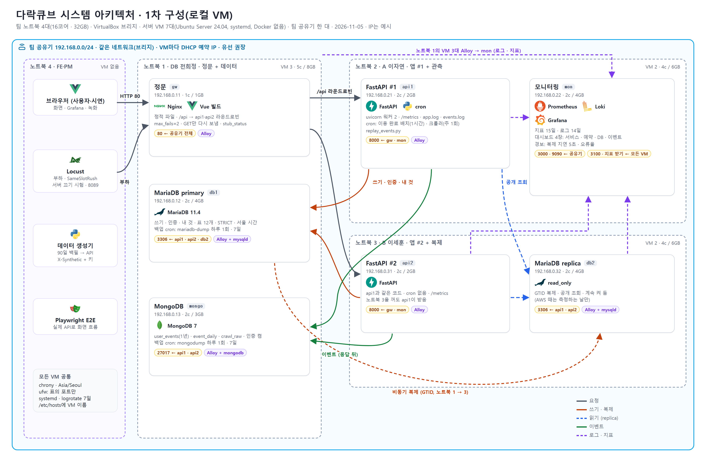
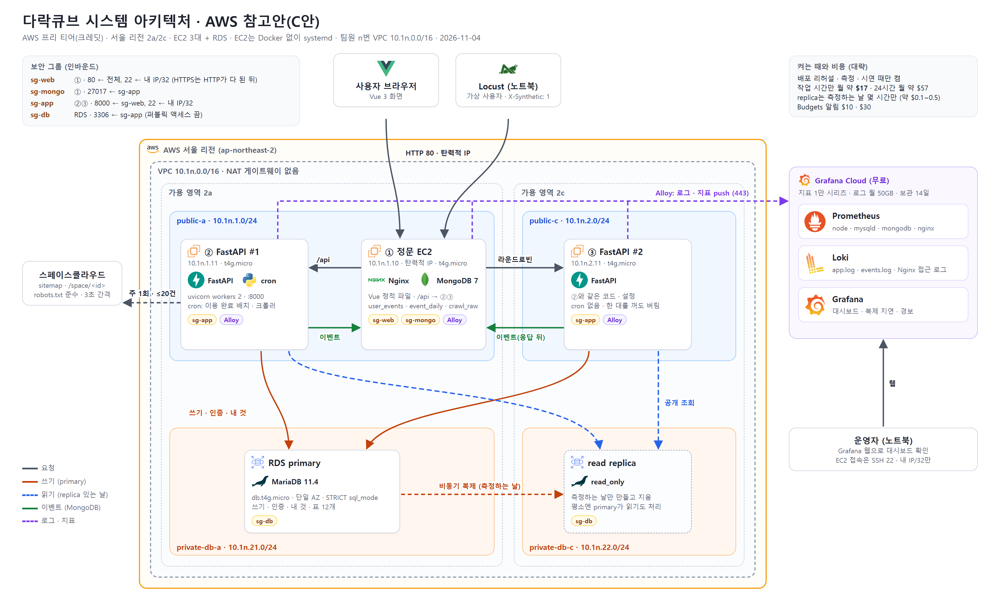
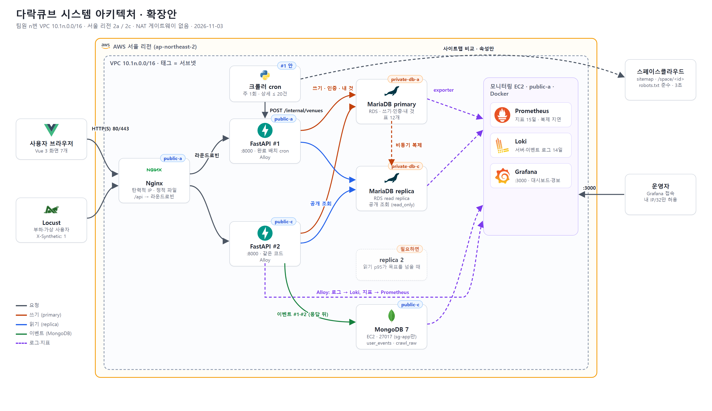
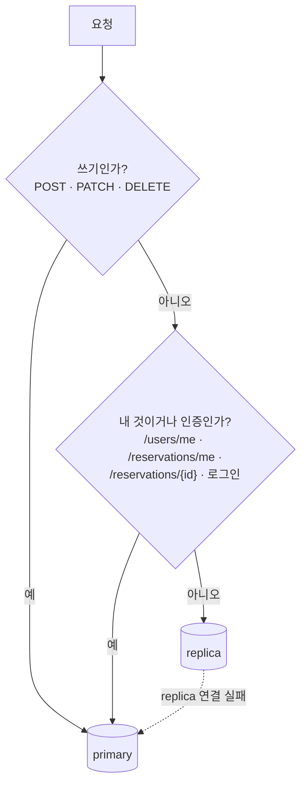
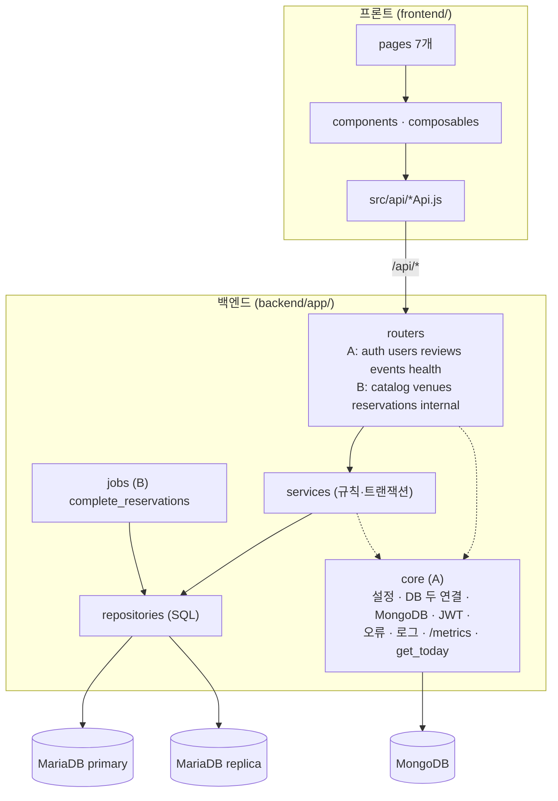
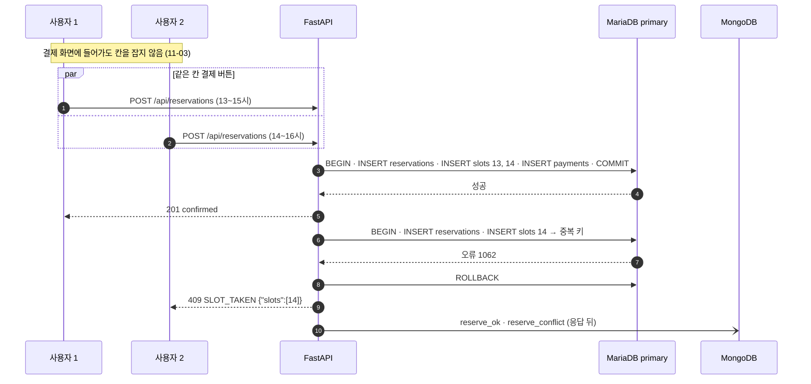
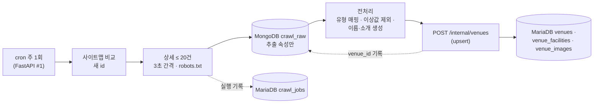
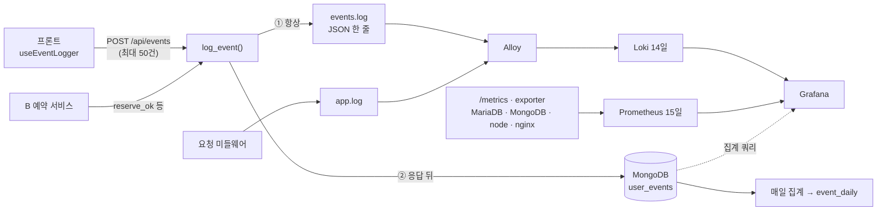

# 다락큐브 시스템 아키텍처 흐름도

2026-11-03 확정안 · 작성 노진산 · 기준: `산출물_04_DB명세서.md`, `AWS_네트워크_설계.md`, 11-03 회의

사용자 요청은 Nginx 한 대가 받아 FastAPI 2대로 나눠 보냅니다. **쓰기와 '내 것' 조회는 MariaDB primary, 공개 조회는 replica**로 보내고, 사용자 이벤트는 **MongoDB**에 쌓습니다. 서버 로그와 이벤트 로그는 **Loki**로, 지표는 **Prometheus**로 모아 **Grafana**에서 봅니다. 크롤러는 FastAPI #1에서 주 1회 돕니다. 팀원마다 자기 AWS 계정에 같은 구성을 올립니다(팀원 n번 = VPC `10.1n.0.0/16`).

**1차 구성(로컬 VM, 11-05):** 팀 노트북 4대에 VM 7대(정문 `gw`, FastAPI `api1`·`api2`, MariaDB `db1`·`db2`, MongoDB `mongo`, 모니터링 `mon`)를 만들어 같은 공유기에 브리지로 붙입니다. 역할은 아래 확장안과 같고, AWS 서브넷·보안 그룹 대신 노트북 분리와 `ufw`를 씁니다. 배치·주소·방화벽·설치 순서: `로컬_VM_구성.md`, `infra/vm/README.md`.

**AWS 참고안(C안, 11-04):** EC2 3대 + RDS, MongoDB는 정문 EC2, 모니터링은 Grafana Cloud. `AWS_프리티어_구성.md`.

**확장안(11-03):** 아래 1절부터 설명하는 구성(EC2 5대 + RDS 2대 + 모니터링 EC2)입니다. 구성 요소와 읽기·쓰기·이벤트·로그 경로는 로컬 VM 구성과 같습니다(VM 7대가 이 역할을 그대로 나눠 맡음). 아래 서브넷·보안 그룹·비용 절은 AWS 참고안입니다.

원본: `figures/src/architecture.html`(로컬 VM)·`architecture_aws.html`·`architecture_expanded.html` (아이콘 `architecture/icons/`, 출처 `SOURCES.md`). 고치면 `figures/README.md`의 명령으로 PNG를 다시 만듭니다.

## 1. 구성 요소

| 구성 요소 | 서브넷 | 역할 |
| --- | --- | --- |
| Nginx | public-a | 탄력적 IP. Vue 빌드 결과를 직접 내보내고 `/api/*`만 FastAPI로 라운드로빈. 무료 Nginx는 **수동 헬스체크만**(요청이 실패해야 뺌, `/health`를 미리 찌르지 못함) |
| FastAPI #1 | public-a | API. 이용 완료 배치·크롤러 cron은 이 한 대에서만 |
| FastAPI #2 | public-c | 같은 코드·설정. 세션을 서버에 두지 않음(JWT) |
| 크롤러 cron | FastAPI #1 안 | 주 1회 사이트맵 비교 → 상세 ≤ 20건 → MongoDB `crawl_raw` → `POST /internal/venues` |
| MariaDB primary | private-db-a | RDS for MariaDB 11.4. 모든 쓰기·인증·'내 것' 조회. 같은 칸 중복을 기본키로 막음 |
| MariaDB replica | private-db-c | RDS read replica, `read_only`. 공개 조회. 읽기 p95가 목표를 넘으면 1대 추가 |
| MongoDB 7 | public-c | EC2. `user_events`·`event_daily`·`crawl_raw`. 27017은 FastAPI 보안 그룹만 |
| 모니터링 EC2 | public-a | Docker로 Prometheus·Loki·Grafana. Grafana 3000은 내 IP만 |
| Grafana Alloy | 각 EC2 | 로그 파일 → Loki, 로컬 지표 → Prometheus(remote_write) |
| Locust | VPC 밖(노트북) → 2단계엔 public-a | 부하·가상 사용자(`X-Synthetic: 1` + `X-Synthetic-Key`) |

DB 구성을 master–slave로 정한 이유(클러스터와 비교)는 `산출물_04_DB명세서.md` 1-2절에 있습니다.

> **단계 (11-03 방향):** 1차는 **이 그림 그대로** 띄우고, 정문 Nginx에 설정 보강(`proxy_next_upstream`, 짧은 연결 시간 제한)만 더합니다. 정문 한 대는 단일 장애점이고 능동 헬스체크가 없으므로, 띄운 뒤 '서버 1대 끄기 시험' 등에서 기준을 넘으면 **ALB(또는 HAProxy) → Auto Scaling** 순서로 더합니다. 조건표는 `인프라_트래픽_안정성_검토.md` 1-1절.

## 2. 읽기·쓰기 경로 규칙

replica는 primary보다 조금 늦습니다(비동기 복제). 그래서 **방금 쓴 것을 다시 읽는 요청은 primary**로 보냅니다.

| 경로 | DB | 이유 |
| --- | --- | --- |
| `POST /auth/signup`, `/auth/login`, `get_current_user()` | primary | 가입 직후 로그인 실패 방지 |
| `POST /reservations`, `/cancel`, `/internal/venues` | primary | 쓰기 |
| `GET /reservations/me`, `/reservations/{id}`, `/users/me`, `/users/me/reviews` | primary | 예약·후기 직후 바로 보여야 함 |
| `GET /categories`, `/regions`, `/facilities`, `/venues…`, `/slots`, `/available-dates`, `/reviews` | replica | 1초 안팎 늦어도 됨 |

칸 조회가 replica라 이미 찬 칸이 잠깐 비어 보일 수 있습니다. 이때 결제하면 primary가 409로 막고, 응답 `detail.slots`로 프론트가 그 칸을 바로 마감 표시합니다. 중복 예약은 생기지 않습니다.

## 3. 계층 구조

## 4. 데이터 흐름

### 4-1. 예약 (동시성 핵심)

### 4-2. 크롤링 → 공간 등록

- 업체 이름·소개·사진·후기 본문·연락처·상세 주소·원본 HTML은 저장하지 않습니다(`crawler/AGENTS.md`).
- 처음 채울 때는 이미 받은 스페이스클라우드 표본 200개에서 저장 금지 항목을 빼고 `crawl_raw` 후보 풀로 씁니다(새 요청 없음). 1차 수집원은 스페이스클라우드·쉐어잇 2곳이며, 부족한 시연용 공간은 생성기로 채워 총 30개를 목표로 합니다. 쉐어잇 실제 실행 전에는 해당 사이트의 약관·robots.txt를 다시 확인합니다. 유형은 스터디룸·스튜디오·카페·강의실·파티룸입니다(11-05 수집 방향).

### 4-3. 이벤트·로그·지표

| 무엇 | 어디 | 보관 | 대시보드 예 |
| --- | --- | --- | --- |
| 사용자 이벤트(분석 원천) | MongoDB `user_events` | 1년(TTL) | 검색 → 예약 전환율, 시간대별 점유율 |
| 이벤트 실시간 흐름 | Loki `job=events` | 14일 | 분당 예약 시도·충돌 수 |
| 서버 요청·오류 | Loki `job=api`, `job=nginx` | 14일 | 오류 로그 검색 |
| 지표 | Prometheus | 15일 | 요청 p95, 서버별 요청 수, **복제 지연**, MongoDB 쓰기 실패 |

MongoDB 쓰기가 실패해도 이벤트는 ① `events.log`와 Loki에 남습니다. `event_id`로 중복 없이 다시 넣을 수 있습니다(`산출물_04` 9-1).

## 5. 네트워크와 보안

| 서브넷 | CIDR | 들어가는 것 | 인터넷 |
| --- | --- | --- | --- |
| public-a (2a) | 10.1n.1.0/24 | Nginx(10.1n.1.10), FastAPI #1(10.1n.1.11), 모니터링(10.1n.1.31) | 인터넷 게이트웨이 |
| public-c (2c) | 10.1n.2.0/24 | FastAPI #2(10.1n.2.11), MongoDB(10.1n.2.21) | 인터넷 게이트웨이 |
| private-db-a / c | 10.1n.21.0/24, 10.1n.22.0/24 | RDS primary(2a), replica(2c) | 없음 |

| 보안 그룹 | 인바운드 |
| --- | --- |
| sg-web (Nginx) | 80·443 ← 전체, 22 ← 내 IP/32 |
| sg-app (FastAPI) | 8000 ← sg-web, 8000(/metrics) ← sg-mon, 22 ← 내 IP/32 |
| sg-db (RDS 2대) | 3306 ← sg-app, 3306 ← sg-mon(exporter) |
| sg-mongo | 27017 ← sg-app, 9216 ← sg-mon(exporter), 22 ← 내 IP/32 |
| sg-mon (모니터링) | 3000 ← 내 IP/32, 3100(Loki)·9090(Prometheus) ← sg-app·sg-mongo·sg-web, 22 ← 내 IP/32 |

- MongoDB를 퍼블릭 서브넷에 두는 이유: NAT 게이트웨이가 없어(월 약 $43) 프라이빗 서브넷 EC2는 설치 경로가 없습니다. 보안 그룹으로 막고 인증을 켭니다.
- `/internal/*`는 Nginx에서 VPC 대역만 허용하고, 앱에서도 `X-Internal-Key`를 확인합니다.
- 비밀값(DB·MongoDB 비밀번호, JWT 키, 내부 키)은 각 인스턴스 `.env`에만 둡니다.

## 6. 비용 (1인당, 서울, 24시간, 대략)

> **11-04:** 아래는 확장안 비용이다. 실제 1차는 프리 티어 C안(EC2 3대: 정문 Nginx+MongoDB · FastAPI #1 · FastAPI #2, Docker 없이 직접 설치 + RDS 1대, replica는 측정하는 날만, 모니터링은 Grafana Cloud 무료, 작업 시간만 켜면 월 약 $17)으로 하며 [AWS_프리티어_구성.md](AWS_프리티어_구성.md)가 기준이다. 구성 요소와 primary/replica·이벤트·로그 경로는 같다.

| 항목 | 사양 (안) | 월 |
| --- | --- | --- |
| 기존 (Nginx·FastAPI 2·RDS 1·공인 IP) | `AWS_네트워크_설계.md` | 약 $55 |
| + RDS read replica | db.t4g.micro + 20GB | 약 $21 |
| + MongoDB EC2 | t4g.small(2GB) + EBS 20GB + 공인 IP | 약 $20 |
| + 모니터링 EC2 | t4g.small + EBS 20GB + 공인 IP | 약 $20 |
| 합계 | | **약 $116** |

- 모니터링은 노트북 Docker로 돌리면 $20을 아낄 수 있습니다. 다만 Prometheus가 VPC 안 사설 주소를 긁을 수 없어 Alloy가 밖으로 밀어 보내야 하고, 노트북을 끄면 기록이 끊깁니다.
- 정확한 단가는 배포 전에 AWS 요금 계산기로 다시 봅니다. 안 쓸 때는 EC2 중지 → RDS 일시 중지(최대 7일) 순서로 끕니다. replica는 일시 중지가 안 되므로 테스트가 끝나면 지웁니다.

## 7. 기술 스택

| 구분 | 사용 | 비고 |
| --- | --- | --- |
| 프론트 | Vue 3.5, Vite, Vue Router, Pinia, reka-ui, vue-sonner | |
| 웹 서버 | Nginx | 정적 파일 + 리버스 프록시 |
| API | FastAPI, uvicorn, Pydantic | Python 3.12 (conda `pro_1`) |
| RDB | MariaDB 11.4 (RDS primary + read replica) | SQLAlchemy 2.1(동기) + PyMySQL |
| NoSQL | MongoDB 7 (EC2) | pymongo 4 (동기) |
| 크롤러 | httpx, BeautifulSoup | `crawler/spacecloud_crawler.py` |
| 관측 | Grafana Alloy, Loki, Prometheus, Grafana | exporter: mysqld, mongodb, node, nginx |
| 부하 | Locust | replica 있음·없음 비교 |
| 품질 | Ruff, pytest, Oxlint·ESLint, Vitest, Playwright + axe | 루트 `verify.ps1` |

## 8. 배포 단위와 포트

| 구성 요소 | 위치 | 포트 | 실행 |
| --- | --- | --- | --- |
| Nginx | EC2 public-a | 80, 443 | systemd |
| FastAPI | EC2 2대 | 8000 (`/metrics` 포함) | uvicorn (systemd) |
| 완료 배치·크롤러 | FastAPI #1 | — | cron (1시간 / 주 1회) |
| MariaDB | RDS primary + replica | 3306 | 관리형 |
| MongoDB | EC2 public-c | 27017 | systemd, 인증 켬 |
| Prometheus·Loki·Grafana | 모니터링 EC2 | 9090·3100·3000 | Docker Compose |
| Alloy | 각 EC2 | — | systemd |

3일차 '자동 환경 구성'은 위 설치를 스크립트(EC2 사용자 데이터 + Docker Compose)로 다시 만드는 것입니다.
