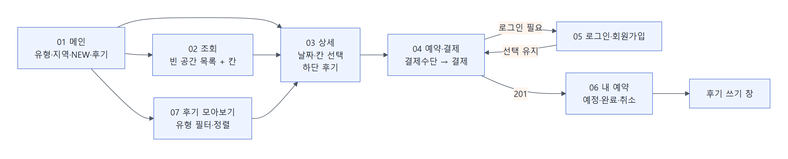
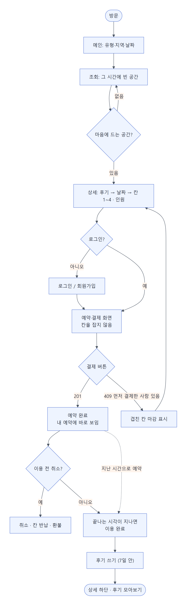
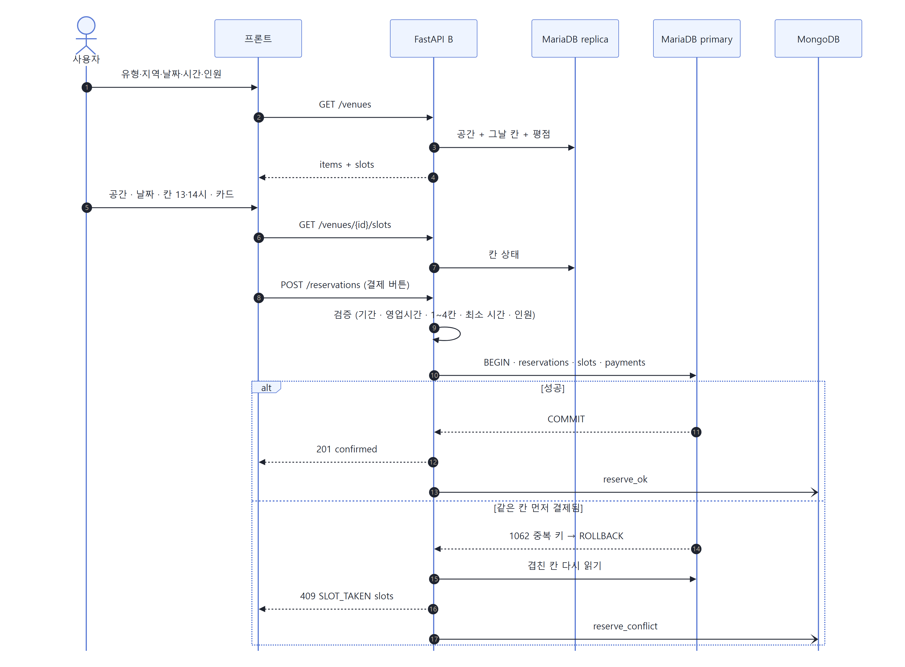
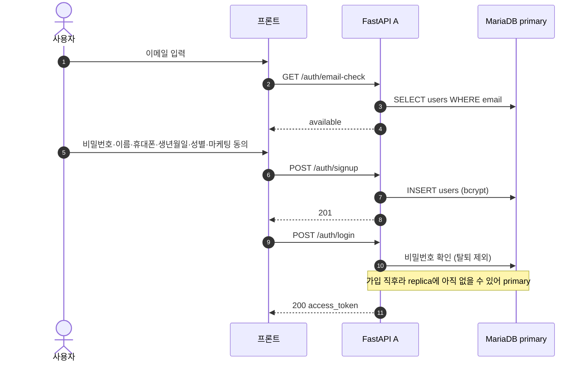
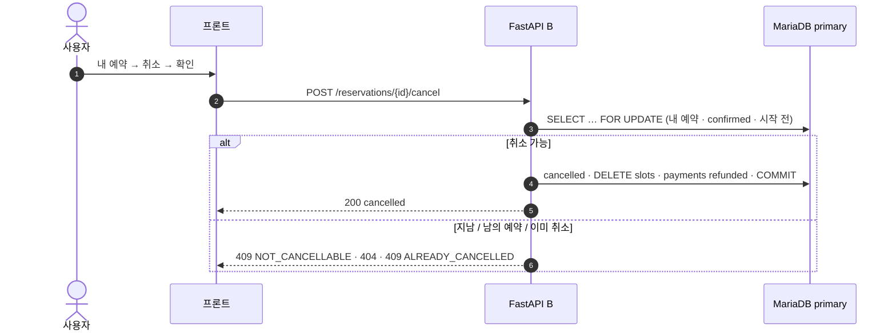
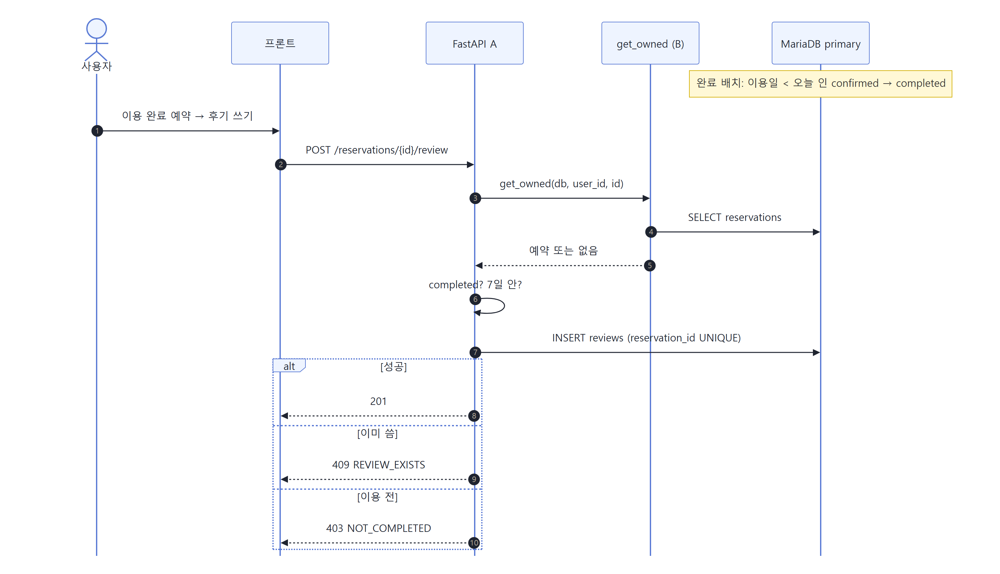
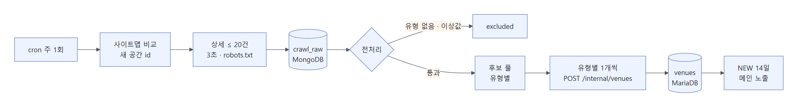
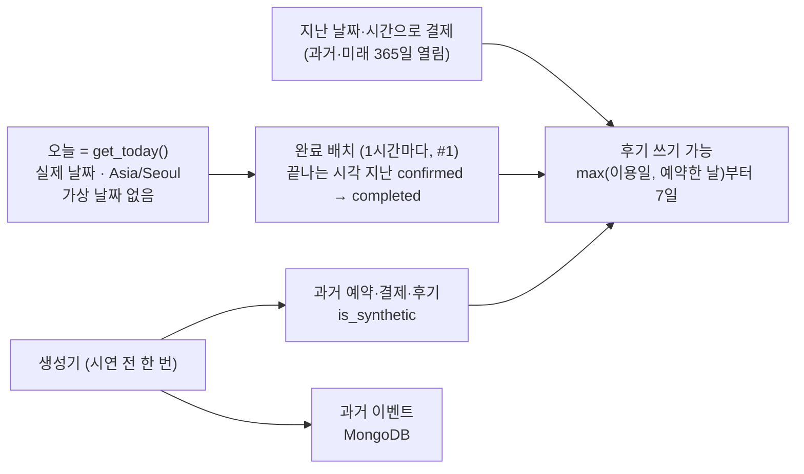
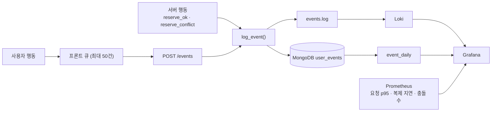

# 공간큐브 서비스 흐름도

2026-11-03 확정안 · 작성 노진산 · 기준: `산출물_01_요구사항명세서.md`, `산출물_04_DB명세서.md`, 11-03 회의, 프론트 화면 7개

사용자가 공간을 찾아 예약하고 후기를 남기기까지의 흐름과, 그 뒤에서 도는 시스템 흐름(크롤링 등록·이용 완료·이벤트 수집)입니다. 그림 원본은 `figures/src/*.mmd`이고, 경로 앞 `/api`는 생략했습니다. 11-03 결정으로 **결제 대기(홀딩)와 자유게시판이 빠졌습니다.**

## 1. 화면 지도

| 화면 | 기능 | 부르는 API |
| --- | --- | --- |
| 01 메인 | F-10, F-11, F-14 | `GET /categories`, `/regions`, `/venues`, `/venues/new`, `/reviews?size=6` |
| 02 조회 | F-12, F-13, F-22 | `GET /venues?…&date=`(칸 상태 포함), `/facilities` |
| 03 상세 | F-20, F-21, F-22, F-51 | `GET /venues/{id}`, `/available-dates`, `/slots?date=`, `/venues/{id}/reviews` |
| 04 예약·결제 | F-30, F-31, F-32 | `POST /reservations` (결제 버튼 한 번) |
| 05 로그인·회원가입 | F-01, F-02 | `GET /auth/email-check`, `POST /auth/signup`, `/auth/login` |
| 06 내 예약 | F-03, F-34, F-40, F-41, F-50 | `GET /users/me`, `/reservations/me`, `POST /reservations/{id}/cancel`, `/reservations/{id}/review` |
| 07 후기 모아보기 | F-51 | `GET /reviews?category=&sort=&page=` |

프론트 주소: `/` → `/search` → `/venues/:venueId` → `/reserve?venue=&date=&start=&hours=&people=`. 결제 화면에는 선택값만 넘기고, 결제 버튼에서 예약을 만듭니다. 회원 화면은 `/login`·`/me`, 후기 모아보기는 `/reviews`입니다. 옛 `/rooms/:roomId`·`/board`는 새 주소로 넘깁니다.

모든 화면은 사용자 행동을 모아 `POST /events`로 보냅니다(7-3).

## 2. 사용자 여정 (처음 방문 → 후기)

- 로그인하러 갔다 와도 고른 칸·인원은 유지됩니다.
- 결제 화면에 들어가도 칸을 잡지 않습니다. 그사이 다른 사람이 먼저 결제하면 409가 납니다. 이건 오류가 아니라 정상 흐름입니다. 화면은 409 응답에 든 칸을 바로 마감 표시합니다.
- 예약 직후 '내 예약'에 바로 보입니다(내 것은 primary에서 읽음).

## 3. 검색 → 예약·결제 (동시성 포함)

| 검증 (쓰기 전) | 실패 시 |
| --- | --- |
| 오늘 ≤ 날짜 < 오늘 + 예약 가능 기간 | 400 `OUT_OF_RANGE` |
| 영업시간 안, 1~4칸, `min_hours` 이상, 오늘이면 지난 시 아님 | 400 `OUT_OF_RANGE` |
| 1 ≤ 인원 ≤ `capacity_max` | 400 `TOO_MANY_PEOPLE` |
| 결제수단 `transfer`·`card`·`phone` | 400 `INVALID_METHOD` |
| 같은 칸이 먼저 커밋됨 | 409 `SLOT_TAKEN` + 겹친 칸 |

## 4. 회원가입·로그인

## 5. 취소

## 6. 후기

후기는 두 곳에서 같은 형식으로 보입니다. 공간 상세 하단(`GET /venues/{id}/reviews`)과 후기 모아보기(`GET /reviews`)입니다. 자유게시판·댓글은 없습니다.

## 7. 시스템 흐름 (사용자 눈에 안 보이는 것)

### 7-1. 크롤링 → 신규 공간 등록

| 단계 | 규칙 |
| --- | --- |
| 수집 | 실제 주 1회, 상세 ≤ 20건, 3초 간격, robots.txt 준수. 결과를 MongoDB `crawl_raw`에, 실행 기록을 MariaDB `crawl_jobs`에 |
| 전처리 | 유형 5개로 매핑(드문 유형 먼저: 카페 → 스터디룸 → 스튜디오 → 파티룸), 가격 상·하위 5% 제외, 영업시간 9~23으로 자름, 시설 이름 맞춤 |
| 등록 | 유형별로 1개씩 `POST /internal/venues`. 이름은 '시·군·구 + 유형 + 번호', 소개는 유형별 템플릿, 그림은 일러스트 풀 |
| 처음 | 이미 받은 스페이스클라우드 표본 200개에서 저장 금지 항목을 빼고 `crawl_raw` 후보 풀로 씀(새 요청 없음). 1차 수집원은 스페이스클라우드·쉐어잇 2곳. 선별한 속성 기반 시연용 공간과 생성기 공간을 합쳐 30개를 목표로 함(11-05 수집 방향) |
| 쓰지 않음 | 업체 이름, 소개 원문, 사진, 후기 본문, 연락처, 상세 주소, 원본 HTML |

### 7-2. 날짜와 이용 완료

가상 날짜는 쓰지 않습니다(11-03 결정, `기록/검토_2026-11-03_가상날짜_제안.md`). 이용 완료·후기를 바로 보려면 지난 시간으로 예약하면 됩니다. 만들 때 바로 `completed`가 됩니다.

### 7-3. 이벤트·로그·지표

| 대시보드 | 데이터 |
| --- | --- |
| 서비스 상태 | Prometheus: 서버별 요청 수·p95·오류율, 복제 지연, MongoDB 쓰기 실패 |
| 예약 경쟁 | Loki `event_type="reserve_conflict"` 분당 수, Prometheus `reservation_total{result}` |
| 사용자 흐름 | MongoDB: 검색 → 상세 → 칸 선택 → 예약 전환율, 시간대별 점유율 |

## 8. 오류가 났을 때 사용자에게 보이는 것

| 상황 | 응답 | 화면 |
| --- | --- | --- |
| 다른 사람이 먼저 결제 | 409 `SLOT_TAKEN` | 토스트 + 응답의 칸을 바로 마감 표시 |
| 로그인 만료 | 401 | 로그인 화면으로, 돌아오면 선택 유지 |
| 기간 밖·영업시간 밖·최소 시간 미만 | 400 `OUT_OF_RANGE` | 칸 선택 해제 + 안내 |
| 인원 초과 | 400 `TOO_MANY_PEOPLE` | 인원 칸 옆 오류 |
| 이미 지난 예약 취소 | 409 `NOT_CANCELLABLE` | 취소 버튼 미리 숨김 |
| FastAPI 한 대 장애 | Nginx가 다른 서버로 | 사용자는 모름 |
| replica 장애 | primary로 읽기 | 사용자는 모름 |
| MongoDB 장애 | 이벤트는 로그 파일·Loki에 남음 | 사용자는 모름 |
