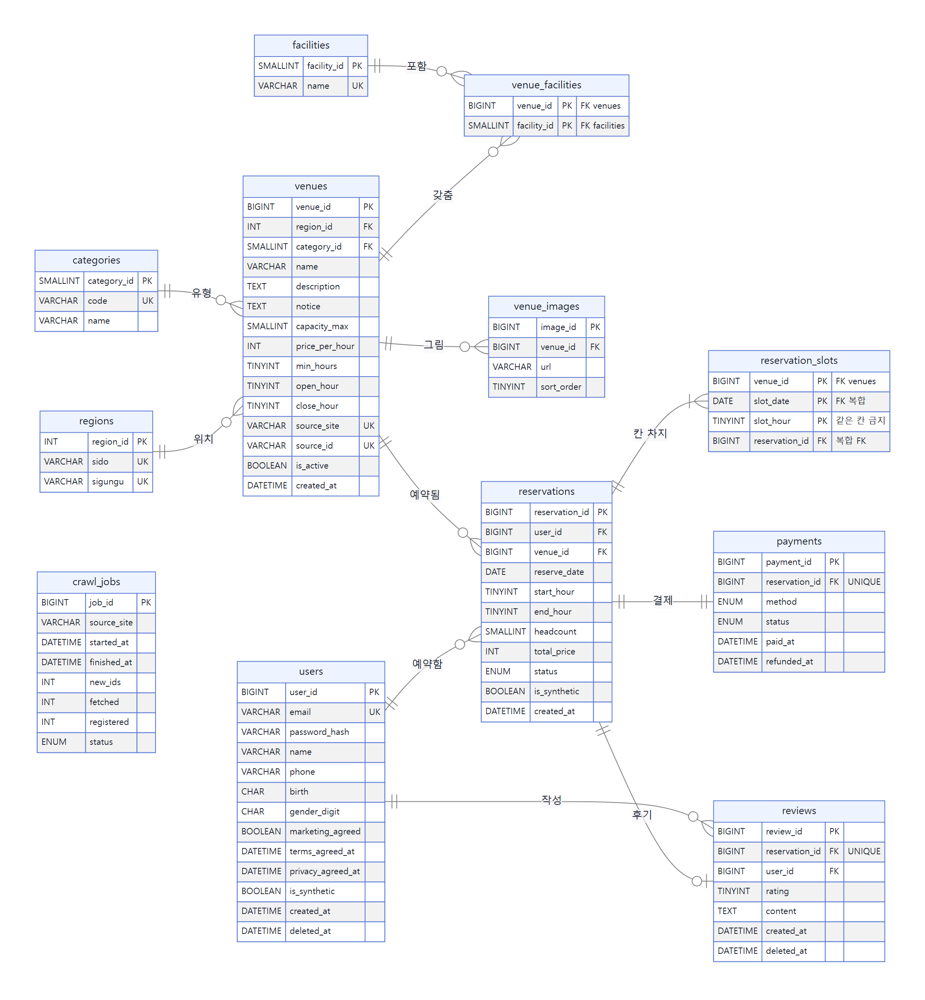

# 다락큐브 DB 명세서

2026-11-03 설계 · 작성 노진산 · 2026-11-07 운영 설명 현행화. 11-04의 MariaDB 11.8·11.4/MongoDB 7 검증은 이력이며, 현재 109의 MariaDB 10.11.14/MongoDB 8.0.34와 구분한다.

| 항목 | 내용 |
| --- | --- |
| 관계형 DB | **MariaDB 10.11.14** (현재 VM `db1`·`db2`; 이전 11.4 compose·AWS 사양은 참고 이력), InnoDB, `utf8mb4_unicode_ci`, 표 12개 + 뷰 1개 |
| 비정형 DB | **MongoDB 8.0.34** (VM `mongo` 1대). space_rental_analytics.events/event_daily와 crawl.crawl_raw |
| 구성 | MariaDB **master–slave**(primary 1 + read replica 1, 부족하면 replica 1대 추가). 클러스터(Galera)는 쓰지 않음 |
| 로그·지표 | 사용자 이벤트 → MongoDB(원천) + Loki(실시간). 서버 로그 → Loki. 지표 → Prometheus. 화면 → Grafana |
| 파일 | DDL `db/migrations/0001_init.sql`, MongoDB 초기화 `docs/db/mongo_init.js`, 제약 시험 `db/tests/check_ddl.py`, ERD `docs/figures/erd_mariadb.png` |
| 바탕 | 팀원 변경 ERD(11-02, 14개 표), 11-03 회의, `공간대여_02_DB정규화.md`(10-30) |

DDL은 11-04 로컬 11.8·11.4에서 검증한 이력이 있다. 현재 109에는 0001_init·seed가 적용돼 있지만 그 사실을 10.11 전체 회귀 테스트 완료로 바꾸어 말하지 않는다. 현재 주소·사양·연결 한도·exporter 검증은 [DB 운영·모니터링 현황](DB_운영_모니터링_현황_2026-11-07.md)을 따른다.

이 worktree의 일부 코드·초기화 파일은 배포본보다 이전 SHA다. 현재 이벤트 명세는 속성 정리 v1 및 배포 메타데이터를 기준으로 설명하며, 재배포/초기화 전 최신 develop 파일과 대조한다. 이 문서 갱신으로 DB 스키마·초기화 코드를 실행하거나 변경하지 않았다.

## 1. 저장소 구성

### 1-1. 무엇을 어디에 두나

| 데이터 | 성격 | 저장소 | 이유 |
| --- | --- | --- | --- |
| 회원·공간·예약·결제·후기 | 정형, 관계, 정합성 필수 | **MariaDB** | 같은 칸 중복을 기본키로 막아야 하고(트랜잭션), 시설 '모두 갖춤' 검색이 조인으로 정확함 |
| 사용자 이벤트 | 대량 추가 전용, 종류마다 속성이 다름 | **MongoDB** `space_rental_analytics.events` | 스키마가 유연하고 추가가 빠름. 11-03 회의 결정(필수) |
| 크롤링 원본 추출값 | 사이트마다 구조가 다름 | **MongoDB** `crawl.crawl_raw` | 11-03 팀원 의견. 정리된 값만 MariaDB `venues`로 |
| 이벤트 하루 집계 | 발표·대시보드용 | **MongoDB** `space_rental_analytics.event_daily` | 원천에서 매일 다시 계산 |
| 서버 로그(요청·오류) | 텍스트, 짧게 보관 | **Loki** | 검색·대시보드. DB에 넣지 않음 |
| 지표(요청 수·지연·복제 지연) | 숫자 시계열 | **Prometheus** | 경보·대시보드 |

### 1-2. master–slave vs 클러스터

| 기준 | master–slave (RDS read replica) | 클러스터 (MariaDB Galera, 다중 마스터) |
| --- | --- | --- |
| 쓰기 | primary 1곳 | 모든 노드가 받지만 모든 노드가 모든 쓰기를 적용 → 쓰기 처리량은 늘지 않음 |
| 같은 칸 동시 예약 | primary 기본키가 판정 → 한 건 `1062` 중복 키 | 다른 노드끼리 충돌하면 커밋 때 인증 실패 → `1213` 교착 오류로 바뀜. 앱이 두 오류를 다 처리하고 재시도 규칙도 정해야 함 |
| 읽기 | replica로 나눔. 복제 지연(보통 1초 미만) 있음 | 동기 복제라 지연은 거의 없음 |
| 최소 대수 | 2 (primary + replica) | 3 (과반 유지) |
| AWS 운영 | RDS가 복제·백업·패치 관리. 콘솔에서 replica 추가 | RDS에 Galera 없음 → EC2 3대 직접 설치·운영. NAT가 없어 설치 경로도 따로 필요 |
| 비용(1인, 대략) | replica 1대 ≈ 월 $21 | EC2 3대 + EBS ≈ 월 $35 이상, 운영 시간 큼 |
| 1차 일정(3일) | 하루 안에 구성 가능 | 설치·장애 연습까지 하면 부족 |

**결정: master–slave.** 이 서비스의 핵심 부하는 '같은 칸에 동시에 쓰기'입니다. 클러스터는 쓰기를 늘려 주지 못하고, 충돌 오류 형태만 바꿉니다. 읽기(검색·상세·칸)는 많을 것으로 보지만 **측정한 적은 없으므로**, Locust로 replica가 있을 때와 없을 때를 비교해 효과를 숫자로 남깁니다(`백엔드_B` 8절). 강사님이 클러스터 실습을 요구하면 이 표를 근거로 2차에서 검토합니다.

### 1-3. MongoDB 구성

- 1차는 **단일 노드**입니다. 이벤트 저장이 멈춰도 예약은 멈추지 않게 설계했기 때문입니다(이벤트는 로그 파일·Loki에도 남아 다시 넣을 수 있음, 9-1).
- 현재는 219망의 Mongo OVA 한 대(.216), 인증 켬이다. Mongo VM ufw는 기존 인계의 미완료 항목이므로 네트워크 차단 완료로 설명하지 않는다. AWS의 public subnet·보안 그룹·NAT 제약은 확장 참고안이다.
- 3노드 replica set(고가용성)은 범위 밖입니다.

## 2. 팀원 변경사항 반영

| 팀원 변경 (11-02 ERD) | 반영 | 이 명세서 |
| --- | --- | --- |
| rooms 삭제 → venues가 예약 단위 | ✅ | 그대로 |
| users: email 100자, birth·gender_digit·marketing_agreed 추가, role·updated_at 삭제 | ✅ | CHECK 2개 추가(birth 숫자 6자리, gender_digit 1~4), **필수 동의 시각 2칸 추가**(`terms_agreed_at`·`privacy_agreed_at`, 11-03 A2) |
| venues: category_id·capacity_max·price_per_hour 추가, promo_text → notice, new_until 삭제 | ✅ | NEW는 `created_at`으로 계산, 인덱스 추가 |
| room_images·room_facilities → venue_images·venue_facilities | ✅ | 시설 역방향 인덱스 추가 |
| reservations: venue_id, status 3개, expires_at 삭제 | ✅ | 11-03 결정(홀딩 없음)과 같음. 값 = confirmed·completed·cancelled |
| payments: amount 삭제, method ENUM | 부분 · **확정(11-03 A2)** | ENUM 값을 한글 → 영문 코드(`transfer`·`card`·`phone`)로. API·로그·정렬에서 같은 값을 쓰려고. 화면 표시는 한글 |
| posts: board 삭제 | 확장 | 11-03 결정 3으로 **posts·comments 표 자체를 삭제** |
| user_events 삭제(로그 파일로) | 변경 이력 | 11-03 Mongo user_events 결정 후 11-06 v1 채택. **현재 원천은 space_rental_analytics.events** |
| `min_hours` 삭제 (rooms와 함께) | **❌ 복원 · 확정(11-03 A2)** | 크롤링을 유지해 최소 예약시간 값이 있고(스튜디오·파티룸은 2시간 이상이 많음), 프론트 '예약 가능한 날' 계산이 이 값을 씀. 칸 1개, 기본 1 |
| `capacity_min` 삭제 | ✅ | 인원은 1~capacity_max |
| crawl_jobs 유지 | ✅ | 크롤링 유지로 사용 |
| DBMS MySQL 8.0 | **변경 이력** | 11-03 11.4 계획 → 현재 VM **MariaDB 10.11.14**. 11.4 로컬 검증은 이력 |
| is_synthetic (users·reservations) | ✅ | 유지. MongoDB 이벤트에도 같은 칸 |

결과: 팀원안 14개 → **12개**(posts·comments 삭제). 칸은 팀원안보다 3개 많습니다(`min_hours`, 필수 동의 시각 2개). 예약 시간은 DB에서도 9~23시로 막습니다(11-03 A2).

## 3. 데이터 추상화

### 3-1. 3단계 스키마

| 단계 | 이 프로젝트에서 | 누가 보나 |
| --- | --- | --- |
| **외부 스키마** (사용자 관점) | 화면·API별로 보이는 데이터. 예: 검색 결과 = 공간 + 지역 + 평점 + 그날 칸, 내 예약 = 예약 + 공간 + 결제 + 후기 여부. 뷰 `v_venue_rating` | 프론트, API 응답 |
| **개념 스키마** (전체 논리 구조) | 엔티티 11개와 관계(4절), 관계 스키마(6절), ERD | 팀 전체 |
| **내부 스키마** (저장 방식) | InnoDB 클러스터드 기본키, 보조 인덱스, utf8mb4, replica 복제, MongoDB 컬렉션·TTL 인덱스 | DB 담당 |

외부 스키마가 바뀌어도(화면 변경) 개념 스키마는 그대로이고(논리적 독립성), 인덱스나 replica를 더해도 API는 그대로입니다(물리적 독립성).

### 3-2. 설계 순서

```
요구사항(산출물_01) → 개념적 설계(엔티티·관계, 4절) → 논리적 설계(관계 스키마·정규화, 5~6절)
 → 물리적 설계(자료형·인덱스·엔진·저장소 배치, 7~8절) → 구현(DDL, docs/db/)
```

## 4. 개념적 설계

### 4-1. 엔티티

| 엔티티 | 뜻 | 식별자 | 주요 속성 |
| --- | --- | --- | --- |
| 회원 | 가입한 사람 | 회원번호 | 이메일, 비밀번호, 이름, 휴대폰, 생년월일, 성별 숫자, 마케팅 동의 |
| 지역 | 시·도 + 시·군·구 | 지역번호 | 시·도, 시·군·구 |
| 유형 | 5개 | 유형번호 | 코드, 이름 |
| 시설 | 와이파이 등 | 시설번호 | 이름 |
| 공간 | 예약 단위 | 공간번호 | 이름, 설명, 이용 안내, 최대 인원, 시간당 가격, 최소 시간, 영업시간, 출처 |
| 이미지 | 공간 그림 | 이미지번호 | 일러스트 코드, 순서 |
| 예약 | 회원이 공간을 쓰기로 한 것 | 예약번호 | 날짜, 시작·끝 시, 인원, 금액, 상태 |
| 예약 칸 | 예약이 차지한 1시간 | (공간, 날짜, 시) | — |
| 결제 | 예약의 모의 결제 | 결제번호 | 수단, 상태, 결제·환불 시각 |
| 후기 | 예약에 대한 평가 | 후기번호 | 별점, 내용 |
| 크롤링 작업 | 크롤러 1회 실행 | 작업번호 | 출처, 시각, 건수, 상태 |

비정형 데이터(MongoDB): 이벤트(회원·공간을 번호로만 가리킴, 외래키 없음), 크롤링 원본(공간 출처 id로 연결).

### 4-2. 관계

| 관계 | 카디널리티 | 참여 | 설명 |
| --- | --- | --- | --- |
| 지역 – 공간 | 1 : N | 공간 필수 | 공간은 한 지역에 있음 |
| 유형 – 공간 | 1 : N | 공간 필수 | 공간은 대표 유형 하나 |
| 공간 – 시설 | M : N | 선택 | 연결 표 venue_facilities |
| 공간 – 이미지 | 1 : N | 선택 | 일러스트 1장 이상 권장 |
| 회원 – 예약 | 1 : N | 예약 필수 | |
| 공간 – 예약 | 1 : N | 예약 필수 | |
| 예약 – 예약 칸 | 1 : N(1~4) | 칸 필수 | 칸은 예약 없이 존재하지 않음(약한 엔티티) |
| 예약 – 결제 | 1 : 1 | 결제 필수(신청 = 결제) | 홀딩이 없어 결제 없는 예약은 생기지 않음 |
| 예약 – 후기 | 1 : 0..1 | 선택 | 이용 완료 후 |
| 회원 – 후기 | 1 : N | 후기 필수 | 작성자 |

ERD 그림: [docs/figures/erd_mariadb.png](figures/erd_mariadb.png) (원본 `figures/src/erd_mariadb.mmd`)



## 5. 정규화

### 5-0. 출발점: 비정규형 예약 전표

| 예약번호 | 회원이메일 | 회원이름 | 생년월일 | 공간명 | 시도 | 시군구 | 유형 | 시간당가격 | 최소시간 | 시설 | 예약일 | 이용시간 | 인원 | 결제수단 | 결제일시 | 별점 | 후기 |
| --- | --- | --- | --- | --- | --- | --- | --- | --- | --- | --- | --- | --- | --- | --- | --- | --- | --- |
| R1 | kim@ex.com | 김공간 | 990315 | 관악구 스터디룸 2호 | 서울 | 관악구 | 스터디룸 | 10,000 | 1 | 화이트보드, 와이파이 | 11-05 | 13, 14 | 4 | 카드 | 11-03 14:03 | 5 | 좋았어요 |

문제: `시설`·`이용시간`에 값이 여러 개(중복 칸을 DB가 비교 못 함), 회원·공간 정보가 예약마다 반복(갱신 이상), 예약 없는 공간은 저장 불가(삽입 이상), 예약을 지우면 공간 가격도 사라짐(삭제 이상).

### 5-1. 1NF — 모든 칸에 값 하나

- `이용시간 13, 14` → 시간마다 한 행. 키 = (예약번호, 이용시간)
- `시설` → 공간–시설 짝으로 분리(시설은 예약이 아니라 공간의 속성)

### 5-2. 2NF — 부분 함수 종속 제거

키 (예약번호, 이용시간)에서 `이용시간`을 뺀 거의 모든 칸이 `예약번호`만으로 정해집니다.

```
예약번호 → 회원이메일, 공간명, 예약일, 인원, 결제수단, 별점, …
(예약번호, 이용시간) → (추가로 정해지는 칸 없음)
```

→ **예약**(PK 예약번호)과 **예약 칸**(PK 예약번호, 이용시간)으로 나눕니다. 공간–시설에서 `시설명`은 `시설`에만 기대므로 **시설** 표를 따로 둡니다.

### 5-3. 3NF — 이행 함수 종속 제거

| 종속 경로 | 떼어 낸 표 |
| --- | --- |
| 예약 → 회원이메일 → 이름·생년월일·휴대폰 | **users** |
| 예약 → 공간 → 공간명·가격·최소시간·영업시간 | **venues** |
| 공간 → 시군구 → 시도 | **regions** |
| 공간 → 유형코드 → 유형명 | **categories** |
| 예약 → 결제 → 수단·상태·시각 | **payments** |
| 예약 → 후기 → 별점·내용 | **reviews** |

팀원안의 '룸 → 공간' 2단계가 없어져, 10-30 설계보다 이행 종속이 하나 줄었습니다(공간이 곧 예약 단위).

### 5-4. BCNF — 예약 칸의 의도한 예외

```
reservation_slots(venue_id, slot_date, slot_hour, reservation_id)
후보키 1: (venue_id, slot_date, slot_hour)    ← 같은 칸 두 번 예약 금지
후보키 2: (reservation_id, slot_hour)
reservation_id → venue_id, slot_date          ← 결정자가 슈퍼키가 아님 → BCNF 위반
```

BCNF로 더 쪼개면 (공간, 날짜, 시) 유니크 키를 걸 표가 사라져 **중복 예약을 DB가 막지 못합니다.** 그래서 3NF에서 멈추고, 어긋남은 복합 외래키 `(reservation_id, venue_id, slot_date) → reservations(reservation_id, venue_id, reserve_date)`로 막습니다.

### 5-5. 의도한 예외

| 위치 | 정규형 | 이유 | 어긋남을 막는 방법 |
| --- | --- | --- | --- |
| reservation_slots의 venue_id, slot_date | 3NF | DB가 중복 예약을 거절하게 | 복합 외래키 |
| reservations.total_price | 3NF 유지 | 예약 당시 금액은 이후 가격 변경과 무관한 사실 | 생성 때 한 번만 기록 |
| reservations.end_hour | 계산 가능(시작 + 칸 수)하지만 저장 | 내 예약·완료 배치가 칸 표 조인 없이 읽게 | CHECK + 칸 수와 같게 생성 |
| payments 1:1 분리 | — | 합칠 수 있지만 환불 상태·시각이 따로 바뀜 | UNIQUE reservation_id |
| reviews에 venue_id 없음 | 3NF 그대로 | 예약을 거치면 알 수 있음 | 느려지면 그때 비정규화 검토 |
| MongoDB 이벤트 | 1NF 아님 | 대량 추가 전용, 종류마다 다른 속성은 `payload` | 외래키 없이 번호로만 연결, 분석 때 조인 |

## 6. 논리 스키마

밑줄 대신 `PK`, 외래키는 `→`로 표기합니다.

```
regions(PK region_id, sido, sigungu)                                   UNIQUE(sido, sigungu)
categories(PK category_id, code, name)                                  UNIQUE(code)
facilities(PK facility_id, name)                                        UNIQUE(name)
users(PK user_id, email, password_hash, name, phone, birth, gender_digit,
      marketing_agreed, terms_agreed_at, privacy_agreed_at, is_synthetic, created_at, deleted_at)           UNIQUE(email)
venues(PK venue_id, region_id→regions, category_id→categories, name, description, notice,
       capacity_max, price_per_hour, min_hours, open_hour, close_hour,
       source_site, source_id, is_active, created_at)                   UNIQUE(source_site, source_id)
venue_facilities(PK(venue_id→venues, facility_id→facilities))
venue_images(PK image_id, venue_id→venues, url, sort_order)
reservations(PK reservation_id, user_id→users, venue_id→venues, reserve_date, start_hour,
             end_hour, headcount, total_price, status, is_synthetic, created_at)
                                                                        UNIQUE(reservation_id, venue_id, reserve_date)
reservation_slots(PK(venue_id, slot_date, slot_hour), reservation_id,
                  (reservation_id, venue_id, slot_date)→reservations)   UNIQUE(reservation_id, slot_hour)
payments(PK payment_id, reservation_id→reservations, method, status, paid_at, refunded_at)
                                                                        UNIQUE(reservation_id)
reviews(PK review_id, reservation_id→reservations, user_id→users, rating, content,
        created_at, deleted_at)                                         UNIQUE(reservation_id)
crawl_jobs(PK job_id, source_site, started_at, finished_at, new_ids, fetched, registered, status)
```

## 7. 테이블 명세 (MariaDB)

공통: 엔진 InnoDB, 문자셋 utf8mb4 / `utf8mb4_unicode_ci`, 시각은 Asia/Seoul로 저장(RDS 파라미터 `time_zone = Asia/Seoul`). NN = NOT NULL.

### users — 회원

| 칸 | 자료형 | NN | 기본값 | 키 | 설명 |
| --- | --- | --- | --- | --- | --- |
| user_id | BIGINT | ✓ | AUTO_INCREMENT | PK | |
| email | VARCHAR(100) | ✓ | | UQ | 로그인 아이디 |
| password_hash | VARCHAR(255) | ✓ | | | bcrypt |
| name | VARCHAR(50) | ✓ | | | 후기에는 '김**'로 가림 |
| phone | VARCHAR(20) | | | | |
| birth | CHAR(6) | ✓ | | | YYMMDD, CHECK 숫자 6자리 |
| gender_digit | CHAR(1) | ✓ | | | CHECK 1~4 |
| marketing_agreed | BOOLEAN | ✓ | FALSE | | 선택 동의 |
| terms_agreed_at | DATETIME | ✓ | | | 이용약관 필수 동의 시각 (11-03 A2) |
| privacy_agreed_at | DATETIME | ✓ | | | 개인정보 수집·이용 필수 동의 시각 (11-03 A2). 만 14세 미만은 가입 자체를 막음(앱) |
| is_synthetic | BOOLEAN | ✓ | FALSE | | 가상 회원 |
| created_at | DATETIME | ✓ | 현재 시각 | | |
| deleted_at | DATETIME | | | | 탈퇴 시각. 탈퇴할 때 이름·휴대폰·생년월일·이메일을 바로 지움(11-03 A4) |

### regions — 지역 / categories — 유형 / facilities — 시설

| 표 | 칸 | 자료형 | NN | 키 | 설명 |
| --- | --- | --- | --- | --- | --- |
| regions | region_id | INT | ✓ | PK | |
| | sido | VARCHAR(20) | ✓ | UQ(sido, sigungu) | 서울·경기 (짧은 이름) |
| | sigungu | VARCHAR(30) | ✓ | | |
| categories | category_id | SMALLINT | ✓ | PK | |
| | code | VARCHAR(20) | ✓ | UQ | studyroom·studio·cafe·lectureroom·partyroom (11-03: cinema → lectureroom) |
| | name | VARCHAR(20) | ✓ | | |
| facilities | facility_id | SMALLINT | ✓ | PK | |
| | name | VARCHAR(30) | ✓ | UQ | 크롤링 시설 이름을 이 목록으로 맞춤 |

### venues — 공간 (예약 단위)

| 칸 | 자료형 | NN | 기본값 | 키 | 설명 |
| --- | --- | --- | --- | --- | --- |
| venue_id | BIGINT | ✓ | AUTO_INCREMENT | PK | |
| region_id | INT | ✓ | | FK regions | |
| category_id | SMALLINT | ✓ | | FK categories | 대표 유형 1개 |
| name | VARCHAR(100) | ✓ | | | **생성 이름**(시·군·구 + 유형 + 번호). 업체 실명 쓰지 않음 |
| description | TEXT | | | | 유형별 템플릿 |
| notice | TEXT | | | | 이용 안내 |
| capacity_max | SMALLINT | ✓ | | | CHECK ≥ 1 |
| price_per_hour | INT | ✓ | | | 원, CHECK > 0 |
| min_hours | TINYINT | ✓ | 1 | | **복원**, CHECK 1~4 |
| open_hour / close_hour | TINYINT | ✓ | 9 / 23 | | CHECK open 9~22, close 10~23, close > open (11-03 A2) |
| source_site | VARCHAR(30) | | | UQ(site, id) | spacecloud · synthetic |
| source_id | VARCHAR(50) | | | | 출처 공간 id (내부용) |
| is_active | BOOLEAN | ✓ | TRUE | | |
| created_at | DATETIME | ✓ | 현재 시각 | IX | NEW 14일 기준 |

인덱스: `(category_id, is_active)`, `(region_id, is_active)`, `(created_at)`.

### venue_facilities / venue_images

| 표 | 칸 | 자료형 | 키 | 설명 |
| --- | --- | --- | --- | --- |
| venue_facilities | venue_id | BIGINT | PK, FK (CASCADE) | |
| | facility_id | SMALLINT | PK, FK | 역방향 인덱스 `(facility_id, venue_id)` |
| venue_images | image_id | BIGINT | PK | |
| | venue_id | BIGINT | FK (CASCADE) | 인덱스 `(venue_id, sort_order)` |
| | url | VARCHAR(500) | | `art:<종류>-<색>` 일러스트 코드 |
| | sort_order | TINYINT | | 기본 0 |

### reservations — 예약

| 칸 | 자료형 | NN | 기본값 | 키 | 설명 |
| --- | --- | --- | --- | --- | --- |
| reservation_id | BIGINT | ✓ | AUTO_INCREMENT | PK | |
| user_id | BIGINT | ✓ | | FK users | |
| venue_id | BIGINT | ✓ | | FK venues | |
| reserve_date | DATE | ✓ | | | |
| start_hour / end_hour | TINYINT | ✓ | | | 끝은 미포함, CHECK 시작 9~22·끝 ≤ 23·1~4칸 |
| headcount | SMALLINT | ✓ | | | CHECK ≥ 1 (≤ capacity_max는 앱이 확인) |
| total_price | INT | ✓ | | | 가격 × 칸 수, 예약 시점 고정 |
| status | ENUM('confirmed','completed','cancelled') | ✓ | confirmed | | 홀딩 없음 |
| is_synthetic | BOOLEAN | ✓ | FALSE | | |
| created_at | DATETIME | ✓ | 현재 시각 | | = 결제 확정 시각 |

인덱스: UQ `(reservation_id, venue_id, reserve_date)`(칸 복합 외래키 대상), `(user_id, status, reserve_date)`, `(venue_id, reserve_date)`, `(status, reserve_date)`, `(created_at, venue_id)`.

### reservation_slots — 예약 칸

| 칸 | 자료형 | NN | 키 | 설명 |
| --- | --- | --- | --- | --- |
| venue_id | BIGINT | ✓ | PK | |
| slot_date | DATE | ✓ | PK | |
| slot_hour | TINYINT | ✓ | PK | CHECK 9~22 (11-03 A2) |
| reservation_id | BIGINT | ✓ | UQ(reservation_id, slot_hour), FK 복합 | 예약 삭제 시 CASCADE |

**같은 칸 중복 예약은 이 표의 기본키가 막습니다(F-32).** 취소하면 행을 지워 칸을 반납하고, 이용 완료된 예약의 칸은 남겨 점유율 분석에 씁니다.

### payments — 결제

| 칸 | 자료형 | NN | 기본값 | 키 | 설명 |
| --- | --- | --- | --- | --- | --- |
| payment_id | BIGINT | ✓ | AUTO_INCREMENT | PK | |
| reservation_id | BIGINT | ✓ | | UQ, FK | 예약 1 : 결제 1 |
| method | ENUM('transfer','card','phone') | ✓ | | | 화면 표시: 계좌이체·카드결제·휴대폰 |
| status | ENUM('paid','refunded') | ✓ | paid | | |
| paid_at | DATETIME | ✓ | 현재 시각 | | |
| refunded_at | DATETIME | | | | CHECK: refunded ⇔ 값 있음 |

금액은 `reservations.total_price`를 씁니다(팀원안대로 amount 없음).

### reviews — 후기

| 칸 | 자료형 | NN | 기본값 | 키 | 설명 |
| --- | --- | --- | --- | --- | --- |
| review_id | BIGINT | ✓ | AUTO_INCREMENT | PK | |
| reservation_id | BIGINT | ✓ | | UQ, FK | 예약 1건당 1개 |
| user_id | BIGINT | ✓ | | FK | 인덱스 `(user_id, created_at)` |
| rating | TINYINT | ✓ | | | CHECK 1~5 |
| content | TEXT | ✓ | | | |
| created_at | DATETIME | ✓ | 현재 시각 | IX | 후기 모아보기 최신순 |
| deleted_at | DATETIME | | | | 소프트 삭제 |

### crawl_jobs — 크롤링 실행 기록

| 칸 | 자료형 | NN | 기본값 | 설명 |
| --- | --- | --- | --- | --- |
| job_id | BIGINT | ✓ | AUTO_INCREMENT | PK |
| source_site | VARCHAR(30) | ✓ | | spacecloud |
| started_at / finished_at | DATETIME | ✓ / | | |
| new_ids | INT | ✓ | 0 | 사이트맵에서 새로 찾은 id |
| fetched | INT | ✓ | 0 | 연 상세 페이지 수(실행당 20 이하) |
| registered | INT | ✓ | 0 | venues에 등록한 수 |
| status | ENUM('running','done','failed') | ✓ | running | |

### v_venue_rating — 뷰

`venue_id, rating_avg(소수 1자리), review_count`. 삭제된 후기는 뺍니다. 검색·상세·평점순에 씁니다.

## 8. MongoDB 컬렉션 명세

### events — 사용자 이벤트 원천 (schema_version=1)

현재 원천은 `space_rental_analytics.events`다. 이전 평면 user_events/event_type/ts/payload 구조를 새 수집 API에 보내지 않는다. 상세 필드·허용 행동·null 조건은 [속성 정리 v1](db/events_event_daily_컬렉션_속성정리_v1.md)이 기준이며, 배포 수집 API의 서비스 검증도 확인한다.

| 필드 | 현재 의미 |
| --- | --- |
| event_id / schema_version | 서버 이벤트 식별자 / 1 |
| event_name | 행동 이름 15종. 프론트 12종과 서버 결과 3종 구분 |
| occurred_at / received_at | 행동 발생 / 서버 수신 시각. UTC 저장 |
| user | user_id, anonymous_id, session_id, session_sequence. user_id는 인증 결과 |
| site / acquisition / page / navigation | 서비스·유입·현재 화면·이동 문맥 |
| products | 상품 ID·서버가 읽은 가격·대여 조건 스냅샷. 상품 없는 행동은 [] |
| properties | 행동별 추가 정보. 개인정보·자유 문자열 제한 |
| is_synthetic / server | 합성 여부 / 수집 주체 |

배포 API는 schema_version=1과 user 문맥, 유효한 site/acquisition/page/navigation을 검증한다. 상품 행동은 products에 유효한 product_id 하나가 필요하고 서버가 상품 스냅샷을 채운다. event_id 고유 인덱스 및 **received_at 기준 TTL 365일**을 확인했다. API 재전송까지 동일 event_id를 재사용하는 보장은 별도 합의 사항이며 로그 재적재의 중복 방지와 구분한다.

### event_daily — 하루 집계

현재 `space_rental_analytics.event_daily`는 `(date,event_type,venue_id,is_synthetic)` 고유 인덱스가 있고 TTL은 없다. 별도 validation은 없으며 집계 구현·cron 검증은 후속이다. 원천 `events.event_name`은 집계의 `event_type`, `products[].product_id`는 `venue_id`로 변환한다. 집계의 field 이름은 원천과 다르므로 일괄 이름 변경하지 않는다.

백필·이탈·인기 분석은 새 이벤트 이름과 시각 필드로 계산한다. 과거 예약을 현재 만든 시연 데이터와 실제 수요를 구분하고, 합성 표시는 유지한다. 직접 Mongo 적재분을 HTTP 이벤트 전달 성공률에 합산하지 않는다.

### crawl_raw — 크롤링 추출값

| 필드 | 설명 |
| --- | --- |
| source_site, source_id | **unique** |
| job_id | MariaDB crawl_jobs.job_id |
| crawled_at | UTC |
| status | ok · no_detail · excluded · registered |
| space_types | 사이트의 유형 목록 |
| extracted | 인원·가격·최소시간·영업시간·시설·시군구 (**이름·사진·후기·연락처·상세 주소·원본 HTML 없음**) |
| mapped | 전처리 결과(우리 유형·지역·가격). 등록 후보 |
| exclude_reason | 이상값·유형 없음 등 |
| venue_id | 등록됐으면 MariaDB venues.venue_id |

지금 크롤러는 업체 이름(`name`)도 뽑습니다. MongoDB에 넣을 때 빼고, MariaDB `venues.name`에는 생성 이름만 넣습니다.

## 9. 로그·지표 데이터

### 9-1. 사용자 이벤트가 가는 길 (두 곳)

```
FastAPI log_event()
  ├─ ① events.log 선기록(JSON, 파일 오류는 별도 검증) ─ Alloy ─▶ Loki  (14일, 실시간 대시보드)
  └─ ② MongoDB space_rental_analytics.events (응답 뒤 백그라운드) ─▶ 분석·집계 (1년)
② 실패 → 서버 로그에 경고. events.log를 읽어 event_id 기준으로 다시 넣는 스크립트로 복구
```

### 9-2. Loki — 로그

| 스트림 | 라벨(낮은 카디널리티만) | 내용 |
| --- | --- | --- |
| 요청 로그 | `job=api, server=api-1, level` | 경로, 상태, 소요 ms, user_id(본문) |
| 이벤트 로그 | `job=events, server` (행동은 본문 event_name) | 9-1의 ①과 같은 JSON |
| 오류 로그 | `job=api, level=error` | 스택 |
| Nginx 접근 로그 | `job=nginx` | upstream 서버, 응답 시간 |

user_id·venue_id·session_id는 **라벨로 쓰지 않고 본문에** 둡니다(라벨 값이 많으면 Loki가 느려짐).

### 9-3. Prometheus — 지표

| 출처 | 지표 예 | 쓰임 |
| --- | --- | --- |
| FastAPI `/metrics` | `http_requests_total{handler,status}`, `http_request_duration_seconds` | 요청 수·p95 |
| 앱 직접 정의 | `reservation_total{result="ok"|"conflict"}`, `mongo_event_write_failures_total` | 충돌 비율, 이벤트 유실 |
| mysqld_exporter (primary·replica) | `mysql_slave_status_seconds_behind_master`, `mysql_global_status_threads_connected` | **복제 지연**, 연결 수 |
| mongodb_exporter | `mongodb_op_counters_total` | 이벤트 쓰기량 |
| node_exporter (EC2) | CPU·메모리·디스크 | 서버 상태 |
| nginx | 활성 연결 | 부하 |

### 9-4. 보관 기간

| 저장소 | 보관 | 이유 |
| --- | --- | --- |
| MariaDB | 계속 (`db1` cron `mariadb-dump` 7일) | 원천 데이터 |
| MongoDB events | 365일 (TTL, `received_at` 기준) | 분석 원천. 생성기가 365일보다 오래된 `ts`로 넣으면 바로 지워지니 백필은 365일 안으로 하고, 오래 둘 수치는 `event_daily`(영구)에 먼저 집계 |
| MongoDB event_daily | 계속 | 작음 |
| Loki | 14일 | 운영 확인용 |
| Prometheus | 15일 | 운영 확인용 |

## 10. 데이터량 추정

아래 수치는 공간 수·영업 칸·방문·예약 비율을 정해 계산한 **생성기·용량 계획값**이며, 실제 사용자 수요의 관측치가 아닙니다. `MVP_시뮬레이션_크롤링_수치.md`의 10-30 스터디룸 6개 계획과 혼동하지 않습니다. 11-05 수집 방향은 스페이스클라우드·쉐어잇 2곳의 속성 기반 시연용 공간을 선별하고, 부족분을 생성해 공간 30개를 목표로 합니다(`데이터_수집_명세.md`).

| 항목 | MVP (공간 30개) | 확대 (공간 200개, 이벤트 세분화) |
| --- | --- | --- |
| 하루 세션 | 약 420 | 약 2,800 |
| 하루 이벤트 (세션당 6 → 25) | 약 2,500 | 약 70,000 |
| 이전 평면 이벤트 가정의 하루 용량 (약 0.5KB; 현재 v1은 재측정 필요) | 약 1.3MB | 약 35MB |
| 1년 (TTL 상한) | 약 0.5GB | 약 13GB |
| 하루 예약 / 칸 행 | 약 125 / 250 | 약 840 / 1,700 |
| Loki (Locust 50명, 1시간) | 약 6만 줄 ≈ 20MB | |

1차 과거 백필 30일은 MVP 열 기준 약 12,600세션·75,000이벤트·3,750예약·7,500칸 행·MongoDB 이벤트 약 40MB입니다. 생성 이벤트는 `is_synthetic = true`로 실제 이벤트와 분리하고, MongoDB 직접 삽입량을 API `events.log` 전달 성공률에 합산하지 않습니다.

MongoDB EC2 디스크는 20GB로 충분합니다. 확대 단계에서 30GB로 늘립니다.

## 11. 읽기·쓰기 경로와 일관성

| 요청 | DB | 이유 |
| --- | --- | --- |
| 모든 쓰기(INSERT·UPDATE·DELETE) | primary | 복제는 primary → replica 한 방향 |
| 인증(가입 확인·로그인·토큰의 회원 확인) | primary | 가입 직후 로그인 실패 방지 |
| 내 것(내 정보·내 예약·예약 상세·내 후기) | primary | 방금 한 예약·후기가 바로 보여야 함 |
| 예약 충돌 후 겹친 칸 다시 읽기 | primary | 이긴 예약이 replica에 아직 없을 수 있음 |
| 공개 조회(유형·지역·시설·검색·상세·칸·예약 가능 날짜·후기 목록) | replica | 1초 안팎 늦어도 됨. 중복은 primary 기본키가 막음 |
| replica 연결 실패 | primary로 대체 | 서버 로그에 경고 |

복제 지연이 5초를 넘으면 Grafana 경보(`mysql_slave_status_seconds_behind_master > 5`)를 띄웁니다.

## 12. 주요 쿼리와 인덱스

| 기능 | 쿼리 요지 | 쓰는 인덱스 |
| --- | --- | --- |
| F-12 검색 | 유형·지역으로 공간 → 그 날짜·시간 칸이 slots에 없는 공간 | ix_venues_category / ix_venues_region, slots PK |
| F-12 시설 '모두 갖춤' | `venue_facilities WHERE facility_id IN (…) GROUP BY venue_id HAVING COUNT(*) = n` | ix_vf_facility |
| F-13 인기순 | 최근 7일 `reservations` 공간별 COUNT | ix_resv_created |
| F-14 NEW | `created_at >= 오늘 - 13일` | ix_venues_created |
| F-21 예약 가능 날짜 | 공간의 기간 내 slots를 날짜별로 세어 영업 칸 수와 비교, 이어진 빈 칸 ≥ min_hours | slots PK |
| F-30 예약 | 한 트랜잭션: reservations → slots × n → payments. 중복 키면 롤백 → 409 | slots PK |
| F-35 완료 배치 | `status='confirmed' AND reserve_date < 오늘` | ix_resv_status_date |
| F-40 내 예약 | user_id, status, 날짜순 | ix_resv_user |
| F-51 공간별 후기 | reservations(venue_id) ⋈ reviews | ix_resv_venue_date, uq_review_resv |

## 13. 계정·백업·MariaDB 메모

| 계정 | 위치 | 권한 |
| --- | --- | --- |
| app_rw | primary | spacecube.* SELECT·INSERT·UPDATE·DELETE |
| app_ro | replica | spacecube.* SELECT (replica는 `read_only=1`) |
| exporter | primary·replica | PROCESS, REPLICATION CLIENT, SELECT |
| Mongo app / analyst / exporter | MongoDB | readWrite / read / clusterMonitor |

- 비밀번호는 각 서버 `.env`에만. 저장소에는 이름만(`.env.example`).
- 백업: `db1` cron으로 하루 한 번 `mariadb-dump` 7일치, MongoDB는 하루 한 번 `mongodump` 7일치(11-05 로컬 VM). 측정 전에는 VM 스냅샷.
- MySQL 8.0 → MariaDB 차이: CHECK·ENUM·복합 외래키는 같음. MariaDB의 `JSON`은 LONGTEXT 별칭이라 JSON 칸은 두지 않았음. 앱은 SQLAlchemy 2.1 + PyMySQL(11-03 결정). RDS 기본 시간대가 UTC라 앱 연결마다 `SET time_zone = '+09:00'`을 걸거나 파라미터 그룹 `time_zone = Asia/Seoul`로 둡니다(`DEFAULT CURRENT_TIMESTAMP`가 세션 시간대를 따름). `sql_mode`에는 `STRICT_TRANS_TABLES`가 꼭 있어야 합니다(파라미터 그룹 + 앱 연결). 없으면 ENUM 밖 값이 빈 문자열로, 빠진 NOT NULL 날짜가 `0000-00-00`으로 경고만 남기고 들어갑니다(11-04 로컬 검증).
- **실행 검증(11-04):** 로컬 MariaDB 11.8에서 DDL이 오류 없이 만들어지고(표 12·뷰 1·CHECK 12), 제약 시험 29건이 모두 기대대로 막거나 통과했습니다(`db/tests/check_ddl.py`). 같은 칸 동시 결제는 먼저 커밋한 쪽만 남고 뒤 요청은 기다렸다가 1062. MongoDB 7 초기화도 시험 13건 통과(`db/tests/check_mongo_init.js`). 같은 날 MariaDB 11.4(로컬 compose)에서도 29건 통과. 기록: `docs/기록/검증_2026-11-04_DDL실행.md`

## 14. 확인 필요·검증 계획

아래는 11-03/04 초기 계획의 이력이다. 로컬 11.4 검증은 13절의 29건 통과 기록을 따르고, 현재 109의 10.11.14에서 같은 전체 회귀를 했다고 확대하지 않는다. 11-07 새 실행기의 C01/C02 50건 경합은 통과했지만 RDS 구성이나 장애 복구 검증을 대신하지 않는다.


| # | 할 일 | 담당 |
| --- | --- | --- |
| 1 | DDL을 로컬 MariaDB 11.4에서 실행(복합 외래키·CHECK·뷰) | DB |
| 2 | 같은 칸 동시 INSERT 50건 → 1건만 성공 | DB, B |
| 3 | `min_hours` 복원과 결제수단 영문 코드 동의 | DB(팀원) |
| 4 | RDS replica 만들고 `app_ro`로 쓰기가 막히는지 | DB |
| 5 | `mongo_init.js` 실행, 검증 규칙에 어긋난 문서가 거절되는지 | DB |
| 6 | Grafana에 복제 지연·충돌 비율 패널 | A |
