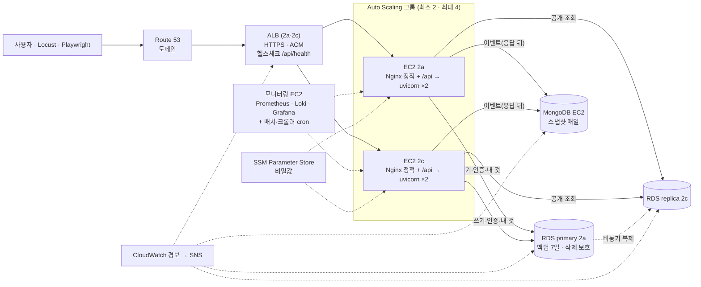

# 인프라·트래픽·안정성 검토 (타당성 조사)

> **11-05 결정:** 1차 배포·측정·시연은 AWS 대신 **팀 노트북 4대의 VM 7대**로 합니다([로컬 VM 구성](로컬_VM_구성.md)). 이 문서의 AWS 내용은 비교용 참고안입니다.

2026-11-03 · 공동 · 질문: ① HAProxy를 둬야 하나 ② Playwright 가상 사용자를 생각하면 있는 게 나은가 ③ 동시 접속자를 버티려면 ④ AWS 기능까지 쓰면 어떻게 안정적으로 만드나 ⑤ 실제 회사라면 어느 팀이 무엇을 보나 · 상태: **권장안, 결정 대기** · 방향(11-03): **먼저 지금 설계로 띄우고 재 본 뒤, 기준을 넘는 것만 더한다**(1-1절)

> **11-04 프리 티어 결정:** AWS는 프리 티어 안에서 한다. 평소는 노트북(로컬 compose), AWS는 EC2 3대(정문 Nginx+MongoDB · FastAPI #1 · FastAPI #2, Docker 없이 직접 설치) + RDS 1대를 측정·시연 때만 켜고, replica는 측정하는 날만, 모니터링은 Grafana Cloud 무료. FastAPI가 실제 2대라 라운드로빈·서버 1대 끄기는 그대로 시험한다. ALB·ASG 검토는 확장안 기준. → [AWS_프리티어_구성.md](AWS_프리티어_구성.md)

## 1. 결론

1. **HAProxy는 꼭 필요하지 않습니다.** 지금 Nginx 한 대가 가진 진짜 약점은 두 가지입니다. 첫째, 무료 Nginx는 `/health`를 미리 찔러 보는 '능동 헬스체크'를 못 합니다(요청이 실패해야 서버를 뺌). 둘째, 그 한 대가 죽으면 서비스 전체가 멈춥니다(단일 장애점). HAProxy는 첫째만 풀고, **AWS ALB는 둘 다 풀면서** HTTPS 인증서(ACM)도 무료로 붙습니다. 안정성 기준 권장은 **ALB + 앱 서버마다 Nginx(정적 파일·`/api` 떼기)**입니다. 다만 1차는 지금 설계(Nginx)에 설정 보강만 하고, ALB는 1-1절의 조건을 넘을 때 넣습니다. 수업에서 HAProxy를 꼭 써야 하면 대안 B(HAProxy EC2)도 타당합니다.
2. **Playwright는 부하를 만드는 도구가 아닙니다.** 브라우저 하나가 수백 MB를 써서 노트북 한 대로는 수십 명이 한계입니다. 그래서 로드밸런서를 고르는 기준이 되지 않습니다. 역할을 나눕니다. **Locust는 트래픽(50 → 200 → 1,000명)**, **Playwright는 실제 화면 흐름 몇 명분**(이벤트·화면 지연 확인)을 맡습니다.
3. **먼저 막힐 곳은 로드밸런서가 아니라 DB 연결 수와 EC2 CPU 크레딧입니다.**
   - RDS MariaDB `db.t4g.micro`의 기본 최대 연결 수는 약 35~40개로 추정됩니다(메모리 공식).
   - `t4g.micro`는 평소 CPU를 vCPU당 10%만 보장합니다.
   - 그래서 연결 풀 크기를 정해 두고, 1,000명 단계에서는 인스턴스를 키우거나 늘려야 합니다.
4. **AWS로 안정성을 올리는 핵심은 다섯 가지입니다.**
   - ALB(여러 가용 영역, 능동 헬스체크)
   - Auto Scaling 그룹(죽은 서버를 자동으로 바꿈, 3일차 '자동 구성'과 같은 일)
   - CloudWatch 경보 + SNS 알림
   - RDS 백업·삭제 보호·파라미터 그룹
   - SSM·Parameter Store(SSH와 `.env` 파일 돌리기를 대신함)

   이 가운데 1차에 바로 넣는 것은 RDS 백업(7일)·삭제 보호·파라미터 그룹뿐이고, 나머지는 띄워서 잰 뒤 조건을 넘을 때 넣습니다(1-1절). Multi-AZ RDS는 운영 단계로 미룹니다.

## 1-1. 단계 구분 — 1차 필수 / 띄워서 잰 뒤 추가

원칙: Auto Scaling처럼 서버 수를 바꾸는 것과 비싼 관리형 서비스는 **서비스를 띄워 실제로 재 본 뒤, 아래 '추가 조건'을 넘을 때만** 넣습니다. 1차에는 지금 설계를 유지하고, 돈이 거의 안 들거나 나중에 바꾸기 어려운 것만 넣습니다.

### 1차 필수 (띄우기 전에 넣음)

| 항목 | 내용 | 왜 지금 |
| --- | --- | --- |
| 정문 | **지금 설계 유지**: Nginx EC2 1대 → FastAPI 2대 | 이미 설계됨. 바꿀지는 재 보고 정함 |
| 정문 보강 | Nginx `proxy_next_upstream error timeout http_502 http_503`(GET만 다른 서버로 다시 보냄), `max_fails=2 fail_timeout=10s`, `proxy_connect_timeout 2s` | 수동 헬스체크의 빈틈을 설정 몇 줄로 줄임. 무료 |
| 앱 값 | 연결 풀 3+2, `--workers 2`, `--limit-concurrency 100`, 시간 제한, 목록 캐시 (5절) | 코드 처음부터 넣어야 함. 무료 |
| RDS 기본 안전 | 자동 백업 7일, 삭제 보호, 파라미터 그룹(`time_zone`, utf8mb4), 저장공간 자동 확장 | 만들 때 체크만. 무료 |
| 비밀값 | `.env`는 각 서버에만, 값은 팀이 정한 한 곳으로 나눔 | 2일차 배포에 필요 |
| 접근 | SSH 22는 내 IP/32만(지금 설계), `X-Synthetic`은 내부 키와 함께일 때만 | 무료 |
| 비용 | AWS Budgets 알림 | 무료 |
| 관측 | 지금 설계(Prometheus·Loki·Grafana) + 아래 '잴 것' 패널 | 재 보려면 먼저 있어야 함 |

### 띄운 뒤 잴 것 (Locust 동시 50명 = 합격 판정, 200명 = 한계 찾기 · 11-05 A7 확정)

판정은 Locust 쪽 p95(Nginx 포함, 사용자가 느끼는 시간)로 하고, Prometheus 서버 쪽 숫자는 원인 찾기에 씁니다. 단계마다 10분, 첫 1분은 데우는 시간이라 뺍니다. 불합격이어도 5일 안에 서버를 늘리지 않고, 원인과 아래 '넣는 조건'을 발표에서 보여 줍니다.

| 잴 것 | 어디서 | 기준(합격선, 11-05 확정) |
| --- | --- | --- |
| 조회·예약 p95, 오류율 | Locust(판정), Prometheus `http_request_duration_seconds`(원인) | 조회 300ms·예약 500ms·오류 1% 미만. 오류 = 5xx·연결 실패·시간 초과(시나리오가 일부러 만드는 409·401·400은 뺌) |
| 로그인·가입 p95 | 같음 | 800ms 미만(bcrypt가 일부러 느려 조회와 따로 잼) |
| 서버 1대 끄기(FastAPI #2 중지) | Locust | 끈 뒤 1분 오류율 1% 미만, 중복 예약 0. MongoDB 끄기는 예약 성공률 그대로 |
| FastAPI CPU, `CPUCreditBalance` | CloudWatch(기본 지표, 무료) | CPU 70% 미만, 크레딧이 계속 줄지 않음 |
| RDS 연결 수·CPU, `ReplicaLag` | CloudWatch | 연결 28개(약 80%) 미만, CPU 70% 미만, 지연 5초 미만 |
| 서버 1대 끄기 시험 | Locust 도는 중 FastAPI #2 중지 | 실패 요청 1% 미만, 1분 안에 정상 |
| 같은 칸 50명 | `SameSlotRush` | 201 정확히 1건 |

### 나중에 추가 (조건을 넘을 때만)

| 추가할 것 | 넣는 조건 | 비용·수고 |
| --- | --- | --- |
| ALB(또는 HAProxy)로 정문 교체 | 서버 1대 끄기 시험에서 실패 1% 이상, 또는 HTTPS를 도메인으로 붙이기로 할 때, 또는 정문 EC2 장애 | ALB 월 약 +$10 순증, 설정 반나절 |
| Auto Scaling 그룹(+ 시작 템플릿) | 목표 인원에서 CPU 70% 이상이 10분 넘게, 또는 p95 기준 초과가 CPU 때문일 때 | 무료(인스턴스 요금만). cron을 모니터링 EC2로 옮겨야 함 |
| 인스턴스 크기 올리기 | `CPUCreditBalance`가 시험 내내 줄어듦 | 시간 단위 요금 |
| RDS 크기 올리기 | 연결 수 80% 이상 또는 CPU 70% 이상 | 인스턴스 요금 약 2배 |
| replica 추가 | replica CPU 70% 이상 또는 조회 p95만 기준 초과 | replica 1대 요금 |
| RDS Multi-AZ | 운영 단계(실사용자)로 넘어갈 때 | 인스턴스 요금 약 2배 |
| CloudWatch 경보 세트 → SNS | 서비스를 하루 넘게 켜 둘 때 | 10개까지 무료 |
| SSM Session Manager·Parameter Store | 서버가 3대를 넘거나 Auto Scaling을 넣을 때 | 무료(표준) |
| 요청 제한(Nginx `limit_req`/WAF) | 공인 주소를 시연 밖에서도 열어 둘 때, 로그인 실패가 몰릴 때 | `limit_req` 무료, WAF 월 약 $5~ |
| MongoDB 스냅샷 자동화(DLM) | 이벤트 데이터를 시연 뒤에도 남길 때 | 스냅샷 저장 요금 |
| Locust EC2 | 1,000명 시험 때만 | 시험 시간만 |

## 2. 지금 구성과 부하 가정

```
사용자 ─▶ Nginx EC2 1대 (정적 + /api 라운드로빈, 수동 헬스체크) ─▶ FastAPI EC2 2대 (t4g.micro)
                                                               ├─▶ RDS primary (db.t4g.micro) / replica 1대
                                                               └─▶ MongoDB EC2 (t4g.small)
```

| 단계 | 동시 사용자 | 생각 시간(평균 3초) | API 요청/초 | 근거 |
| --- | --- | --- | --- | --- |
| MVP | 50 | 1~5초 | 약 17 | `simulator/locust/README.md` |
| 2단계 | 200 | 1~5초 | 약 67 | 같음 |
| 3단계 | 1,000 | 1~5초 | 약 333 | 같음 |

여기에 '같은 칸 50명 동시 결제'(순간 50건)가 따로 있습니다. 정적 파일(빌드 약 0.9MB)은 처음 들어온 사용자에게만 한 번 내려갑니다.

## 3. HAProxy를 둬야 하나 — 정문 비교

| 기준 | C. 지금 (Nginx 단독) | B. HAProxy EC2 | **A. ALB + 앱 서버별 Nginx (권장)** |
| --- | --- | --- | --- |
| 서버 헬스체크 | 수동만(`max_fails`: 실패한 요청으로 판단). `/health`의 503을 미리 보지 못함 | 능동(`option httpchk GET /health`) | 능동(대상 그룹 헬스체크 `/api/health`) |
| 단일 장애점 | 있음(EC2 1대) | 있음(EC2 1대) | 없음(ALB는 두 가용 영역에 걸친 관리형) |
| 과부하 때 | 백엔드로 그대로 넘김 | 서버별 `maxconn` + 대기열로 넘치는 요청을 줄 세움 | 대상이 느리면 504. 대신 Auto Scaling으로 늘림 |
| HTTPS | 도메인 + Let's Encrypt 직접 | 같음 | ACM 인증서 무료·자동 갱신(도메인 필요) |
| 지표 | nginx exporter | 내장 통계 페이지·Prometheus 지표 | CloudWatch(Grafana에 CloudWatch 데이터 소스로 연결) |
| 정적 파일 | Nginx가 냄 | HAProxy는 못 냄 → Nginx 하나 더 필요 | 앱 서버마다 Nginx가 냄(같은 `dist/`) |
| `/api` 떼기 | Nginx | Nginx 또는 HAProxy | 앱 서버의 Nginx(지금 설정 재사용). ALB도 2025-10부터 경로 바꾸기 지원 |
| 월 비용(1인, 대략) | Nginx EC2 + 공인 IP 약 $11 | 비슷 | ALB 약 $20 + 사용량. Nginx EC2·공인 IP가 빠져 순증 약 $10 |
| 수업 연계 | — | HAProxy 실습 내용과 같음 | AWS 관리형 서비스 실습 |

- **판단:** 안정성이 기준이면 A입니다. 장애점이 없고, 서버 상태를 미리 확인하고, 3일차 Auto Scaling과 바로 이어지기 때문입니다. B는 '과부하 때 줄 세우기'와 '수업 연계'가 장점이지만 한 대짜리라 A의 대안입니다. C는 헬스체크가 수동뿐이라 `산출물_02`에 적힌 "`/health` 실패한 서버는 뺌"이 실제로는 동작하지 않습니다(문구를 고쳤습니다).
- **DB 쪽 HAProxy:** RDS MariaDB에는 Aurora 같은 '읽기 묶음 주소(reader endpoint)'가 없습니다. replica마다 주소가 따로 있습니다. replica를 2대 이상 두면 HAProxy(TCP)로 묶을 수 있지만 장애점이 하나 늘어납니다. 우리는 replica 1대이고 앱이 이미 'replica 실패 → primary'로 대체하므로 **필요 없습니다.** 2대가 되면 앱에서 두 주소를 번갈아 쓰는 쪽이 단순합니다.

## 4. Playwright 가상 사용자를 생각하면?

| 도구 | 하는 일 | 한 대로 낼 수 있는 양 | 우리 쓰임 |
| --- | --- | --- | --- |
| Locust | HTTP 요청만, 화면 없음 | 노트북 수백 명, EC2 한 대 1,000명 이상 | 동시 50·200·1,000명, 같은 칸 50명 |
| Playwright | 진짜 브라우저로 화면 흐름 | 브라우저 하나에 수백 MB → 노트북에서 수십 명 | 부하 중에 실제 사용자 2~5명분 흐름(검색 → 칸 → 결제 → 후기)을 돌려 화면 지연·오류·프론트 이벤트(`X-Session-Id` 포함) 확인 |

- Playwright 트래픽도 가상 데이터로 표시합니다(`extraHTTPHeaders`로 `X-Synthetic`과 내부 키).
- 1,000명 단계 Locust는 노트북 회선이 먼저 막히므로, 같은 VPC의 Locust EC2(예: c7g.large, 테스트 동안만 켬)에서 ALB로 보냅니다.
- 결론: Playwright는 로드밸런서 선택에 영향을 주지 않습니다. **정문이 필요한 이유는 앱 서버가 2대 이상이기 때문입니다.**

## 5. 동시 접속 용량 (추정 → Locust로 실측해 고침)

가정: API 요청 하나에 파이썬 CPU 10~20ms(SQLAlchemy·JSON), DB 쿼리 수 ms. **추정값이라 Locust 결과로 이 표를 고칩니다.**

| 자원 | 한계 | 50명 | 200명 | 1,000명 |
| --- | --- | --- | --- | --- |
| FastAPI CPU (t4g.micro 2대) | 평소 보장 vCPU당 10%(2대 합쳐 0.4 vCPU ≈ 20~40 req/s), 크레딧으로 순간 2 vCPU까지. 기본이 '무제한 모드'라 넘게 쓰면 요금이 붙음 | 여유 | 크레딧으로 버팀, `CPUCreditBalance` 감시 | **부족**: t4g.medium 이상 또는 c7g 3~4대로 Auto Scaling |
| primary 연결 수 (db.t4g.micro) | 기본 `max_connections` ≈ 메모리 ÷ 25,165,760 → 약 35~40 (실제 값은 `SELECT @@max_connections`) | 풀 규칙 지키면 여유 | 같음 | db.t4g.small 이상(약 80) |
| replica | primary와 같은 한계, 공개 조회만 | 여유 | 여유 | 실측 후 1대 추가 또는 크기 올림 |
| MongoDB (t4g.small) | 응답 뒤 쓰기라 사용자 지연에는 영향 없음 | 여유 | 여유 | `mongo_event_write_failures_total` 감시 |
| 정문 | ALB는 자동 확장. Nginx·HAProxy EC2는 연결 수천 개 | 여유 | 여유 | ALB 여유 / EC2 정문은 크기 확인 |

### 앱이 지킬 값 (권장, `backend/AGENTS.md`에 반영)

| 항목 | 값 | 이유 |
| --- | --- | --- |
| uvicorn 프로세스 | 서버당 `--workers 2` | t4g.micro 메모리 1GB에 맞춤 |
| 연결 풀 (프로세스마다, 엔진마다) | `pool_size=3`, `max_overflow=2`, `pool_timeout=3` | 2대 × 2프로세스 × 5 = primary 20개. cron·크롤러·exporter·관리용을 더해도 35 아래 |
| 풀 대기 초과 | `SERVICE_UNAVAILABLE`(503, 잠시 후 다시) | 무한 대기보다 빨리 실패하는 게 낫다 |
| 동시 요청 상한 | `--limit-concurrency 100`(서버당) | 넘치면 503으로 끊어 서버가 같이 죽지 않게 |
| 시간 제한 | DB 쿼리 5초, Nginx·ALB 대상 30초, 헬스체크 0.5초 | 느린 요청이 연결을 붙잡지 않게 |
| 캐시 | 유형·지역·시설 목록은 프로세스 메모리에 5분 | 거의 안 바뀌는데 매 화면 부름 |
| 정적 파일 | `assets/*`는 `Cache-Control: max-age=31536000, immutable`, `index.html`은 캐시 안 함 | 같은 사용자가 다시 받지 않게 |

### 결제 버튼을 두 번 누를 때 (새로 찾은 위험)

결제 요청이 성공했는데 응답이 늦게 와서 다시 누르거나 브라우저가 재시도하면, 두 번째 요청은 **자기 칸과 부딪혀** 409 "다른 분이 먼저 결제한 시간이 있어요"를 받습니다. 중복 예약은 생기지 않지만 사용자는 실패로 압니다. 권장안은 두 가지입니다.

- 409에서 겹친 칸이 **같은 사용자 예약이면** `detail.mine = true`와 `reservation_id`를 같이 줍니다. 프론트는 "이미 예약됐어요"로 내 예약에 보냅니다.
- 프론트는 결제 버튼을 응답이 올 때까지 막습니다. 지금 `BaseButton loading`이 이미 이렇게 동작합니다.

## 6. AWS 안정성 검토 (서비스별)

| 영역 | 지금 | 1차 권장 (3일, 비용 적게) | 운영이라면 |
| --- | --- | --- | --- |
| 정문 | Nginx EC2 1대 | **ALB**(2a·2c), 대상 그룹 헬스체크 `/api/health`(정상 2회·비정상 2회, 10초), 앱 서버마다 Nginx | + WAF(속도 제한 규칙), ALB 접근 로그 → S3 |
| HTTPS·도메인 | 미정(평문) | Route 53 도메인 1개 + ACM 인증서를 ALB에 붙임, 80 → 443 넘김 | 같음 + HSTS |
| 앱 서버 | EC2 2대 손으로 | **시작 템플릿 + Auto Scaling 그룹**(최소 2·최대 4, 2a·2c), 사용자 데이터로 설치·배포 = 3일차 자동 구성 | 대상 추적 정책(CPU 50%), 인스턴스 새로고침으로 무중단 배포 |
| 인스턴스 크기 | t4g.micro | 부하 시험 동안만 t4g.small, `CPUCreditBalance` 경보 | c7g/m7g(크레딧 없음) |
| cron 한 대만 | FastAPI #1 고정 | ASG 안에서는 '#1'이 바뀔 수 있음 → 완료 배치·크롤러는 **모니터링 EC2에서** 돌리거나 DB 잠금(`GET_LOCK`)으로 한 대만 | EventBridge Scheduler + 작업 전용 |
| RDS primary | db.t4g.micro, Single-AZ | 연결 풀 규칙 지킴, **자동 백업 7일(시점 복구)·삭제 보호·파라미터 그룹**(`time_zone=Asia/Seoul`, utf8mb4), 저장공간 자동 확장 | **Multi-AZ**(자동 장애 조치 1~2분), db.t4g.small 이상 |
| RDS replica | 1대 | 복제 지연 경보(`ReplicaLag` > 5초). primary 장애 때 **replica 수동 승격 절차**를 런북에 | Multi-AZ와 함께, 필요하면 replica 추가 |
| MongoDB | EC2 1대 | EBS gp3 + **Data Lifecycle Manager 하루 스냅샷 7개**, EC2 상태 검사 실패 시 자동 복구 경보 | 복제 세트 3대 또는 관리형(DocumentDB/Atlas) |
| 모니터링 | Prometheus·Loki·Grafana EC2 | + **CloudWatch 경보 → SNS 이메일**: ALB 5xx·비정상 대상, RDS CPU·연결 수·남은 저장공간·복제 지연, EC2 상태 검사·CPU 크레딧, Budgets | 온콜 알림(Slack 등) |
| 접속·비밀값 | SSH 22 + `.env` 파일 | **SSM Session Manager**(22 닫음), EC2에 **IAM 역할**(접근 키 안 둠), 비밀값은 **SSM Parameter Store SecureString**(표준 무료) → 사용자 데이터가 읽어 `.env` 생성 | Secrets Manager 자동 교체 |
| 네트워크 | 보안 그룹 5개 | sg-web을 ALB 보안 그룹으로, sg-app 80은 ALB에서만 | VPC 흐름 로그 |
| 비용 | Budgets 알림 | 같음 + 끄는 순서 스크립트(ASG 0 → RDS 중지 → replica 삭제) | 예약 인스턴스·Savings Plans |
| 감사 | — | CloudTrail(기본 90일 이벤트 기록) 확인 | 추적 → S3 보관 |

**1차 권장안 비용 변화 (1인, 24시간, 대략, 계산기로 다시 확인):** ALB +약 $20, Nginx EC2·공인 IP −약 $11, Route 53 도메인 연 $3~15, CloudWatch 경보 10개까지 무료, Parameter Store 표준 무료, 부하 시험 동안 t4g.small·Locust EC2 시간 단위. **월 순증 약 $10.** Multi-AZ는 RDS 인스턴스 요금이 두 배라 운영 단계로 미룹니다.

### 권장 구성 (A안)



## 7. 실제 회사에서 사이트를 배포할 때 관여하는 팀과 각 팀의 검토

| 팀 | 출시 전에 보는 것 | 우리 상태 | 빈 곳 | 할 일 |
| --- | --- | --- | --- | --- |
| 기획·PO | 출시 범위, 성공 지표, 출시 판정 기준 | 요구사항 F-ID·NFR 있음 | 성공 지표·합격선 숫자(p95 등) 없음 | NFR-05 목표 숫자 확정 |
| 디자인·UX | 화면, 접근성, 문구 | UI 패턴·UX 법칙·axe 검사 | 개편 후 화면 미구현 | 프론트 변경 목록 |
| 프론트엔드 | 브라우저·반응형, 오류 처리, 성능 | 테스트 체계 있음 | 11-03 흐름 미반영, `client.js` 오류·세션 헤더 | 프론트 변경 목록 |
| 백엔드 | API 계약, 트랜잭션, 성능 | A·B 문서, 오류 코드 표 | 코드 시작 전, 이중 결제 클릭 처리 | 5절 권장 반영 |
| QA | 테스트 계획, 회귀, 부하·성능, 출시 판정 | 단위·E2E·동시성 테스트 계획 | 부하 시험 합격선, 출시 체크리스트 | Locust 합격선 + 출시 체크리스트 한 장 |
| DBA·데이터 엔지니어 | 스키마, 인덱스, 백업·복구, 연결 수, 마이그레이션 | DB 명세·DDL·정규화 | DDL 실행 검증 전, 복구 연습 없음, 연결 수 계획 | 연결 풀 규칙(5절), 백업에서 복구 한 번 해 보기 |
| 인프라·DevOps(플랫폼) | 네트워크, IaC, 배포 파이프라인, 비밀값 | 네트워크·보안 그룹 설계 | 손으로 만듦, CI/CD 없음, 비밀값 배포 방법 | 시작 템플릿·사용자 데이터, Parameter Store, GitHub Actions |
| SRE·운영(온콜) | 가용성 목표, 알림, 런북, 장애 대응 | Prometheus·Loki·Grafana | 경보·런북·승격 절차 없음 | CloudWatch 경보 10개, 런북 한 장 |
| 정보보안 | 취약점, 인증, 전송 암호화, 공격 차단, 권한 | JWT·bcrypt·보안 그룹 | HTTPS·요청 제한·SSH 개방·의존성 점검 | ACM·WAF 또는 `limit_req`·SSM·`pip-audit`/`npm audit`·`ecc-security-review` 점검 |
| 개인정보보호(CPO) | 수집 항목·동의·보관·파기, 처리방침 | 이벤트에 개인정보 없음, 로그 규칙 | 필수 동의 기록, 처리방침 화면, 탈퇴 회원 파기 시점 | 결정 목록 |
| 법무 | 약관, 크롤링 저작권·DB권, 상표 | 크롤링 사이트 조사(보류) | 약관 최종 확인, 서비스명 | 발표 전 확인 |
| 재무·FinOps | 예산, 비용 경보, 끄기 | Budgets, 1인 약 $116 | 4명 합계 월 약 $460(켜 두면)·부하 시험 비용 | 끄는 순서 스크립트, 시험 날짜만 켜기 |
| 데이터·분석 | 이벤트 설계, 지표 정의, 대시보드 | 이벤트 12종·세션 묶음·이탈 정의 | 대시보드 미구현 | A 대시보드 |
| CS·운영 | 문의 창구, 장애 공지, FAQ | 없음(수업 범위 밖) | 장애 공지 화면 | `SERVICE_UNAVAILABLE` 전체 안내(오류 코드 표에 있음) |
| 릴리스·변경 관리(CAB) | 배포 승인, 일정, 되돌리기 계획 | 없음 | 배포·롤백 절차 | 런북에 '배포 → 확인 → 되돌리기' |

## 8. 바뀐 문서

- `산출물_02` 1절: Nginx 헬스체크 문구 정정, 권장안 링크.
- `backend/AGENTS.md`: 연결 풀·프로세스·시간 제한 값.
- `infra/aws/README.md`: 안정성 체크리스트.
- `infra/nginx/README.md`: A안(앱 서버별 Nginx)·B안(HAProxy) 설정 위치.
- `simulator/README.md`·`locust/README.md`: Locust·Playwright 역할.
- `docs/오류코드.md`: 풀 대기 초과는 503, 409의 `detail.mine`(11-03 A4 확정).
- `STATE.md`: 한 번에 검토할 목록.

## 9. 한계

- 처리량 숫자는 가정에서 나온 추정입니다. Locust로 replica 있음·없음과 함께 재고 이 문서를 고칩니다.
- AWS 요금은 서울 리전 공개 요금을 다시 확인하지 않은 대략값입니다. 배포 전에 요금 계산기로 확인합니다.
- `max_connections`는 공식으로 추정한 값입니다. 만든 뒤 `SELECT @@max_connections;`로 확인합니다.

## 10. 출처

- AWS, [Application Load Balancer URL·Host 헤더 바꾸기 출시 (2025-10)](https://aws.amazon.com/about-aws/whats-new/2025/10/application-load-balancer-url-header-rewrite/)
- AWS 문서, [버스트 가능 인스턴스 기준 성능·무제한 모드](https://docs.aws.amazon.com/AWSEC2/latest/UserGuide/burstable-performance-instances-unlimited-mode-concepts.html)
- AWS re:Post, [RDS MySQL·MariaDB 기본 max_connections 차이](https://repost.aws/ko/questions/QUb0eVsMLySaWLvFj2SKfUFg/why-does-default-max-connections-differ-in-the-default-parameter-groups-for-rds-mysql-and-rds-mariadb)
- 읽기 replica는 replica마다 주소가 따로 있고 묶음 주소는 Aurora 기능: AWS CDK `CfnDBCluster` 읽기 엔드포인트 설명, [RDS read replica 정리](https://oneuptime.com/blog/post/2026-02-12-create-rds-read-replicas-read-scaling/view)
