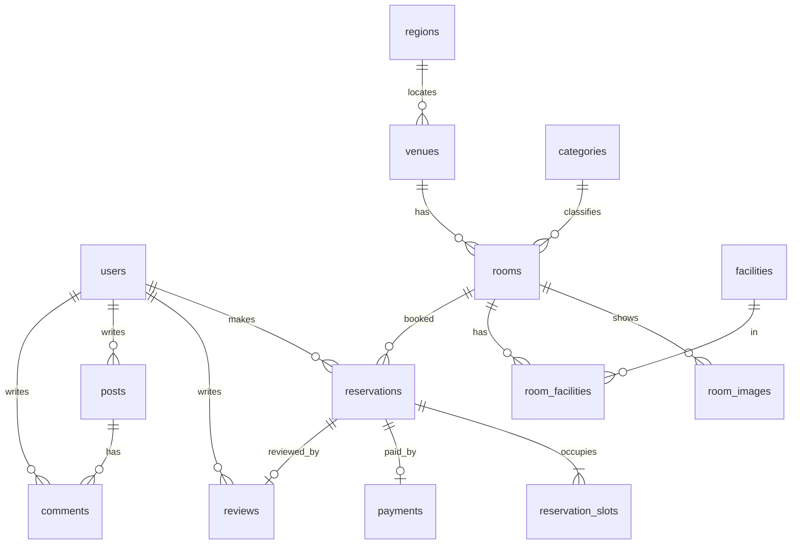

# 공간대여 예약 시스템 — DB 정규화 초안

2026-10-30 · 작성 노진산 · DBMS: MariaDB (InnoDB, utf8mb4)

예약 전표 한 장에 모든 정보가 들어 있는 비정규형에서 시작해 1NF → 2NF → 3NF → BCNF로 쪼개면 테이블 15개가 나옵니다. 정규화를 일부러 어긴 곳은 세 군데이고, 이유는 [의도한 예외](#의도한-예외)에 적었습니다. 기능 ID(F-xx)는 `공간대여_01_기능정의.md`를 따릅니다.

## 0. 출발점: 비정규형 예약 전표

화면에 보이는 예약 한 건을 그대로 한 줄에 담으면 이렇게 됩니다.

| 예약번호 | 회원이메일 | 회원이름 | 회원휴대폰 | 공간명 | 시도 | 시군구 | 룸이름 | 유형 | 시간당가격 | 시설 | 예약일 | 이용시간 | 인원 | 결제금액 | 결제수단 | 결제일시 | 별점 | 후기 |
| --- | --- | --- | --- | --- | --- | --- | --- | --- | --- | --- | --- | --- | --- | --- | --- | --- | --- | --- |
| R1 | kim@ex.com | 김스터디 | 010-0000-0000 | 스터디큐브 관악점 | 서울 | 관악구 | 201호 | 스터디룸 | 10,000 | 화이트보드, TV, WiFi | 10-30 | 13, 14 | 4 | 20,000 | 모의결제 | 10-29 15:02 | 5 | 좋았어요 |

문제:

- **반복 그룹:** `시설`과 `이용시간` 칸에 값이 여러 개 들어 있어, 특정 칸이 예약됐는지 DB가 비교할 수 없습니다. 그래서 중복 예약을 DB 제약으로 막을 수 없습니다.
- **갱신 이상:** 회원이 휴대폰 번호를 바꾸면 그 회원의 모든 예약 줄을 고쳐야 합니다.
- **삽입 이상:** 아직 예약이 없는 룸이나 회원은 저장할 곳이 없습니다.
- **삭제 이상:** 예약을 지우면 룸 가격과 공간 정보까지 사라질 수 있습니다.

## 1. 1NF: 모든 칸에 값 하나

여러 값이 든 칸을 행으로 펼칩니다.

- `이용시간 13, 14` → 시간마다 한 행. 이 표의 기본키는 **(예약번호, 이용시간)** 이 됩니다.
- `시설 화이트보드, TV, WiFi` → 룸과 시설의 짝으로 따로 뺍니다. 시설은 예약이 아니라 룸에 딸린 값이기 때문입니다.

**예약_시간 (1NF)** — PK (예약번호, 이용시간)

| 예약번호 | 이용시간 | 회원이메일 | 회원이름 | 공간명 | 시도 | 시군구 | 룸이름 | 유형 | 시간당가격 | 예약일 | 인원 | 결제금액 | 결제수단 | 별점 | … |
| --- | --- | --- | --- | --- | --- | --- | --- | --- | --- | --- | --- | --- | --- | --- | --- |
| R1 | 13 | kim@ex.com | 김스터디 | 스터디큐브 관악점 | 서울 | 관악구 | 201호 | 스터디룸 | 10,000 | 10-30 | 4 | 20,000 | 모의결제 | 5 | … |
| R1 | 14 | kim@ex.com | 김스터디 | 스터디큐브 관악점 | 서울 | 관악구 | 201호 | 스터디룸 | 10,000 | 10-30 | 4 | 20,000 | 모의결제 | 5 | … |

**룸_시설 (1NF)** — PK (룸, 시설): (201호, 화이트보드), (201호, TV), (201호, WiFi)

값 하나짜리 칸은 됐지만, 예약 정보가 이용 시간 수만큼 복제됩니다.

## 2. 2NF: 키의 일부에만 기대는 칸 분리

예약_시간의 키는 (예약번호, 이용시간)인데, `이용시간`을 뺀 거의 모든 칸이 `예약번호` 하나로 정해집니다(부분 함수 종속).

```
예약번호 → 회원이메일, 회원이름, 룸이름, 예약일, 인원, 결제금액, 결제수단, 별점, …
(예약번호, 이용시간) → (추가로 정해지는 칸 없음)
```

그래서 둘로 나눕니다.

- **예약** — PK 예약번호: 예약 한 건의 정보
- **예약_칸** — PK (예약번호, 이용시간): 예약이 차지한 칸 목록

룸_시설도 같은 원리로 `시설명`이 `시설` 하나에만 기대므로 **시설** 표를 따로 둡니다.

## 3. 3NF: 키가 아닌 칸을 거쳐 정해지는 칸 분리

예약 표 안에는 키가 아닌 칸을 거쳐서 정해지는 칸(이행 함수 종속)이 남아 있습니다.

| 종속 경로 | 떼어 낼 표 |
| --- | --- |
| 예약번호 → 회원이메일 → 회원이름, 휴대폰 | **회원** |
| 예약번호 → 룸 → 룸이름, 시간당가격, 인원 범위 | **룸** |
| 룸 → 공간 → 공간명, 설명, 홍보 문구, 영업시간 | **공간** |
| 공간 → 시군구 → 시도 | **지역** |
| 룸 → 유형 → 유형명 | **유형** |
| 예약번호 → 결제 → 결제수단, 결제일시, 결제 상태 | **결제** |
| 예약번호 → 후기 → 별점, 내용 | **후기** |

`결제금액`은 예약 표에 남깁니다. 시간당가격 × 칸 수로 계산할 수 있어 보이지만, 가격은 나중에 바뀝니다. 예약 시점에 확정된 금액은 그 자체로 사실이라 이행 종속이 아닙니다.

## 4. BCNF: 예약_칸의 중복 차단 키

중복 예약을 DB가 막으려면 칸 표에 **(룸, 날짜, 시간)** 유니크 키가 있어야 합니다. 그래서 예약_칸에 룸과 날짜를 함께 둡니다.

```
reservation_slots(reservation_id, room_id, slot_date, slot_hour)
후보키 1: (room_id, slot_date, slot_hour)      ← 같은 칸 두 번 예약 금지
후보키 2: (reservation_id, slot_hour)
reservation_id → room_id, slot_date            ← 결정자가 슈퍼키가 아님
```

`room_id`, `slot_date`는 후보키 1의 일부라 3NF는 만족하지만, `reservation_id`가 슈퍼키가 아닌데 이 둘을 결정하므로 BCNF는 깨집니다. 여기서 BCNF로 더 쪼개면 (룸, 날짜, 시간) 유니크 키를 걸 표가 없어져 중복 차단을 DB가 못 합니다.

**결정:** BCNF 대신 3NF에서 멈추고, 어긋남을 복합 외래키로 막습니다. `reservations`에 UNIQUE (reservation_id, room_id, reserve_date)를 두고, `reservation_slots`의 (reservation_id, room_id, slot_date)가 이를 참조하게 합니다. 그러면 칸의 룸·날짜가 예약과 다를 수 없습니다.

## 5. 최종 테이블 (15개)

| 표 | 역할 | 기본키 | 주요 외래키·제약 | 기능 |
| --- | --- | --- | --- | --- |
| users | 회원 | user_id | UNIQUE email | F-01~04 |
| categories | 유형 5개 | category_id | UNIQUE code | F-10 |
| regions | 시도·시군구 | region_id | UNIQUE (sido, sigungu) | F-11 |
| venues | 공간(지점) | venue_id | region_id, UNIQUE (source_site, source_id) | F-20, F-61 |
| rooms | 예약 단위 룸 | room_id | venue_id, category_id | F-20 |
| room_images | 룸 이미지 | image_id | room_id | F-20 |
| facilities | 시설 목록 | facility_id | UNIQUE name | F-20 |
| room_facilities | 룸–시설 | (room_id, facility_id) | 두 외래키 | F-20 |
| reservations | 예약 | reservation_id | user_id, room_id, UNIQUE (reservation_id, room_id, reserve_date) | F-30~34 |
| reservation_slots | 예약이 차지한 칸 | (room_id, slot_date, slot_hour) | (reservation_id, room_id, slot_date) → reservations | F-32 |
| payments | 모의 결제 | payment_id | UNIQUE reservation_id | F-31 |
| reviews | 후기 | review_id | UNIQUE reservation_id, user_id | F-50~51 |
| posts | 게시글 | post_id | user_id | F-52~53 |
| comments | 댓글 | comment_id | post_id, user_id | F-52 |
| user_events | 활동 로그 | event_id | (외래키 없음, 아래 예외) | F-60 |

크롤링 실행 기록 `crawl_jobs`는 운영 표라 위 정규화 대상에서 뺐습니다(16번째 표로 추가).

## 6. ERD



## 7. 의도한 예외

| 위치 | 정규형 | 이유 | 어긋남을 막는 방법 |
| --- | --- | --- | --- |
| reservation_slots의 room_id, slot_date | 3NF (BCNF 아님) | (룸, 날짜, 시간) 유니크 키로 중복 예약을 DB가 거절하게 하려고 | 복합 외래키로 예약과 일치 강제 |
| reservations.total_price | 3NF 유지 | 예약 당시 금액은 이후 가격 변경과 무관한 사실 | 예약 생성 때 한 번만 기록 |
| user_events.payload (JSON), 외래키 없음 | 1NF 아님 | 대량 append 전용 로그. 외래키 검사를 빼서 쓰기 속도를 지키고, 이벤트 종류마다 다른 속성은 JSON에 담음 | 분석 때 user_id·room_id로 조인. 원본 테이블이 바뀌어도 로그는 그대로 둠 |

후기의 room_id는 예약을 거치면 알 수 있어(reviews → reservations → rooms) 넣지 않았습니다. 룸별 후기 조회가 느려지면 그때 비정규화를 검토합니다.

## 8. 물리 스키마 초안 (MariaDB)

```sql
CREATE TABLE users (
  user_id       BIGINT AUTO_INCREMENT PRIMARY KEY,
  email         VARCHAR(255) NOT NULL UNIQUE,
  password_hash VARCHAR(255) NOT NULL,
  name          VARCHAR(50)  NOT NULL,
  phone         VARCHAR(20),
  role          ENUM('user','admin') NOT NULL DEFAULT 'user',
  is_synthetic  BOOLEAN NOT NULL DEFAULT FALSE,
  created_at    DATETIME NOT NULL DEFAULT CURRENT_TIMESTAMP,
  updated_at    DATETIME NOT NULL DEFAULT CURRENT_TIMESTAMP ON UPDATE CURRENT_TIMESTAMP,
  deleted_at    DATETIME NULL
);

CREATE TABLE categories (
  category_id SMALLINT AUTO_INCREMENT PRIMARY KEY,
  code        VARCHAR(20) NOT NULL UNIQUE,   -- studyroom, studio, cafe, cinema, partyroom
  name        VARCHAR(20) NOT NULL
);

CREATE TABLE regions (
  region_id INT AUTO_INCREMENT PRIMARY KEY,
  sido      VARCHAR(20) NOT NULL,
  sigungu   VARCHAR(30) NOT NULL,
  UNIQUE KEY uq_region (sido, sigungu)
);

CREATE TABLE venues (
  venue_id    BIGINT AUTO_INCREMENT PRIMARY KEY,
  region_id   INT NOT NULL,
  name        VARCHAR(100) NOT NULL,
  description TEXT,
  promo_text  VARCHAR(200),
  open_hour   TINYINT NOT NULL DEFAULT 9,
  close_hour  TINYINT NOT NULL DEFAULT 23,
  new_until   DATE NULL,                       -- NEW 배지 끝나는 날
  source_site VARCHAR(30) NULL,                -- spacecloud, synthetic
  source_id   VARCHAR(50) NULL,
  is_active   BOOLEAN NOT NULL DEFAULT TRUE,
  created_at  DATETIME NOT NULL DEFAULT CURRENT_TIMESTAMP,
  UNIQUE KEY uq_source (source_site, source_id),
  FOREIGN KEY (region_id) REFERENCES regions(region_id)
);

CREATE TABLE rooms (
  room_id        BIGINT AUTO_INCREMENT PRIMARY KEY,
  venue_id       BIGINT NOT NULL,
  category_id    SMALLINT NOT NULL,
  name           VARCHAR(100) NOT NULL,
  capacity_min   SMALLINT NOT NULL DEFAULT 1,
  capacity_max   SMALLINT NOT NULL,
  price_per_hour INT NOT NULL,
  min_hours      TINYINT NOT NULL DEFAULT 1,
  description    TEXT,
  is_active      BOOLEAN NOT NULL DEFAULT TRUE,
  FOREIGN KEY (venue_id) REFERENCES venues(venue_id),
  FOREIGN KEY (category_id) REFERENCES categories(category_id),
  KEY ix_rooms_category (category_id, is_active)
);

CREATE TABLE room_images (
  image_id   BIGINT AUTO_INCREMENT PRIMARY KEY,
  room_id    BIGINT NOT NULL,
  url        VARCHAR(500) NOT NULL,            -- 일러스트 종류·색 (예: art:booth-1) 또는 실사 사진 URL
  sort_order TINYINT NOT NULL DEFAULT 0,
  FOREIGN KEY (room_id) REFERENCES rooms(room_id)
);

CREATE TABLE facilities (
  facility_id SMALLINT AUTO_INCREMENT PRIMARY KEY,
  name        VARCHAR(30) NOT NULL UNIQUE
);

CREATE TABLE room_facilities (
  room_id     BIGINT NOT NULL,
  facility_id SMALLINT NOT NULL,
  PRIMARY KEY (room_id, facility_id),
  FOREIGN KEY (room_id) REFERENCES rooms(room_id),
  FOREIGN KEY (facility_id) REFERENCES facilities(facility_id)
);

CREATE TABLE reservations (
  reservation_id BIGINT AUTO_INCREMENT PRIMARY KEY,
  user_id        BIGINT NOT NULL,
  room_id        BIGINT NOT NULL,
  reserve_date   DATE NOT NULL,
  start_hour     TINYINT NOT NULL,
  end_hour       TINYINT NOT NULL,             -- 끝 시각(미포함). 13~15시면 13, 15
  headcount      SMALLINT NOT NULL,
  total_price    INT NOT NULL,
  status         ENUM('pending','confirmed','completed','cancelled','expired') NOT NULL DEFAULT 'pending',
  expires_at     DATETIME NULL,                -- pending 만료 시각
  is_synthetic   BOOLEAN NOT NULL DEFAULT FALSE,
  created_at     DATETIME NOT NULL DEFAULT CURRENT_TIMESTAMP,
  UNIQUE KEY uq_resv_room_date (reservation_id, room_id, reserve_date),
  KEY ix_resv_user (user_id, status, reserve_date),
  KEY ix_resv_room_date (room_id, reserve_date),
  CHECK (end_hour > start_hour AND end_hour - start_hour <= 4),
  FOREIGN KEY (user_id) REFERENCES users(user_id),
  FOREIGN KEY (room_id) REFERENCES rooms(room_id)
);

CREATE TABLE reservation_slots (
  room_id        BIGINT NOT NULL,
  slot_date      DATE NOT NULL,
  slot_hour      TINYINT NOT NULL,
  reservation_id BIGINT NOT NULL,
  PRIMARY KEY (room_id, slot_date, slot_hour),          -- 같은 칸 두 번 예약 금지
  UNIQUE KEY uq_slot_resv (reservation_id, slot_hour),
  FOREIGN KEY (reservation_id, room_id, slot_date)
    REFERENCES reservations(reservation_id, room_id, reserve_date) ON DELETE CASCADE
);

CREATE TABLE payments (
  payment_id     BIGINT AUTO_INCREMENT PRIMARY KEY,
  reservation_id BIGINT NOT NULL UNIQUE,
  amount         INT NOT NULL,
  method         VARCHAR(20) NOT NULL DEFAULT 'mock',
  status         ENUM('paid','refunded') NOT NULL,
  paid_at        DATETIME NOT NULL DEFAULT CURRENT_TIMESTAMP,
  refunded_at    DATETIME NULL,
  FOREIGN KEY (reservation_id) REFERENCES reservations(reservation_id)
);

CREATE TABLE reviews (
  review_id      BIGINT AUTO_INCREMENT PRIMARY KEY,
  reservation_id BIGINT NOT NULL UNIQUE,                 -- 예약 1건당 후기 1개
  user_id        BIGINT NOT NULL,
  rating         TINYINT NOT NULL CHECK (rating BETWEEN 1 AND 5),
  content        TEXT NOT NULL,
  created_at     DATETIME NOT NULL DEFAULT CURRENT_TIMESTAMP,
  deleted_at     DATETIME NULL,
  FOREIGN KEY (reservation_id) REFERENCES reservations(reservation_id),
  FOREIGN KEY (user_id) REFERENCES users(user_id)
);

CREATE TABLE posts (
  post_id    BIGINT AUTO_INCREMENT PRIMARY KEY,
  user_id    BIGINT NOT NULL,
  board      ENUM('free','notice') NOT NULL DEFAULT 'free',
  title      VARCHAR(200) NOT NULL,
  content    TEXT NOT NULL,
  view_count INT NOT NULL DEFAULT 0,
  created_at DATETIME NOT NULL DEFAULT CURRENT_TIMESTAMP,
  updated_at DATETIME NOT NULL DEFAULT CURRENT_TIMESTAMP ON UPDATE CURRENT_TIMESTAMP,
  deleted_at DATETIME NULL,
  KEY ix_posts_board (board, created_at),
  FOREIGN KEY (user_id) REFERENCES users(user_id)
);

CREATE TABLE comments (
  comment_id BIGINT AUTO_INCREMENT PRIMARY KEY,
  post_id    BIGINT NOT NULL,
  user_id    BIGINT NOT NULL,
  content    VARCHAR(1000) NOT NULL,
  created_at DATETIME NOT NULL DEFAULT CURRENT_TIMESTAMP,
  deleted_at DATETIME NULL,
  FOREIGN KEY (post_id) REFERENCES posts(post_id),
  FOREIGN KEY (user_id) REFERENCES users(user_id)
);

CREATE TABLE user_events (
  event_id     BIGINT AUTO_INCREMENT PRIMARY KEY,
  session_id   CHAR(36) NOT NULL,
  user_id      BIGINT NULL,
  event_type   VARCHAR(40) NOT NULL,          -- search, view_room, select_slot, reserve_try, reserve_ok, reserve_conflict, abandon …
  room_id      BIGINT NULL,
  payload      JSON NULL,
  is_synthetic BOOLEAN NOT NULL DEFAULT FALSE,
  occurred_at  DATETIME(3) NOT NULL,
  KEY ix_events_time (occurred_at),
  KEY ix_events_type (event_type, occurred_at)
);

CREATE TABLE crawl_jobs (
  job_id      BIGINT AUTO_INCREMENT PRIMARY KEY,
  source_site VARCHAR(30) NOT NULL,
  started_at  DATETIME NOT NULL,
  finished_at DATETIME NULL,
  new_ids     INT NOT NULL DEFAULT 0,
  fetched     INT NOT NULL DEFAULT 0,
  registered  INT NOT NULL DEFAULT 0,
  status      ENUM('running','done','failed') NOT NULL
);
```

## 9. 주요 쿼리와 인덱스

| 기능 | 쿼리 요지 | 쓰는 인덱스 |
| --- | --- | --- |
| F-12 검색 | 유형·지역으로 룸을 고르고, 그 날짜·시간 칸이 reservation_slots에 없는 룸만 | rooms(category_id, is_active), venues.region_id, slots PK |
| F-21 예약 가능 날짜 | 룸의 14일 칸 중 slots에 있는 칸 수를 날짜별로 세어 영업 칸 수보다 적은 날 | slots PK (room_id, slot_date, …) |
| F-30 예약 신청 | 한 트랜잭션에서 reservations INSERT → 칸 수만큼 slots INSERT. 하나라도 중복 키면 롤백 → 409 | slots PK |
| F-33 만료 | status='pending' AND expires_at < NOW() → expired, 칸 삭제 | reservations(status) 추가 검토 |
| F-40 내 예약 | user_id, status, 날짜순 | ix_resv_user |
| F-60 로그 분석 | 기간·이벤트 종류별 집계 | ix_events_time, ix_events_type |

user_events가 수천만 건으로 커지면 `occurred_at` 기준 월별 파티션을 겁니다.

## 10. DB 담당 할 일

- [ ] 위 DDL을 마이그레이션 파일로 옮기고(Alembic 등) 로컬 MariaDB에서 생성 확인. 초안 작성 시점에는 실제 MariaDB에서 실행해 보지 않았습니다(특히 복합 외래키와 CHECK 제약 확인 필요)
- [ ] 룸별 평균 별점·후기 수 뷰 `v_room_rating` 생성 (FastAPI 파트 B가 검색·상세에서 사용)
- [ ] 기초 데이터: categories 5개, facilities(크롤링에서 나온 20종), regions
- [ ] 크롤러 결과(JSON)를 venues·rooms·room_facilities·room_images로 적재하는 스크립트
- [ ] 같은 칸 동시 INSERT 시 한 건만 성공하는지 테스트 (F-32)
- [ ] 가상 데이터 생성기가 쓸 `is_synthetic` 규칙 확인
